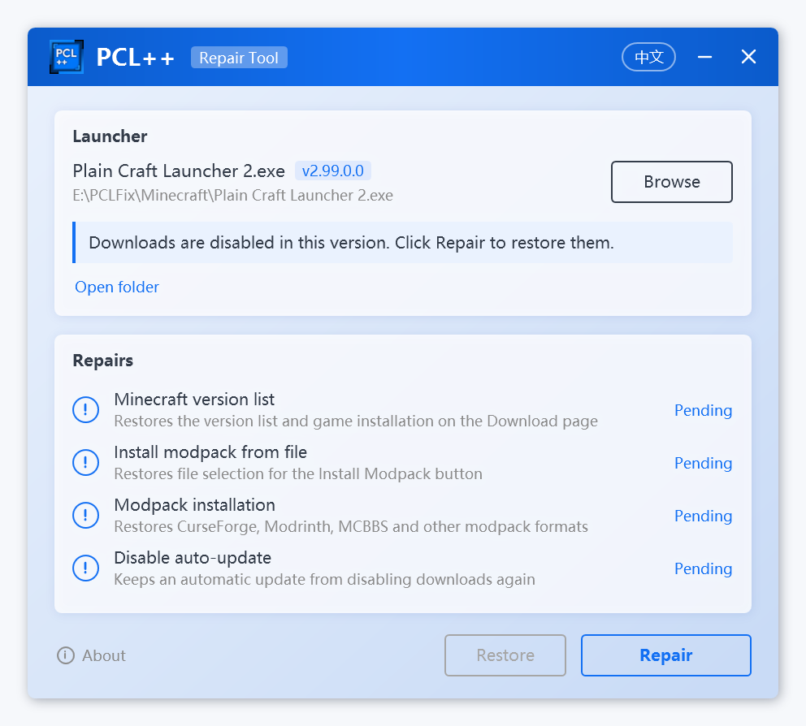
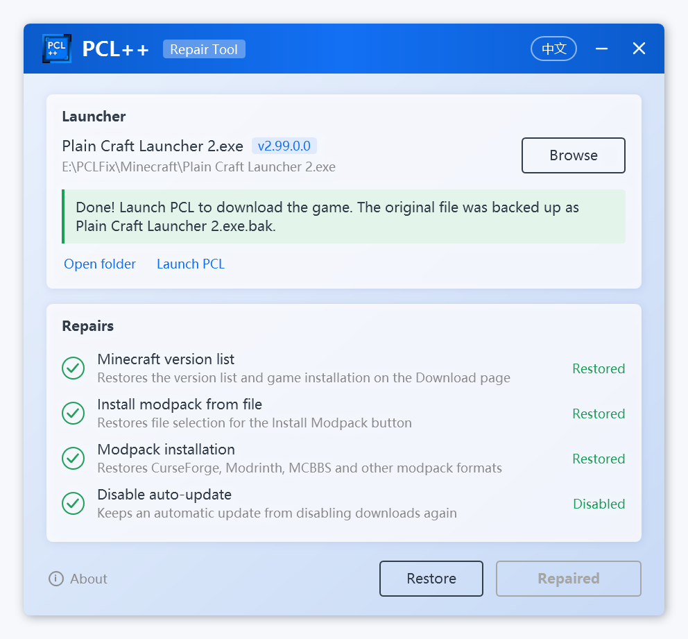

<p align="center">
  
</p>

<h1 align="center">PCL++</h1>

<p align="center">
  Enhancement and repair toolkit for the official <a href="https://github.com/Meloong-Git/PCL">Plain Craft Launcher 2</a>
</p>

<p align="center">
  <a href="README.md">简体中文</a> | <b>English</b>
</p>

<p align="center">
  <a href="https://github.com/Xocio/PCLPlus/releases/latest"></a>
  <a href="https://github.com/Xocio/PCLPlus/releases"></a>
  <a href="https://github.com/Xocio/PCLPlus/actions/workflows/build.yml"></a>
  
</p>

<p align="center">
  
</p>

## Features

The current version repairs the Minecraft download feature:

- ✅ Restores the Minecraft version list and the installation of the game and mod loaders
- ✅ Restores modpack installation (CurseForge, Modrinth, MCBBS, HMCL, MMC and more)
- ✅ Disables auto-update so the repair is not overwritten
- ✅ Backs up the original launcher automatically; restore it with one click
- ✅ Single file, about 0.7 MB, no runtime to install
- ✅ Chinese / English interface, follows the system language and can be switched from the title bar

## Usage

1. Download `PCL++.exe` from [Releases](https://github.com/Xocio/PCLPlus/releases/latest).
2. Put it in the folder that contains `Plain Craft Launcher 2.exe` (or select the launcher after starting PCL++, or drag it into the window).
3. **Close PCL**, open PCL++ and click **Repair**.

<p align="center">
  
</p>

Launch PCL as usual afterwards. The original launcher is kept as `Plain Craft Launcher 2.exe.bak` in the same folder; click **Restore** to bring it back.

**Requirements**: Windows 7 SP1 / 8 / 8.1 / 10 / 11 with .NET Framework 4.8. PCL 2.99 itself requires .NET Framework 4.8, so any PC that runs PCL can run PCL++. Windows 10 / 11 include it; on Windows 7 / 8, download it from [Microsoft](https://dotnet.microsoft.com/download/dotnet-framework/net48) if needed.

## Supported versions

| Launcher | Result |
| --- | --- |
| Official PCL 2.99.0.0 | ✅ Repairable |
| Official PCL before 2.99 | Downloads work, no repair needed |
| [PCL Community Edition](https://github.com/PCL-Community/PCL-CE) | Downloads work, no repair needed |

PCL++ locates its patch points by method name and code shape instead of fixed offsets, so minor launcher updates will most likely keep working. If a version is not recognized, PCL++ reports it as unsupported and **does not modify any file**.

## FAQ

**Is it safe?**
PCL++ only changes the four download-related methods of the launcher and adds no network activity. The repaired launcher is built in memory, reloaded and verified item by item before anything is written to disk; if any step fails, the original file stays untouched.

**My antivirus flags it. What now?**
Tools that modify other programs are occasionally flagged by mistake. PCL++ is fully open source: review the code and [build it yourself](#building-from-source).

**Can PCL still update after the repair?**
To keep the repair in place, PCL++ disables PCL's auto-update. To upgrade, download the new PCL manually, then run PCL++ again to check whether a repair is needed.

**How do I undo the repair?**
Open PCL++ and click **Restore**, or delete `Plain Craft Launcher 2.exe` and rename `Plain Craft Launcher 2.exe.bak` back to it.

## How it works

| Repair | Method changed | Description |
| --- | --- | --- |
| Minecraft version list | `PageDownloadInstall.LoaderInit` | Binds the Download page back to the version list loader `ModDownload.DlClientListLoader` |
| Install modpack from file | `ModModpack.ModpackInstall()` | Restores file selection and installs in a background thread |
| Modpack installation | `ModModpack.ModpackInstall(File, …)` | Calls the installer that matches the detected modpack format |
| Disable auto-update | `ModSecret.UpdateStart` | Returns immediately |

## Building from source

Requires the [.NET SDK](https://dotnet.microsoft.com/download) 8 or later, or Visual Studio 2022 or later.

```bash
git clone https://github.com/Xocio/PCLPlus.git
cd PCLPlus
dotnet build src/PCLPlus/PCLPlus.csproj -c Release
```

You can also open `PCLPlus.slnx` in Visual Studio.

Start with `--lang=en` or `--lang=zh` to override the display language.

## Project layout

```
PCLPlus/
├─ docs/                         Documentation and images
├─ src/PCLPlus/
│  ├─ Patching/                  Patch framework
│  │  ├─ Patch.cs                Patch base class
│  │  ├─ PatchCatalog.cs         All patches in application order
│  │  ├─ ModuleQuery.cs          Lookup by name and code shape
│  │  ├─ IlEditor.cs             Safe IL editing
│  │  └─ Patches/                One class per repair
│  ├─ Launcher/                  Launcher inspection, repair, restore, process check
│  ├─ Localization/              Chinese and English string tables
│  ├─ Themes/                    UI theme
│  ├─ Assets/                    Icons
│  ├─ MainWindow.xaml            Main and about pages
│  └─ EmbeddedAssemblyLoader.cs  Loads embedded dependencies
└─ PCLPlus.slnx
```

To add a repair: derive from `Patch`, implement `TextKey` / `FindTarget` / `GetState` / `Apply`, add it to `PatchCatalog.All`, and add `Patch.<TextKey>.Title` / `Description` to `Localization/Text.Chinese.cs` and `Text.English.cs`.

## Dependencies

- [dnlib](https://github.com/0xd4d/dnlib): reads and writes .NET assemblies

## Notes

- PCL++ is a community project, not affiliated with PCL or its author.
- Repairs run locally; nothing is uploaded or downloaded.
- Please report issues on the [issue tracker](https://github.com/Xocio/PCLPlus/issues).
