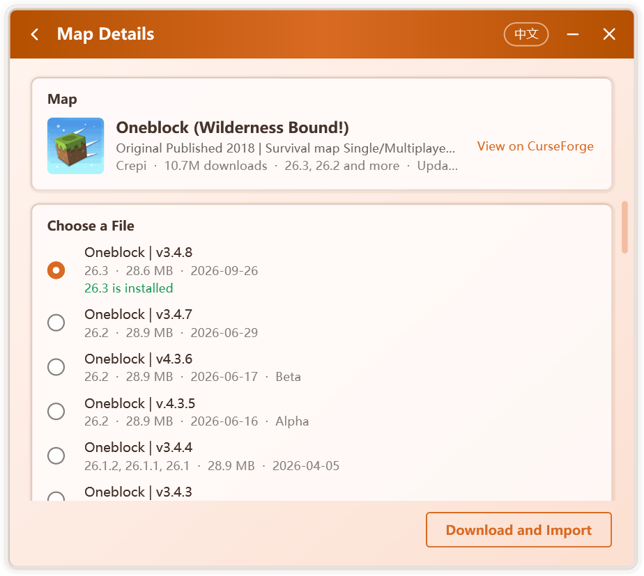
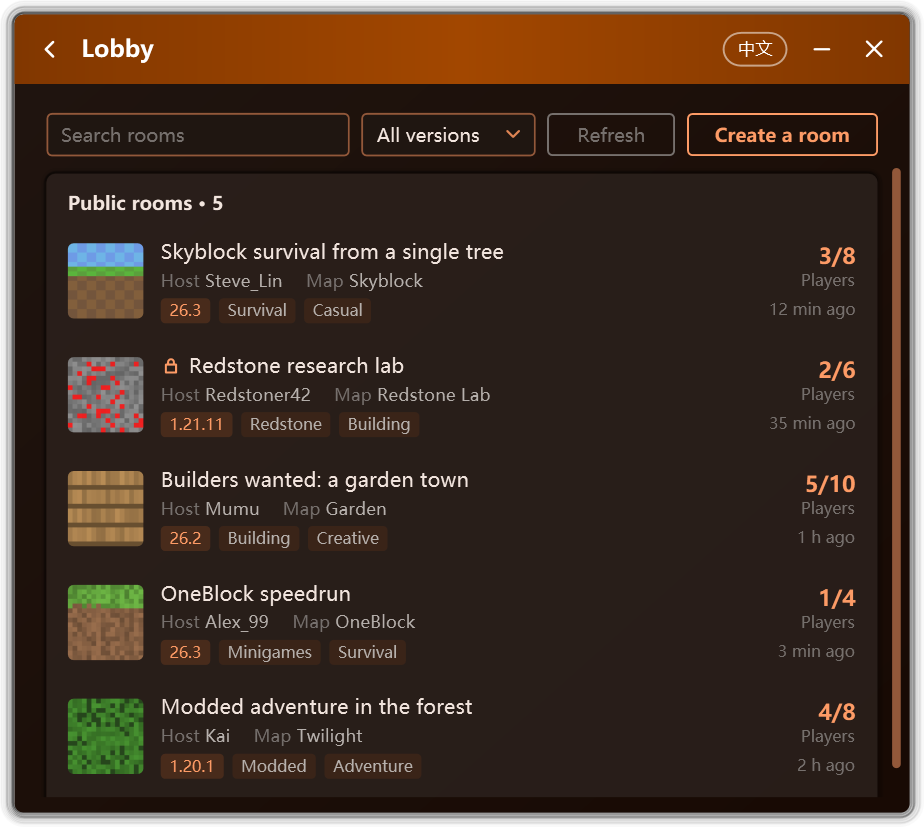

<p align="center">
  
</p>

<h1 align="center">Campfire</h1>

<p align="center">
  An advanced Minecraft toolbox
</p>

<p align="center">
  <a href="README.md">简体中文</a> | <b>English</b>
</p>

<p align="center">
  Community: <a href="https://t.me/CampfireGroup">Telegram group</a> · <a href="https://t.me/McCampfire">Telegram channel</a>
</p>

<p align="center">
  <a href="https://github.com/Xocio/Campfire/releases/latest"></a>
  <a href="https://github.com/Xocio/Campfire/releases"></a>
  <a href="https://mccampfire.top/en/"></a>
  
  <a href="NETWORK.en.md"></a>
</p>

<p align="center">
  An integrated toolbox built for Minecraft: Java Edition.<br />
  Multiplayer across any distance, an open lobby, a complete map workflow, and precise, reversible launcher repair.
</p>

<p align="center">
  
</p>

<p align="center">
  <a href="https://github.com/Xocio/Campfire/releases/latest"><b>Download</b></a> · <a href="https://mccampfire.top/en/guide/getting-started">Get started</a> · <a href="https://mccampfire.top/en/">Documentation</a> · <a href="CHANGELOG.md">Changelog</a>
</p>

## Overview

<table>
  <tr>
    <td width="50%" valign="top">
      
      <h3>Lobby</h3>
      Publish a room for every Campfire user to discover and join, with its own name, tags, password and picture.
    </td>
    <td width="50%" valign="top">
      
      <h3>Online maps</h3>
      Search the CurseForge map catalog, filtered and sorted by category, game version and popularity.
    </td>
  </tr>
  <tr>
    <td width="50%" valign="top">
      
      <h3>Download and import</h3>
      Choose a file to download and import it in one step; matching installed versions are marked.
    </td>
    <td width="50%" valign="top">
      
      <h3>Version matching</h3>
      Identifies a map's game version, pairs it with a version that can open it, and opens it to LAN on entry.
    </td>
  </tr>
  <tr>
    <td width="50%" valign="top">
      
      <h3>Launcher repair</h3>
      Restores downloads, modpack installation and JRE support in PCL. Every change is verified, the original is backed up, and restoring takes a single click.
    </td>
    <td width="50%" valign="top">
      
      <h3>Themes and appearance</h3>
      Light, dark and Monet colors in several palette styles, complemented by refined transitions.
    </td>
  </tr>
</table>

## Features

<table>
  <tr>
    <td width="33%" valign="top">
      <h3>Invite codes</h3>
      A singleplayer world is opened to LAN on entry and given an invite code. No public address or port forwarding required.
    </td>
    <td width="33%" valign="top">
      <h3>Peer-to-peer first</h3>
      Direct connections come first, with latency close to a LAN; relays or self-hosted nodes take over when needed.
    </td>
    <td width="33%" valign="top">
      <h3>Rooms in the game</h3>
      A welcome message and a live Tab list of host, players and latency, across every release since 1.7.2.
    </td>
  </tr>
  <tr>
    <td width="33%" valign="top">
      <h3>Privacy by design</h3>
      Your IP address can be hidden and login credentials are never read. Statistics are sent only with consent, and always open to inspection.
    </td>
    <td width="33%" valign="top">
      <h3>Signed updates</h3>
      A new version is installed only once its digital signature is verified. No server message can keep Campfire from running.
    </td>
    <td width="33%" valign="top">
      <h3>Launcher independent</h3>
      Campfire works with the running game itself, so players on different launchers share the same rooms.
    </td>
  </tr>
</table>

## Service and security

<p>
  
</p>

Campfire's update, notice, lobby and online map services are provided and protected by **Cloudflare**, with all traffic encrypted over HTTPS. Game data never passes through Campfire's servers.

The server can deliver only text and list data, which cannot change settings, run commands or start programs. Only updates that pass signature verification and the multiplayer component with matching hashes are ever run. See [NETWORK.en.md](NETWORK.en.md) for the full account.

## Getting started

| | Multiplayer | Launcher repair |
| --- | --- | --- |
| **1** | Download and run `Campfire.exe` from [Releases](https://github.com/Xocio/Campfire/releases/latest) | Place `Campfire.exe` in the launcher's folder |
| **2** | The host clicks **Create a room**, then enters a singleplayer world | Close PCL and open **Tools › Launcher Repair Tool** |
| **3** | Friends enter the invite code, or choose a room in the **Lobby** | Click **Repair**, then start PCL as usual |

**Requirements**: Windows 7 SP1 or later with .NET Framework 4.8. Multiplayer on Windows 7 additionally requires KB3063858 and KB4474419.

The complete guide is available in the [documentation](https://mccampfire.top/en/).

<details>
<summary><b>Supported launcher versions</b></summary>

| Launcher | Result |
| --- | --- |
| Official PCL 2.99.0.0 | ✅ Repairable |
| Official PCL before 2.99 | Downloads work; no repair needed |
| [PCL Community Edition](https://github.com/PCL-Community/PCL-CE) 2.15.1 and later | ✅ Region lock can be lifted |
| PCL Community Edition 2.15.0 and earlier | Downloads work; no repair needed |

Campfire locates its patch points by method name and code shape rather than fixed offsets, so later minor releases are usually supported as they are. An unrecognized version is reported as unsupported, and **no file is modified**.

The Community Edition ships as a .NET single-file bundle. Campfire locates the `PCL.Core` assembly inside it and rewrites the region check in place; the file keeps its size and bundle layout, and nothing is repacked.

</details>

<details>
<summary><b>FAQ</b></summary>

**Whose servers carry the game traffic?**
None of Campfire's. The host and friends connect peer-to-peer whenever possible, and public nodes only help them find each other. Game traffic passes through a relay node only when relaying is allowed and a direct connection fails.

**Joining fails with "Invalid session".**
When the host opens LAN with a premium account, the game verifies every joining player. Enter through the LAN worlds at the bottom of the multiplayer list, or ask the host to open LAN with an offline account.

**A room cannot be joined.**
Confirm that the invite code is correct and that the room is still open. When both networks are restrictive, a direct connection may not be possible; allow relaying in the multiplayer settings, or let the player with the better network host. **View multiplayer log** on the failure page records the exact cause.

**The Tab information does not appear in the game.**
Campfire attaches a small Java agent to the host's game process, supporting vanilla 1.7.2 and later as well as loaders that keep the official names. When the game runs on a JRE without `jdk.attach`, or a loader such as Fabric or Quilt remaps its classes, Campfire falls back to the LAN entry and the connection is unaffected. The cause is recorded in `%LocalAppData%\Campfire\agent.log`.

**Is the launcher repair safe?**
Campfire changes only download-related methods: four in the official build and one region check in the Community Edition, with no network behavior added. The repaired launcher is built in memory, reloaded and verified item by item before anything is written; should any step fail, the original remains untouched.

**An antivirus product flags Campfire.**
Tools that modify other programs are occasionally flagged in error. Campfire is fully open source; the code can be reviewed and built from source.

**Can PCL still update after a repair?**
To keep the repair in place, Campfire disables PCL's auto-update. To upgrade, download the new PCL manually and run Campfire again to check whether a repair is needed.

**How is a repair undone?**
Click **Restore** in Campfire, or delete `Plain Craft Launcher 2.exe` and rename `Plain Craft Launcher 2.exe.bak` back to its original name.

</details>

<details>
<summary><b>How the repair works</b></summary>

| Repair | Method changed | Description |
| --- | --- | --- |
| Minecraft version list | `PageDownloadInstall.LoaderInit` | Binds the Download page back to the version list loader `ModDownload.DlClientListLoader` |
| Install modpack from file | `ModModpack.ModpackInstall()` | Restores file selection and installs in a background thread |
| Modpack installation | `ModModpack.ModpackInstall(File, …)` | Calls the installer that matches the detected modpack format |
| Disable auto-update | `ModSecret.UpdateStart` | Returns immediately |
| Community region lock | `RegionAssessment.get_IsRestricted` | Returns `false`; every guarded entry reads this one property |

</details>

<details>
<summary><b>Building from source</b></summary>

Requires the [.NET SDK](https://dotnet.microsoft.com/download) 8 or later, or Visual Studio 2022 or later.

```bash
git clone https://github.com/Xocio/Campfire.git
cd Campfire
dotnet build src/Campfire/Campfire.csproj -c Release
```

`Campfire.slnx` can also be opened in Visual Studio.

Start with `--lang=en` or `--lang=zh` to override the display language.

The Java agent attached to the game is prebuilt in `src/java-agent/dist`, so building Campfire requires no JDK. After changing the agent sources, run `powershell -File src/java-agent/build.ps1` with JDK 21 or later, then build Campfire.

Builds from source never contact Campfire's online service and never send usage statistics; multiplayer with invite codes is unaffected.

</details>

<details>
<summary><b>Project layout</b></summary>

```
Campfire/
├─ docs/                         Documentation site and images
├─ src/Campfire/
│  ├─ Patching/                  Patch framework
│  │  ├─ Patch.cs                Patch base class
│  │  ├─ PatchCatalog.cs         All patches in application order
│  │  ├─ ModuleQuery.cs          Lookup by name and code shape
│  │  ├─ IlEditor.cs             Safe IL editing
│  │  ├─ BundleScanner.cs        Finds assemblies inside a .NET single-file bundle
│  │  └─ Patches/                One class per repair
│  ├─ Launcher/                  Launcher inspection, repair, restore, process check
│  ├─ Link/                      Multiplayer: rooms, networking and the game connection proxy
│  ├─ Online/                    Update check, notices and anonymous usage statistics
│  ├─ Worlds/                    Map browsing, downloads and import
│  ├─ Tools/                     JRE Tool
│  ├─ Pages/                     Pages and settings
│  ├─ Controls/                  Animations and custom controls
│  ├─ Localization/              Chinese and English string tables
│  ├─ Themes/                    Control styles, palette generation and wallpaper colors
│  ├─ Assets/                    Icons
│  ├─ MainWindow.xaml            Main window and page changes
│  ├─ TrayIcon.cs                Notification area icon
│  └─ EmbeddedAssemblyLoader.cs  Loads embedded dependencies
├─ src/java-agent/               Java agent attached to the host's game
├─ tools/                        Release signing scripts
└─ Campfire.slnx
```

To add a repair: derive from `Patch`, implement `TextKey` / `FindTarget` / `GetState` / `Apply`, add it to `PatchCatalog.All`, and add `Patch.<TextKey>.Title` / `Description` to `Localization/Text.Chinese.cs` and `Text.English.cs`. The Community Edition is handled by `CommunityLauncher`: its patch point lives in the bundled `PCL.Core` assembly and can only be rewritten in place.

</details>

## Dependencies

| Component | Purpose | License |
| --- | --- | --- |
| [dnlib](https://github.com/0xd4d/dnlib) | Reads and writes .NET assemblies | MIT |
| [EasyTier](https://github.com/EasyTier/EasyTier) | Networking component for multiplayer, downloaded on first use | LGPL-3.0 |
| [ASM](https://asm.ow2.io) | Java bytecode library, packaged with the in-game component | BSD-3-Clause |

Full license texts are in [THIRD-PARTY-NOTICES.md](THIRD-PARTY-NOTICES.md).

## Notes

- Campfire is an independent community project, not affiliated with PCL or its author.
- The rooms shown in the lobby screenshot are sample data.
- Questions and suggestions are welcome in [Issues](https://github.com/Xocio/Campfire/issues).

## Star History

<a href="https://www.star-history.com/?repos=xocio%2Fcampfire&type=date&legend=top-left">
 <picture>
   <source media="(prefers-color-scheme: dark)" srcset="https://api.star-history.com/chart?repos=xocio/campfire&type=date&theme=dark&legend=top-left" />
   <source media="(prefers-color-scheme: light)" srcset="https://api.star-history.com/chart?repos=xocio/campfire&type=date&legend=top-left" />
   
 </picture>
</a>
