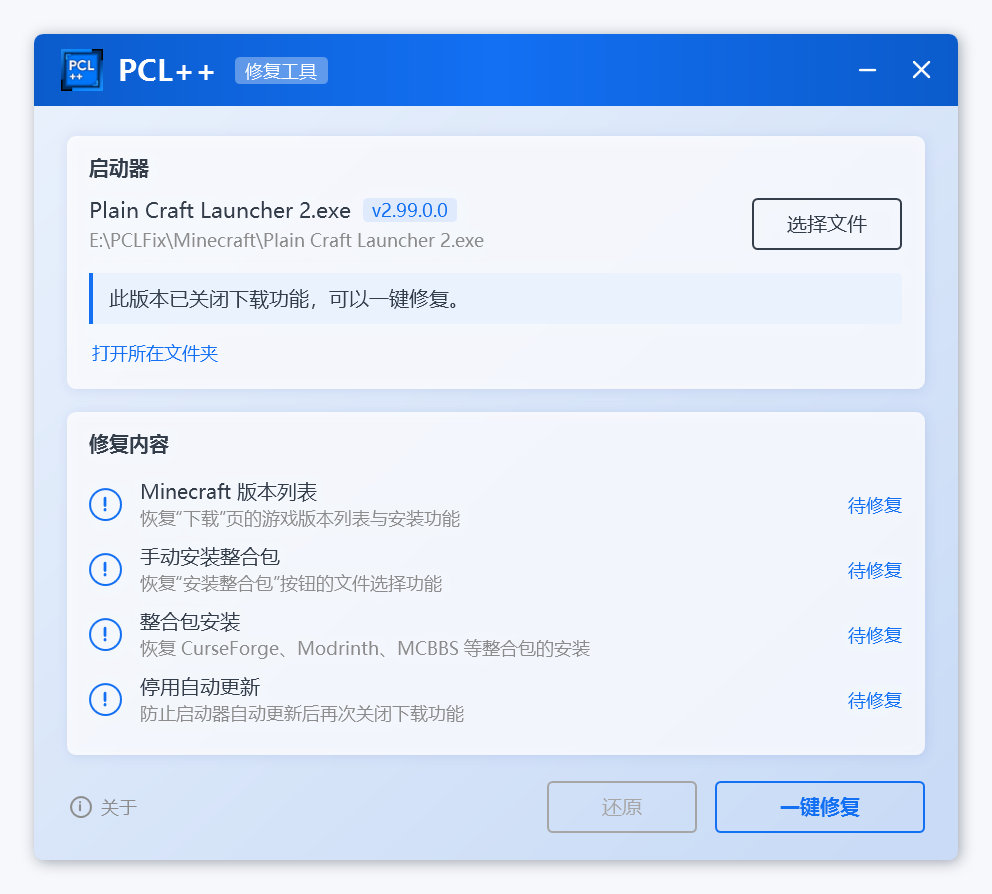
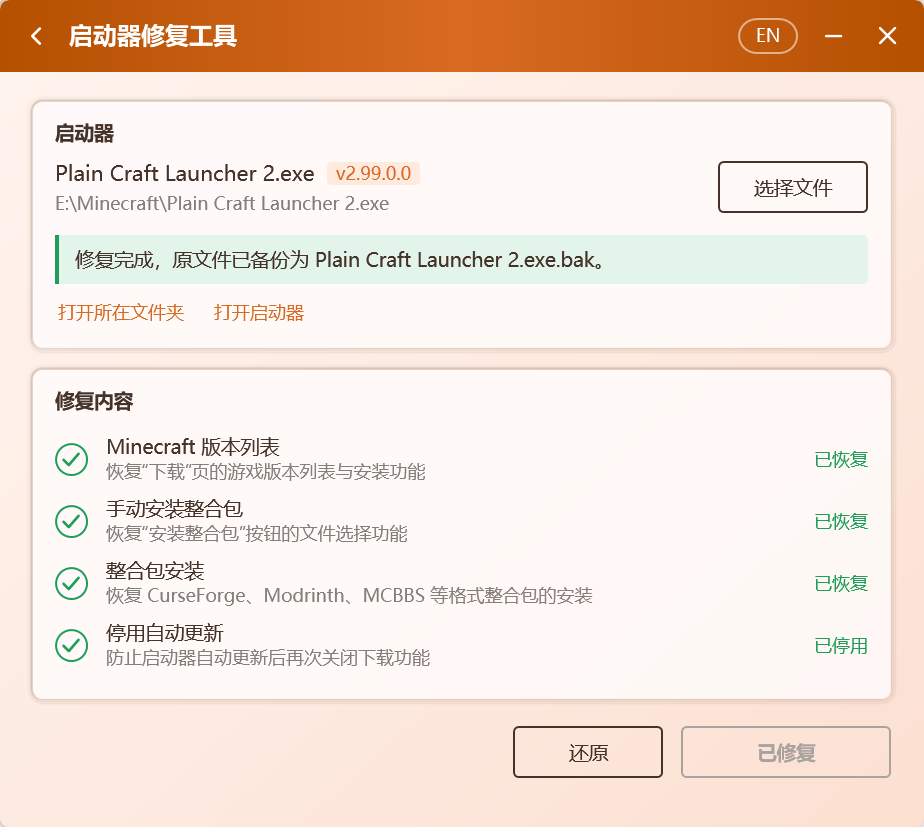

<p align="center">
  
</p>

<h1 align="center">PCL++</h1>

<p align="center">
  <a href="https://github.com/Meloong-Git/PCL">Plain Craft Launcher 2</a> 正式版的增强与修复工具
</p>

<p align="center">
  <a href="https://github.com/Xocio/PCLPlus/releases/latest"></a>
  <a href="https://github.com/Xocio/PCLPlus/releases"></a>
  <a href="https://github.com/Xocio/PCLPlus/actions/workflows/build.yml"></a>
  
</p>

<p align="center">
  
</p>

## 功能

当前版本提供 Minecraft 下载功能修复：

- ✅ 恢复 Minecraft 版本列表、游戏与 Mod 加载器安装
- ✅ 恢复整合包安装（CurseForge、Modrinth、MCBBS、HMCL、MMC 等格式）
- ✅ 停用自动更新，避免修复结果被覆盖
- ✅ 自动备份原启动器，随时一键还原
- ✅ 单文件、约 0.7 MB，无需安装任何运行库

## 使用方法

1. 从 [Releases](https://github.com/Xocio/PCLPlus/releases/latest) 下载 `PCL++.exe`。
2. 把它放到 `Plain Craft Launcher 2.exe` 所在的文件夹（也可以运行后手动选择，或把启动器拖进窗口）。
3. **关闭 PCL**，打开 PCL++，点击 **一键修复**。

<p align="center">
  
</p>

修复完成后直接启动 PCL 即可。修复前的启动器保存在同一文件夹下的 `Plain Craft Launcher 2.exe.bak`，需要时点击 **还原**。

**运行环境**：Windows 10 / 11，.NET Framework 4.8（系统自带；能运行 PCL 的电脑就能运行 PCL++）。

## 支持的版本

| 启动器 | 结果 |
| --- | --- |
| PCL 正式版 2.99.0.0 | ✅ 可修复 |
| PCL 正式版 2.99 之前的版本 | 下载功能正常，无需修复 |
| [PCL 社区版](https://github.com/PCL-Community/PCL-CE) | 下载功能正常，无需修复 |

PCL++ 按方法名和代码特征定位修改位置，不依赖固定偏移，后续小版本大概率可以直接支持。遇到无法识别的版本时，PCL++ 会提示“暂不支持”，**不会修改任何文件**。

## 常见问题

**修复安全吗？**
PCL++ 只修改启动器里与下载有关的 4 个方法，不添加任何联网行为。修复结果会先在内存中生成，重新加载并逐项校验通过后才写入磁盘；任一步失败都不会改动原文件。

**杀毒软件报毒怎么办？**
修改其他程序文件的工具偶尔会被误报。PCL++ 完全开源，可以自行审阅源码并[从源码构建](#从源码构建)。

**修复后 PCL 能更新吗？**
为防止更新覆盖修复结果，PCL++ 会停用 PCL 的自动更新。需要升级时，请手动下载新版 PCL，再运行一次 PCL++ 检测是否需要修复。

**怎么撤销修复？**
打开 PCL++，点击 **还原**；或者删除 `Plain Craft Launcher 2.exe`，再把 `Plain Craft Launcher 2.exe.bak` 改回原名。

## 修复原理

| 修复项 | 修改的方法 | 说明 |
| --- | --- | --- |
| Minecraft 版本列表 | `PageDownloadInstall.LoaderInit` | 下载页重新绑定版本列表加载器 `ModDownload.DlClientListLoader` |
| 手动安装整合包 | `ModModpack.ModpackInstall()` | 恢复文件选择，并在后台线程安装 |
| 整合包安装 | `ModModpack.ModpackInstall(File, …)` | 按识别出的整合包格式调用对应的安装方法 |
| 停用自动更新 | `ModSecret.UpdateStart` | 更新入口直接返回 |

## 从源码构建

需要 [.NET SDK](https://dotnet.microsoft.com/download) 8 或更高版本，或 Visual Studio 2022 及以上版本。

```bash
git clone https://github.com/Xocio/PCLPlus.git
cd PCLPlus
dotnet build src/PCLPlus/PCLPlus.csproj -c Release
```

也可以用 Visual Studio 打开 `PCLPlus.slnx`。


## 项目结构

```
PCLPlus/
├─ docs/                         文档与图片
├─ src/PCLPlus/
│  ├─ Patching/                  补丁框架
│  │  ├─ Patch.cs                补丁基类
│  │  ├─ PatchCatalog.cs         全部补丁及执行顺序
│  │  ├─ ModuleQuery.cs          按名称与代码特征定位
│  │  ├─ IlEditor.cs             安全的 IL 编辑
│  │  └─ Patches/                每个修复项一个类
│  ├─ Launcher/                  启动器检测、修复、还原、进程检查
│  ├─ Themes/                    界面主题
│  ├─ Assets/                    图标
│  ├─ MainWindow.xaml            主界面与关于页
│  └─ EmbeddedAssemblyLoader.cs  加载嵌入的依赖库
└─ PCLPlus.slnx
```

新增修复项：继承 `Patch`，实现 `FindTarget` / `GetState` / `Apply`，再加入 `PatchCatalog.All`。

## 依赖

- [dnlib](https://github.com/0xd4d/dnlib)：读取与写入 .NET 程序集

## 说明

- PCL++ 是社区项目，与 PCL 及其作者无关。
- 修复只在本机进行，不上传、不下载任何文件。
- 问题反馈请提交 [Issue](https://github.com/Xocio/PCLPlus/issues)。