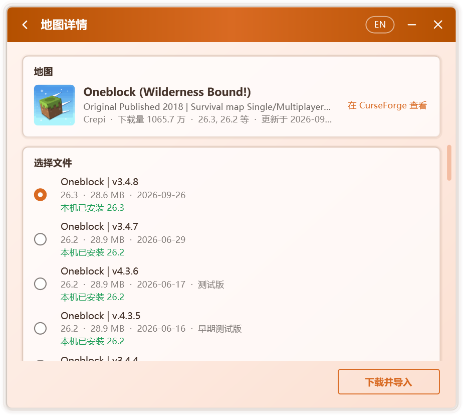
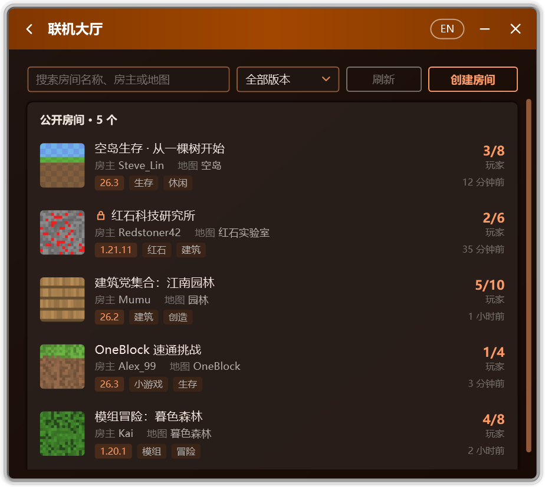

<p align="center">
  
</p>

<h1 align="center">Campfire</h1>

<p align="center">
  先进的 Minecraft 工具箱
</p>

<p align="center">
  <b>简体中文</b> | <a href="README.en.md">English</a>
</p>

<p align="center">
  友情链接：<a href="https://linux.do">LINUX DO</a>
</p>

<p align="center">
  <a href="https://github.com/Xocio/Campfire/releases/latest"></a>
  <a href="https://github.com/Xocio/Campfire/releases"></a>
  <a href="https://mccampfire.top"></a>
  
  <a href="NETWORK.md"></a>
</p>

<p align="center">
  为 Minecraft Java 版而生的一体化工具箱。<br />
  跨越网络的多人游戏、开放的联机大厅、完整的地图工作流，以及精确可逆的启动器修复。
</p>

<p align="center">
  
</p>

<p align="center">
  <a href="https://github.com/Xocio/Campfire/releases/latest"><b>下载</b></a> · <a href="https://mccampfire.top/guide/getting-started">快速上手</a> · <a href="https://mccampfire.top">文档</a> · <a href="CHANGELOG.md">更新日志</a>
</p>

## 概览

<table>
  <tr>
    <td width="50%" valign="top">
      
      <h3>联机大厅</h3>
      房间可公开至大厅，供所有 Campfire 用户发现与加入，并支持自定义名称、标签、密码与图标。
    </td>
    <td width="50%" valign="top">
      
      <h3>在线地图</h3>
      检索 CurseForge 地图库，按分类、游戏版本与热度筛选排序。
    </td>
  </tr>
  <tr>
    <td width="50%" valign="top">
      
      <h3>下载即导入</h3>
      选定文件即可完成下载与导入，本机已安装的对应版本一并标注。
    </td>
    <td width="50%" valign="top">
      
      <h3>版本匹配</h3>
      识别地图的游戏版本，匹配可开启它的版本，并在进入地图后自动对局域网开放。
    </td>
  </tr>
  <tr>
    <td width="50%" valign="top">
      
      <h3>启动器修复</h3>
      恢复 PCL 的下载、整合包安装与 JRE 支持。每项修改均经校验，原文件自动备份，随时可还原。
    </td>
    <td width="50%" valign="top">
      
      <h3>主题与外观</h3>
      浅色、深色与莫奈取色，多种配色风格，辅以细腻流畅的过渡动效。
    </td>
  </tr>
</table>

## 特性

<table>
  <tr>
    <td width="33%" valign="top">
      <h3>邀请码联机</h3>
      进入单人世界后自动对局域网开放并生成邀请码，无需公网地址或端口映射。
    </td>
    <td width="33%" valign="top">
      <h3>点对点优先</h3>
      优先建立直接连接，延迟接近局域网；必要时经中转节点或自建节点传输。
    </td>
    <td width="33%" valign="top">
      <h3>游戏内房间信息</h3>
      欢迎消息与 Tab 列表实时呈现房主、在线人数与延迟，覆盖 1.7.2 起的全部正式版。
    </td>
  </tr>
  <tr>
    <td width="33%" valign="top">
      <h3>隐私为先</h3>
      支持隐藏 IP 地址，从不读取登录凭据；使用统计仅在授权后发送，内容随时可查。
    </td>
    <td width="33%" valign="top">
      <h3>签名更新</h3>
      新版本须通过数字签名校验方可安装，任何服务器消息均无法阻止 Campfire 运行。
    </td>
    <td width="33%" valign="top">
      <h3>不限启动器</h3>
      作用于正在运行的游戏本身，使用不同启动器的玩家亦可进入同一房间。
    </td>
  </tr>
</table>

## 服务与安全

<p>
  
</p>

Campfire 的更新、公告、联机大厅与在线地图服务由 **Cloudflare** 提供服务与安全防护，全部通信均经 HTTPS 加密。游戏数据不经由 Campfire 的服务器传输。

服务器下发的内容仅限文字与列表数据，无法更改设置、执行命令或启动程序；只有通过签名校验的更新与哈希一致的联机组件才会被运行。完整说明见[联网说明](NETWORK.md)。

## 快速上手

| | 多人联机 | 启动器修复 |
| --- | --- | --- |
| **1** | 自 [Releases](https://github.com/Xocio/Campfire/releases/latest) 下载并运行 `Campfire.exe` | 将 `Campfire.exe` 置于启动器所在的文件夹 |
| **2** | 房主点击 **创建房间**，随后进入单人世界 | 关闭 PCL，打开 **工具 › 启动器修复工具** |
| **3** | 好友输入邀请码，或在 **联机大厅** 中选择房间 | 点击 **一键修复**，完成后照常启动 PCL |

**运行环境**：Windows 7 SP1 及以上版本，.NET Framework 4.8。在 Windows 7 上使用多人联机，需预先安装 KB3063858 与 KB4474419。

完整指南请参阅[文档](https://mccampfire.top)。

<details>
<summary><b>支持的启动器版本</b></summary>

| 启动器 | 结果 |
| --- | --- |
| PCL 正式版 2.99.0.0 | ✅ 可修复 |
| PCL 正式版 2.99 之前的版本 | 下载功能正常，无需修复 |
| [PCL 社区版](https://github.com/PCL-Community/PCL-CE) 2.15.1 及以上 | ✅ 可解除地区限制 |
| PCL 社区版 2.15.0 及之前的版本 | 下载功能正常，无需修复 |

Campfire 依据方法名称与代码特征定位修改位置，不依赖固定偏移，因此通常可直接适配后续的小版本。遇到无法识别的版本时，Campfire 会提示“暂不支持”，**不会修改任何文件**。

社区版为 .NET 单文件包。Campfire 先在其中定位 `PCL.Core` 程序集，再原地改写地区判定方法，文件大小与打包布局均保持不变，无需重新打包。

</details>

<details>
<summary><b>常见问题</b></summary>

**联机时，数据经由谁的服务器传输？**
游戏数据不经由 Campfire 的服务器。房主与好友之间优先点对点直连，公共节点仅用于双方互相发现；只有在允许中转且直连失败时，游戏数据才会经中转节点传输。

**加入时提示“无效会话”。**
房主以正版账号开放局域网时，游戏会校验每位加入者的身份。请从多人游戏列表底部的局域网世界进入，或请房主改用离线账号开放局域网。

**无法加入房间。**
请先确认邀请码无误，且房主的房间仍处于开启状态。双方网络限制均较严时可能无法直连，可在联机设置中允许中转，或由网络条件更好的一方担任房主。失败页面中的 **查看联机日志** 记录了详细原因。

**游戏内未显示 Tab 信息。**
Campfire 会将一个小型 Java Agent 附加到房主的游戏进程，支持 1.7.2 及以上的原版，以及沿用官方名称的加载器。若游戏所用的 JRE 不提供 `jdk.attach`，或类名经 Fabric、Quilt 等加载器重映射，Campfire 将退回仅在局域网条目中显示信息，游戏连接不受影响。原因记录于 `%LocalAppData%\Campfire\agent.log`。

**启动器修复是否安全？**
Campfire 仅修改启动器中与下载相关的方法：正式版 4 处，社区版 1 处地区判定方法，且不添加任何联网行为。修复结果先在内存中生成，重新加载并逐项校验后方才写入磁盘；任一步骤失败，原文件均保持不变。

**杀毒软件报告风险。**
修改其他程序文件的工具偶有误报。Campfire 完全开源，可自行审阅源代码并从源码构建。

**修复后，PCL 能否继续更新？**
为避免更新覆盖修复结果，Campfire 会停用 PCL 的自动更新。如需升级，请手动下载新版 PCL，再运行 Campfire 检测是否需要修复。

**如何撤销修复？**
在 Campfire 中点击 **还原**；或删除 `Plain Craft Launcher 2.exe`，再将 `Plain Craft Launcher 2.exe.bak` 恢复为原名。

</details>

<details>
<summary><b>修复原理</b></summary>

| 修复项 | 修改的方法 | 说明 |
| --- | --- | --- |
| Minecraft 版本列表 | `PageDownloadInstall.LoaderInit` | 下载页重新绑定版本列表加载器 `ModDownload.DlClientListLoader` |
| 手动安装整合包 | `ModModpack.ModpackInstall()` | 恢复文件选择，并在后台线程安装 |
| 整合包安装 | `ModModpack.ModpackInstall(File, …)` | 按识别出的整合包格式调用对应的安装方法 |
| 停用自动更新 | `ModSecret.UpdateStart` | 更新入口直接返回 |
| 社区版地区限制 | `RegionAssessment.get_IsRestricted` | 判定方法直接返回 `false`；下载、安装、补全、修复等入口均读取这一属性 |

</details>

<details>
<summary><b>从源码构建</b></summary>

需要 [.NET SDK](https://dotnet.microsoft.com/download) 8 或更高版本，或 Visual Studio 2022 及以上版本。

```bash
git clone https://github.com/Xocio/Campfire.git
cd Campfire
dotnet build src/Campfire/Campfire.csproj -c Release
```

亦可使用 Visual Studio 打开 `Campfire.slnx`。

附加到游戏的 Java Agent 已预先构建于 `src/java-agent/dist`，构建 Campfire 无需 JDK。修改 Agent 源码后，需使用 JDK 21 或更高版本运行 `powershell -File src/java-agent/build.ps1`，再构建 Campfire。

从源码构建的版本不连接 Campfire 的在线服务，也不发送使用统计；邀请码联机不受影响。

</details>

<details>
<summary><b>项目结构</b></summary>

```
Campfire/
├─ docs/                         文档站与图片
├─ src/Campfire/
│  ├─ Patching/                  补丁框架
│  │  ├─ Patch.cs                补丁基类
│  │  ├─ PatchCatalog.cs         全部补丁及执行顺序
│  │  ├─ ModuleQuery.cs          按名称与代码特征定位
│  │  ├─ IlEditor.cs             安全的 IL 编辑
│  │  ├─ BundleScanner.cs        在 .NET 单文件包中定位程序集
│  │  └─ Patches/                每个修复项一个类
│  ├─ Launcher/                  启动器检测、修复、还原、进程检查
│  ├─ Link/                      多人联机：房间、网络组件与游戏连接代理
│  ├─ Online/                    更新检查、公告与匿名使用统计
│  ├─ Worlds/                    地图浏览、下载与导入
│  ├─ Tools/                     JRE 启用工具
│  ├─ Pages/                     各页面与设置
│  ├─ Controls/                  动画与自绘控件
│  ├─ Localization/              中英文字符串表
│  ├─ Themes/                    控件样式、配色生成与壁纸取色
│  ├─ Assets/                    图标
│  ├─ MainWindow.xaml            主窗口与页面切换
│  ├─ TrayIcon.cs                通知区域图标
│  └─ EmbeddedAssemblyLoader.cs  加载嵌入的依赖库
├─ src/java-agent/               附加到房主游戏的 Java Agent
├─ tools/                        发布签名脚本
└─ Campfire.slnx
```

新增修复项：继承 `Patch`，实现 `TextKey` / `FindTarget` / `GetState` / `Apply`，加入 `PatchCatalog.All`，并在 `Localization/Text.Chinese.cs` 与 `Text.English.cs` 中添加 `Patch.<TextKey>.Title` / `Description`。社区版经由独立的 `CommunityLauncher` 处理：补丁点位于单文件包内的 `PCL.Core` 程序集，只能原地改写方法体。

</details>

## 依赖

| 组件 | 用途 | 许可 |
| --- | --- | --- |
| [dnlib](https://github.com/0xd4d/dnlib) | 读取与写入 .NET 程序集 | MIT |
| [EasyTier](https://github.com/EasyTier/EasyTier) | 多人联机的网络组件，首次联机时按需下载 | LGPL-3.0 |
| [ASM](https://asm.ow2.io) | Java 字节码库，随游戏内组件一同打包 | BSD-3-Clause |

各组件的许可原文见 [THIRD-PARTY-NOTICES.md](THIRD-PARTY-NOTICES.md)。

## 说明

- Campfire 为独立的社区项目，与 PCL 及其作者无关。
- 联机大厅截图中的房间为示例数据。
- 问题与建议请提交至 [Issues](https://github.com/Xocio/Campfire/issues)。

## Star History

<a href="https://www.star-history.com/?repos=xocio%2Fcampfire&type=date&legend=top-left">
 <picture>
   <source media="(prefers-color-scheme: dark)" srcset="https://api.star-history.com/chart?repos=xocio/campfire&type=date&theme=dark&legend=top-left" />
   <source media="(prefers-color-scheme: light)" srcset="https://api.star-history.com/chart?repos=xocio/campfire&type=date&legend=top-left" />
   
 </picture>
</a>
