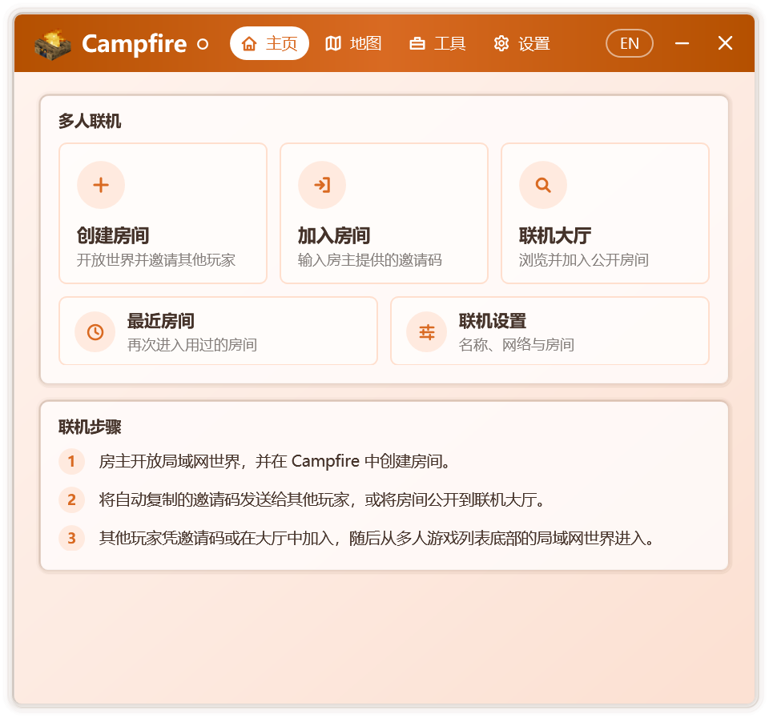
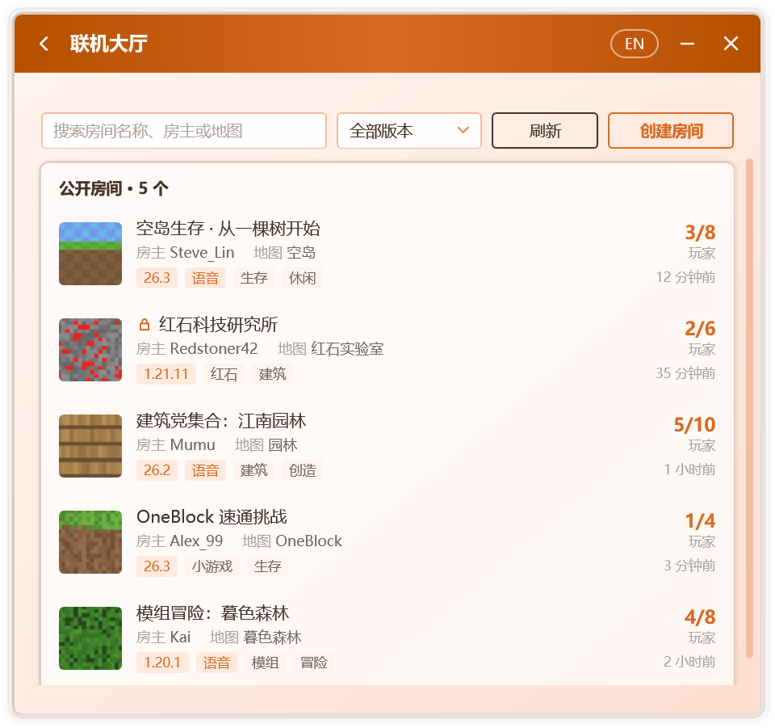
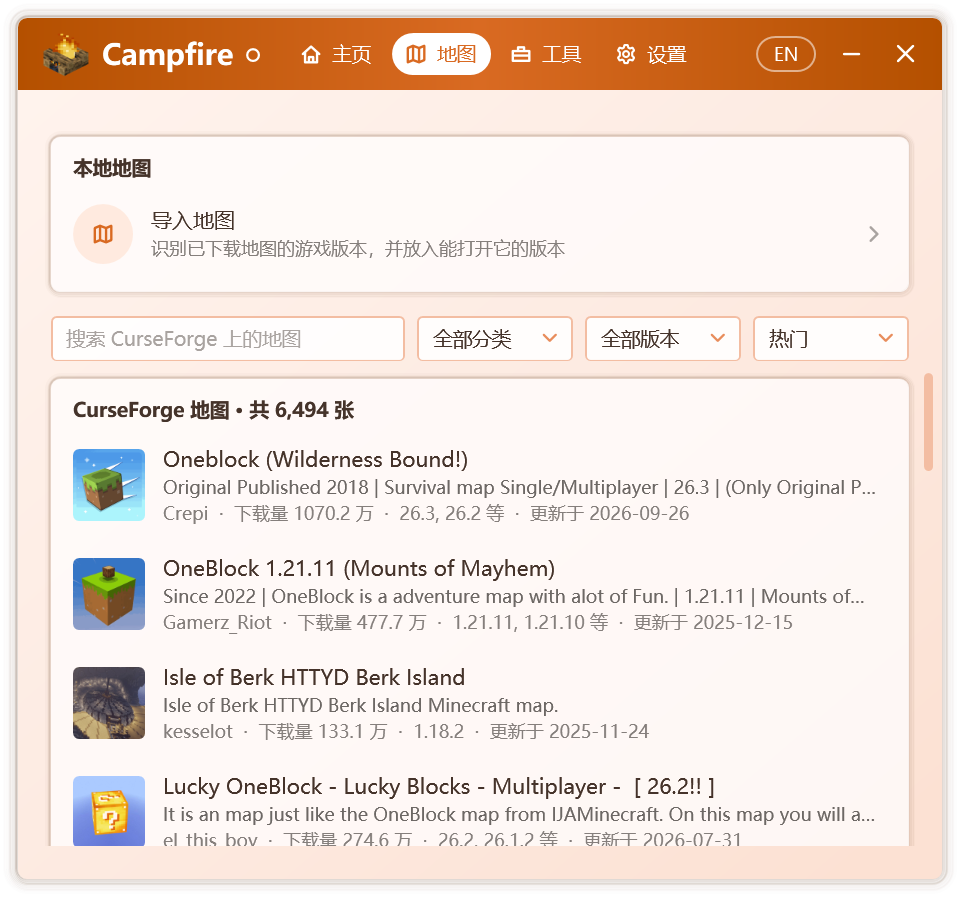
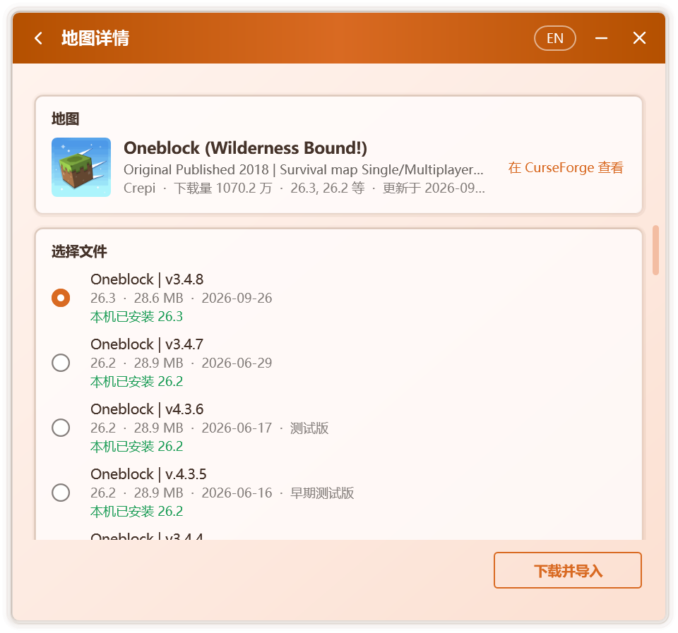
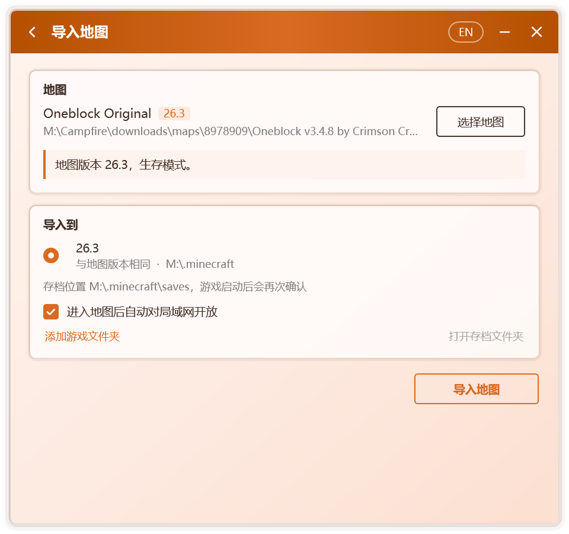
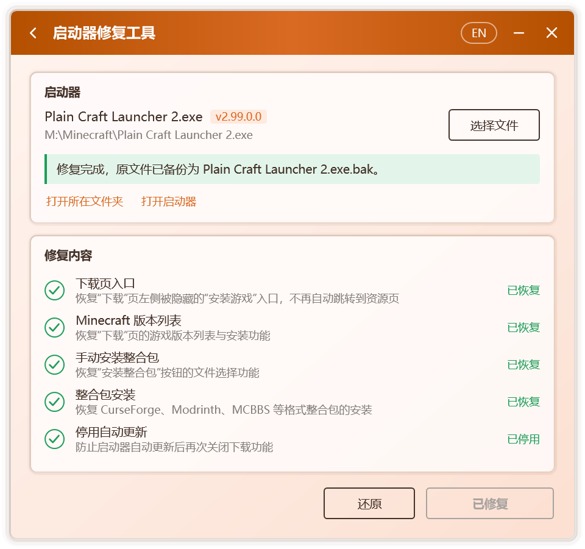
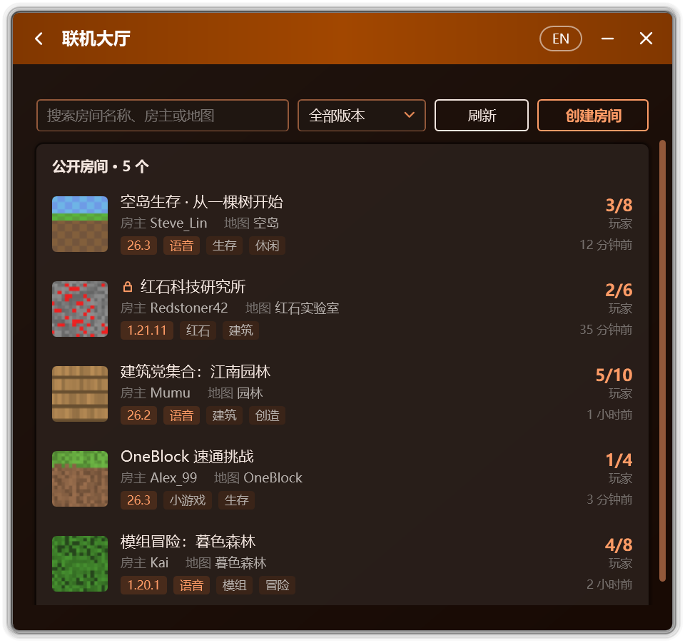

<p align="center">
  
</p>

<h1 align="center">Campfire</h1>

<p align="center">
  先進的 Minecraft 工具箱
</p>

<p align="center">
  <a href="README.md">简体中文</a> | <b>繁體中文</b> | <a href="README.yue.md">粵語</a> | <a href="README.en.md">English</a>
</p>

<p align="center">
  交流：<a href="https://t.me/CampfireGroup">Telegram 群聊</a> · <a href="https://t.me/McCampfire">Telegram 頻道</a>
</p>

<p align="center">
  <a href="https://github.com/Xocio/Campfire/releases/latest"></a>
  <a href="https://github.com/Xocio/Campfire/releases"></a>
  <a href="https://mccampfire.top/zh-hant/"></a>
  
  <a href="https://mccampfire.top/zh-hant/download"></a>
  <a href="NETWORK.zh-Hant.md"></a>
</p>

<p align="center">
  為 Minecraft Java 版而生的一體化工具箱。<br />
  跨越網路的多人遊戲、開放的連線大廳、完整的地圖工作流，以及精確可逆的啟動器修復。
</p>

<p align="center">
  
</p>

<p align="center">
  <a href="https://github.com/Xocio/Campfire/releases/latest"><b>下載</b></a> · <a href="https://mccampfire.top/zh-hant/guide/getting-started">快速上手</a> · <a href="https://mccampfire.top/zh-hant/">文件</a> · <a href="CHANGELOG.md">更新日誌</a>
</p>

## 概覽

<table>
  <tr>
    <td width="50%" valign="top">
      
      <h3>連線大廳</h3>
      房間可公開至大廳，供所有 Campfire 使用者發現與加入，並支援自定義名稱、標籤、密碼與圖示。
    </td>
    <td width="50%" valign="top">
      
      <h3>線上地圖</h3>
      檢索 CurseForge 地相簿，按分類、遊戲版本與熱度篩選排序。
    </td>
  </tr>
  <tr>
    <td width="50%" valign="top">
      
      <h3>下載即匯入</h3>
      選定檔案即可完成下載與匯入，本機已安裝的對應版本一併標註。
    </td>
    <td width="50%" valign="top">
      
      <h3>版本匹配</h3>
      識別地圖的遊戲版本，匹配可開啟它的版本，並在進入地圖後自動對區域網開放。
    </td>
  </tr>
  <tr>
    <td width="50%" valign="top">
      
      <h3>啟動器修復</h3>
      恢復 PCL 的下載、整合包安裝與 JRE 支援。每項修改均經校驗，原檔案自動備份，隨時可還原。
    </td>
    <td width="50%" valign="top">
      
      <h3>主題與外觀</h3>
      淺色、深色與莫奈取色，多種配色風格，輔以細膩流暢的過渡動效。
    </td>
  </tr>
</table>

## 特性

<table>
  <tr>
    <td width="33%" valign="top">
      <h3>邀請碼連線</h3>
      進入單人世界後自動對區域網開放並生成邀請碼，無需公網地址或埠對映。
    </td>
    <td width="33%" valign="top">
      <h3>點對點優先</h3>
      優先建立直接連線，延遲接近區域網；必要時經中轉節點或自建節點傳輸。
    </td>
    <td width="33%" valign="top">
      <h3>遊戲內房間資訊</h3>
      歡迎訊息與 Tab 列表即時呈現房主、線上人數與延遲，覆蓋 1.7.2 起的全部正式版。
    </td>
  </tr>
  <tr>
    <td width="33%" valign="top">
      <h3>隱私為先</h3>
      支援隱藏 IP 地址，從不讀取登入憑據；使用統計僅在授權後傳送，內容隨時可查。
    </td>
    <td width="33%" valign="top">
      <h3>簽名更新</h3>
      新版本須通過數字簽名校驗方可安裝，任何伺服器訊息均無法阻止 Campfire 執行。
    </td>
    <td width="33%" valign="top">
      <h3>不限啟動器</h3>
      作用於正在執行的遊戲本身，使用不同啟動器的玩家亦可進入同一房間。
    </td>
  </tr>
</table>

## 服務與安全

<p>
  
</p>

Campfire 的更新、公告、連線大廳與線上地圖服務由 **Cloudflare** 提供服務與安全防護，全部通訊均經 HTTPS 加密。遊戲資料不經由 Campfire 的伺服器傳輸。

伺服器下發的內容僅限文字與列表資料，無法更改設定、執行命令或啟動程式；只有通過簽名校驗的更新與雜湊一致的連線元件才會被執行。完整說明見[連網說明](NETWORK.zh-Hant.md)。

## 快速上手

| | 多人連線 | 啟動器修復 |
| --- | --- | --- |
| **1** | 自 [Releases](https://github.com/Xocio/Campfire/releases/latest) 下載並執行 `Campfire.exe` | 將 `Campfire.exe` 置於啟動器所在的資料夾 |
| **2** | 房主點選 **建立房間**，隨後進入單人世界 | 關閉 PCL，開啟 **工具 › 啟動器修復工具** |
| **3** | 好友輸入邀請碼，或在 **連線大廳** 中選擇房間 | 點選 **一鍵修復**，完成後照常啟動 PCL |

**執行環境**：Windows 7 SP1 及以上版本，.NET Framework 4.8。在 Windows 7 上使用多人連線，需預先安裝 KB3063858 與 KB4474419。

完整指南請參閱[文件](https://mccampfire.top/zh-hant/)。

<details>
<summary><b>支援的啟動器版本</b></summary>

| 啟動器 | 結果 |
| --- | --- |
| PCL 正式版 2.99.0.0 | ✅ 可修復 |
| PCL 正式版 2.99 之前的版本 | 下載功能正常，無需修復 |
| [PCL 社群版](https://github.com/PCL-Community/PCL-CE) 2.15.1 及以上 | ✅ 可解除地區限制 |
| PCL 社群版 2.15.0 及之前的版本 | 下載功能正常，無需修復 |

Campfire 依據方法名稱與程式碼特徵定位修改位置，不依賴固定偏移，因此通常可直接適配後續的小版本。遇到無法識別的版本時，Campfire 會提示「暫不支援」，**不會修改任何檔案**。

社群版為 .NET 單檔案包。Campfire 先在其中定位 `PCL.Core` 程式集，再原地改寫地區判定方法，檔案大小與打包佈局均保持不變，無需重新打包。

</details>

<details>
<summary><b>常見問題</b></summary>

**連線時，資料經由誰的伺服器傳輸？**
遊戲資料不經由 Campfire 的伺服器。房主與好友之間優先點對點直連，公共節點僅用於雙方互相發現；只有在允許中轉且直連失敗時，遊戲資料才會經中轉節點傳輸。

**加入時提示「無效會話」。**
房主以正版賬號開放區域網時，遊戲會校驗每位加入者的身份。請從多人遊戲列表底部的區域網世界進入，或請房主改用離線賬號開放區域網。

**無法加入房間。**
請先確認邀請碼無誤，且房主的房間仍處於開啟狀態。雙方網路限制均較嚴時可能無法直連，可在連線設定中允許中轉，或由網路條件更好的一方擔任房主。失敗頁面中的 **檢視連線日誌** 記錄了詳細原因。

**遊戲內未顯示 Tab 資訊。**
Campfire 會將一個小型 Java Agent 附加到房主的遊戲程序，支援 1.7.2 及以上的原版，以及沿用官方名稱的載入器。若遊戲所用的 JRE 不提供 `jdk.attach`，或類名經 Fabric、Quilt 等載入器重對映，Campfire 將退回僅在區域網條目中顯示資訊，遊戲連線不受影響。原因記錄於 `%LocalAppData%\Campfire\agent.log`。

**啟動器修復是否安全？**
Campfire 僅修改啟動器中與下載相關的方法：正式版 4 處，社群版 1 處地區判定方法，且不新增任何連網行為。修復結果先在記憶體中生成，重新載入並逐項校驗後方才寫入磁碟；任一步驟失敗，原檔案均保持不變。

**防毒軟體報告風險。**
修改其他程式檔案的工具偶有誤報。Campfire 完全開源，可自行審閱原始碼並從原始碼構建。

**修復後，PCL 能否繼續更新？**
為避免更新覆蓋修復結果，Campfire 會停用 PCL 的自動更新。如需升級，請手動下載新版 PCL，再執行 Campfire 檢測是否需要修復。

**如何撤銷修復？**
在 Campfire 中點選 **還原**；或刪除 `Plain Craft Launcher 2.exe`，再將 `Plain Craft Launcher 2.exe.bak` 恢復為原名。

</details>

<details>
<summary><b>修復原理</b></summary>

| 修復項 | 修改的方法 | 說明 |
| --- | --- | --- |
| Minecraft 版本列表 | `PageDownloadInstall.LoaderInit` | 下載頁重新繫結版本列表載入器 `ModDownload.DlClientListLoader` |
| 手動安裝整合包 | `ModModpack.ModpackInstall()` | 恢復檔案選擇，並在後臺執行緒安裝 |
| 整合包安裝 | `ModModpack.ModpackInstall(File, …)` | 按識別出的整合包格式呼叫對應的安裝方法 |
| 停用自動更新 | `ModSecret.UpdateStart` | 更新入口直接返回 |
| 社群版地區限制 | `RegionAssessment.get_IsRestricted` | 判定方法直接返回 `false`；下載、安裝、補全、修復等入口均讀取這一屬性 |

</details>

<details>
<summary><b>從原始碼構建</b></summary>

需要 [.NET SDK](https://dotnet.microsoft.com/download) 8 或更高版本，或 Visual Studio 2022 及以上版本。

```bash
git clone https://github.com/Xocio/Campfire.git
cd Campfire
dotnet build src/Campfire/Campfire.csproj -c Release
```

亦可使用 Visual Studio 開啟 `Campfire.slnx`。

附加到遊戲的 Java Agent 已預先構建於 `src/java-agent/dist`，構建 Campfire 無需 JDK。修改 Agent 原始碼後，需使用 JDK 21 或更高版本執行 `powershell -File src/java-agent/build.ps1`，再構建 Campfire。

從原始碼構建的版本不連線 Campfire 的線上服務，也不傳送使用統計；邀請碼連線不受影響。

Android 版位於 `src/android`，需要 JDK 21 與 Android SDK 37。它使用 ZeroUI 設計系統，構建前需按 `src/android/zeroui-commit.txt` 中記錄的提交將其複製到 `src/android/zeroui`：

```bash
cd src/android
git clone https://github.com/Xocio/ZeroUI.git zeroui
git -C zeroui checkout $(cat zeroui-commit.txt)
./gradlew :app:assembleDebug
```

詳見 [src/android/README.md](src/android/README.md)。

</details>

<details>
<summary><b>專案結構</b></summary>

```
Campfire/
├─ docs/                         文件站與圖片
├─ src/Campfire/
│  ├─ Patching/                  補丁框架
│  │  ├─ Patch.cs                補丁基類
│  │  ├─ PatchCatalog.cs         全部補丁及執行順序
│  │  ├─ ModuleQuery.cs          按名稱與程式碼特徵定位
│  │  ├─ IlEditor.cs             安全的 IL 編輯
│  │  ├─ BundleScanner.cs        在 .NET 單檔案包中定位程式集
│  │  └─ Patches/                每個修復項一個類
│  ├─ Launcher/                  啟動器檢測、修復、還原、程序檢查
│  ├─ Link/                      多人連線：房間、網路元件與遊戲連線代理
│  ├─ Online/                    更新檢查、公告與匿名使用統計
│  ├─ Worlds/                    地圖瀏覽、下載與匯入
│  ├─ Tools/                     JRE 啟用工具
│  ├─ Pages/                     各頁面與設定
│  ├─ Controls/                  動畫與自繪控制元件
│  ├─ Localization/              簡體、繁體、粵語與英文字串表
│  ├─ Themes/                    控制元件樣式、配色生成與桌布取色
│  ├─ Assets/                    圖示
│  ├─ MainWindow.xaml            主視窗與頁面切換
│  ├─ TrayIcon.cs                通知區域圖示
│  └─ ILRepack.targets           構建後把 dnlib 合併進 Campfire.exe
├─ src/java-agent/               附加到房主遊戲的 Java Agent
├─ src/android/                  Android 應用
├─ tools/                        釋出簽名指令碼
└─ Campfire.slnx
```

新增修復項：繼承 `Patch`，實現 `TextKey` / `FindTarget` / `GetState` / `Apply`，加入 `PatchCatalog.All`，並在 `Localization` 的四個字串表中新增 `Patch.<TextKey>.Title` / `Description`。社群版經由獨立的 `CommunityLauncher` 處理：補丁點位於單檔案包內的 `PCL.Core` 程式集，只能原地改寫方法體。

</details>

## Android 版

Campfire Android 版與桌面版使用同一套連線協定，手機與電腦上的玩家可進入同一房間。它支援憑邀請碼建立與加入房間、瀏覽連線大廳並公開自己的房間、房間設定、白名單、語音、正版玩家皮膚頭像、連線診斷與節點測速，介面基於 [ZeroUI](https://github.com/Xocio/ZeroUI) 設計系統，執行於 Android 7.0 及以上版本。

原始碼位於 [`src/android`](src/android)，連網行為見[連網說明](NETWORK.zh-Hant.md#android-版)。

## 依賴

| 元件 | 用途 | 許可 |
| --- | --- | --- |
| [dnlib](https://github.com/0xd4d/dnlib) | 讀取與寫入 .NET 程式集 | MIT |
| [EasyTier](https://github.com/EasyTier/EasyTier) | 多人連線的網路元件，首次連線時按需下載 | LGPL-3.0 |
| [ASM](https://asm.ow2.io) | Java 位元組碼庫，隨遊戲內元件一同打包 | BSD-3-Clause |

各元件的許可原文見 [THIRD-PARTY-NOTICES.md](THIRD-PARTY-NOTICES.md)。

Android 版的依賴與許可見 [src/android/THIRD_PARTY_NOTICES.md](src/android/THIRD_PARTY_NOTICES.md)。

## 說明

- Campfire 為獨立的社群專案，與 PCL 及其作者無關。
- 連線大廳截圖中的房間為示例資料。
- 問題與建議請提交至 [Issues](https://github.com/Xocio/Campfire/issues)。

## Star History

<a href="https://www.star-history.com/?repos=xocio%2Fcampfire&type=date&legend=top-left">
 <picture>
   <source media="(prefers-color-scheme: dark)" srcset="https://api.star-history.com/chart?repos=xocio/campfire&type=date&theme=dark&legend=top-left" />
   <source media="(prefers-color-scheme: light)" srcset="https://api.star-history.com/chart?repos=xocio/campfire&type=date&legend=top-left" />
   
 </picture>
</a>
