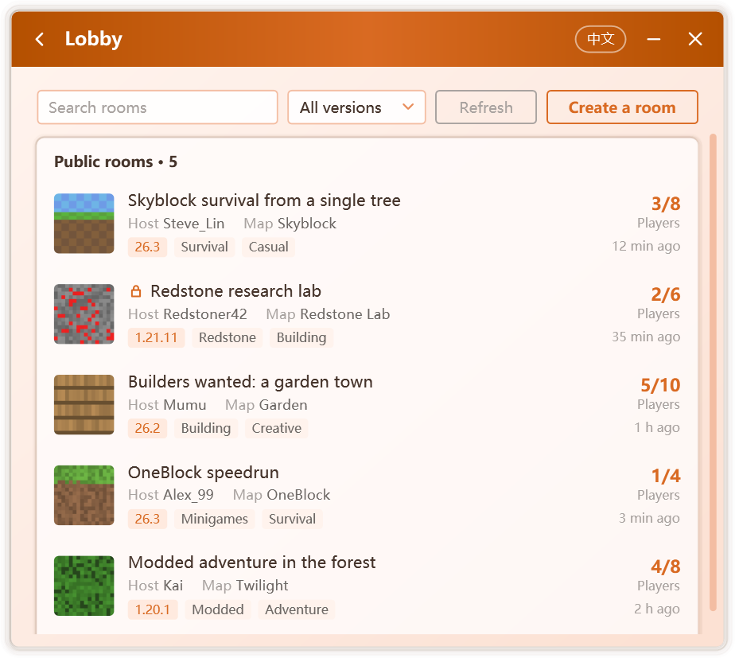

# Lobby

The lobby brings together the rooms that Campfire users have made public. Players can discover worlds in progress and join them; hosts can publish their own rooms to welcome more company.

Open it from **Lobby** on **Home**.

  

::: info
The lobby is provided by the Campfire service and is available in official releases only. Builds from source do not offer it; multiplayer with invite codes is unaffected.
:::

## Browsing and joining

The lobby lists every public room, each with the following information:

| Information | Description |
| --- | --- |
| Picture and name | Set by the host |
| Host and map | The host's player name and the world name |
| Game version and tags | Confirm that your game version matches before joining |
| Players | Current and maximum player count |
| Age | How long the room has been listed |

Rooms can be searched by name, host or map, and filtered by game version. The list refreshes periodically; **Refresh** updates it at once.

Selecting a room opens **Room details**, which shows the game version, rough region and opening time. **Join room** retrieves the room's invite code from the lobby and completes the join; from there the process is identical to joining with an invite code, as described in [Hosting and Joining](./multiplayer).

::: tip Password-protected rooms
Rooms marked **Password** require the password provided by the host. The server verifies it before releasing the invite code.
:::

::: warning Confirm the game version
Start the game with the same version as the room. After joining, enter through the LAN worlds at the bottom of the multiplayer list.
:::

A room cannot be joined while you are in another; leave or close the current room first.

## Listing your room

1. Create a room as described in [Hosting and Joining](./multiplayer).
2. Once the room is ready, click **List in the lobby** on the multiplayer page.
3. Complete the listing:

   | Option | Description |
   | --- | --- |
   | **Room name** | Required; defaults to "Player's world". Names containing inappropriate content are refused |
   | **Picture** | Optional. A PNG or JPG image, or the map's own icon |
   | **Password** | Optional. Leave it empty to admit anyone |
   | **Tags** | Up to three, such as Survival, Building, Redstone or Minigames |
   | **Show my region** | Whether the lobby displays the rough region inferred by the server |

4. Click **List room**.

Campfire reads the game version and world name from the running game, so neither needs to be entered; should reading fail, the room can still be listed.

While listed, the room's lobby status appears at the bottom left of the multiplayer page, and Campfire updates the player count every few minutes. **Unlist** withdraws the listing at any time; closing the room withdraws it automatically.

::: warning About your IP address
Players who connect to you directly can learn your IP address. If this is a concern, enable [Hide my IP address](./network#hide-my-ip-address) in the multiplayer settings. Once listed, you can still [remove or block](./room) any player at any time.
:::

## Reporting

If a room's name or content is inappropriate, choose **Report** in its room details. Once several players have reported it, the room is hidden from the lobby.

## Messages when listing

| Message | Cause and resolution |
| --- | --- |
| The room name contains words that cannot be shown | Revise the room name and try again |
| Another player has already listed this room | An invite code can be listed only once |
| Too many requests | Too many rooms from this network, or too many attempts; try again later |
| The lobby is full | Try again later |
| This version cannot list rooms | Update Campfire first |
| The room was hidden after several players reported it | The same invite code cannot be listed again for a period of time |

## Privacy

Campfire sends room information only when you list a room: the room name, invite code, player name, game version, map name, tags and player count, together with a random ID used only by the lobby. That ID is unrelated to the multiplayer device ID and to the statistics ID.

The server retains only a digest of a room password, and keeps IP addresses only as salted digests, used to limit listing frequency and to address abuse. When a room is unlisted or closed, it leaves the lobby immediately and its records are deleted within a day. See [Network Security](./security#lobby) for the complete account.
