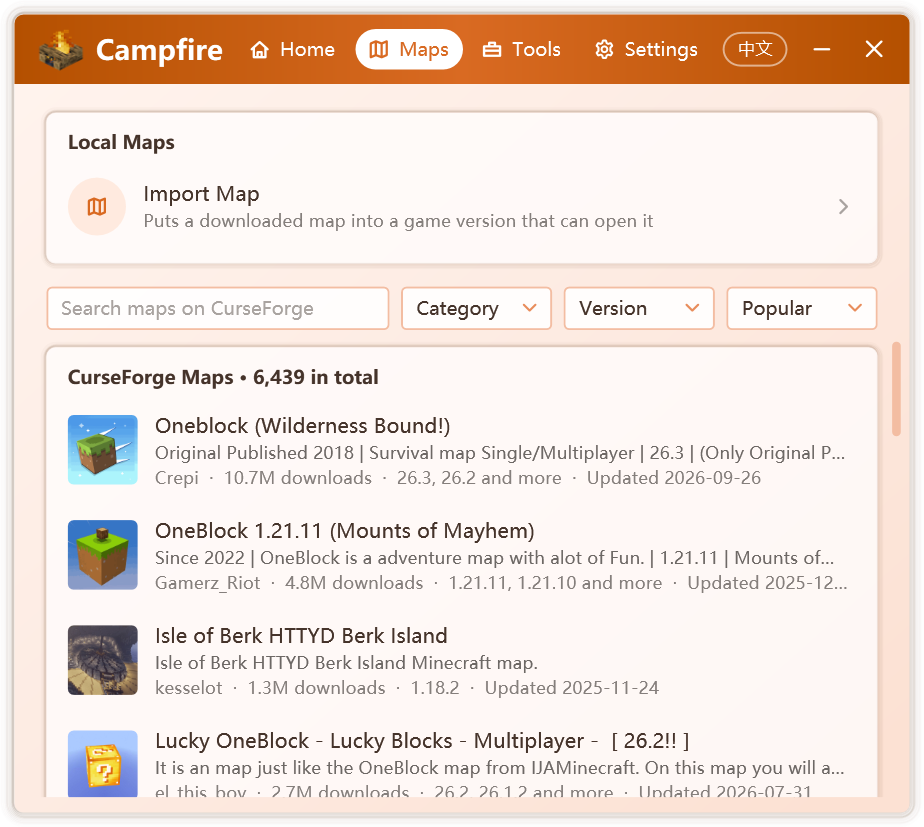
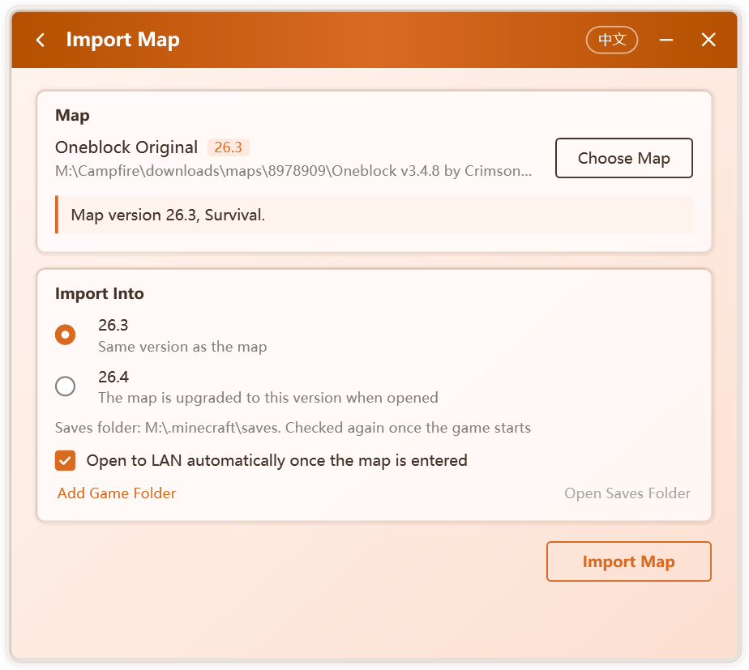

# Maps

The **Maps** tab offers browsing and downloading of CurseForge maps, as well as importing maps already on your computer. On import, Campfire identifies the map's game version and places it into an installed version that can open it; a room can then be created to play it with friends.

## Browsing online maps

  

The tab lists Java Edition maps from CurseForge and supports:

- searching by name;
- filtering by category, including Adventure, Creation, Game Map, Parkour, Puzzle, Survival and Modded World;
- filtering by game version;
- sorting by Popular, Downloads, Updated, Newest or Name.

Further maps load as you scroll.

::: info
Online maps are provided by the Campfire service and are available in official releases only. When the service is unavailable, or in a build from source, maps already on your computer can still be imported.
:::

## Downloading and importing

Selecting a map opens **Map Details**, with its description, downloads, last update and supported game versions.

1. Under **Choose a File**, select the file to download. Each file states its game version; files that require a mod loader name it with **Needs**, and a matching installed version is marked **is installed**.
2. Click **Download and Import**. The download can be cancelled at any time.
3. Once the download completes, the import page opens; continue with [Importing a map](#importing-a-map).

Downloads are verified against the checksum provided by CurseForge and kept for a week, so importing the same map again requires no second download.

::: tip Maps available only on the website
Some authors permit downloads only on the CurseForge website. The details page then offers **Download on CurseForge**; after downloading in your browser, drag the file into the Campfire window to import it.
:::

## Importing a map

Choose **Import Map** under **Local Maps** on the **Maps** tab, or drag a map file into the Campfire window.

  

### 1. Choose the map

Zip archives, map folders and the `level.dat` file within a map folder are accepted. Once the map is read, Campfire shows:

- its game version and game mode, such as Survival, Creative or Hardcore;
- the mod loader and number of mods it uses. For maps that do not record their version, the version is inferred from the mod information;
- a choice of maps, when an archive contains several.

The following cases are reported explicitly:

| Message | Meaning |
| --- | --- |
| This is a Bedrock Edition map | Java Edition cannot open Bedrock maps |
| The map is incomplete | Without `level.dat`, the game would generate a new world |
| `level.dat` is damaged | When the game left a backup, the backup is used instead |
| No map was found | The selected file contains no map folder |

### 2. Choose where to import

Campfire searches the game folders on your computer and lists the versions that can open the map, labeling each:

| Label | Meaning |
| --- | --- |
| Same version as the map | The safest choice |
| The map is upgraded to this version when opened | The game upgrades the map; the original file is untouched |
| Upgrades across 1.13; commands and redstone may break | 1.13 changed the map format, which frequently breaks command blocks and redstone |
| Cannot tell whether it opens the map | Shown when the map's version cannot be identified |
| Loader not installed | The map uses mods, but this version lacks the matching loader |

Choosing a version that upgrades across 1.13 or lacks the loader requires confirmation.

Campfire searches the default `.minecraft` folder, `.minecraft` folders beside launchers, and the game folders recorded in launcher settings. If yours is not found, choose **Add Game Folder** and select the `.minecraft` folder or its `versions` folder.

Each version shows the saves folder the map will be placed in. Launchers with version isolation keep saves within the version folder; once the game starts, Campfire confirms the saves folder from the running game and relocates the map if it differs.

### 3. Import

Click **Import Map**. A copy is imported and the original file is untouched; if disk space is insufficient, Campfire states how much is required.

After importing:

- choose **Open Saves Folder** to view the imported map;
- choose **Create Room** to invite friends;
- start the corresponding version in your launcher and open the map in singleplayer. **Open to LAN automatically once the map is entered** is enabled by default on the import page, so Campfire opens the map to LAN once you are in; see [Opening to LAN automatically](./multiplayer#opening-to-lan-automatically). Where the chosen version does not support this, open to LAN in the game manually.

## Where data is stored

| Path | Contents |
| --- | --- |
| `%LocalAppData%\Campfire\downloads\maps\` | Downloaded map files, removed after a week unused |

Imported maps reside in the game's saves folder, independent of Campfire; uninstalling Campfire does not affect them.
