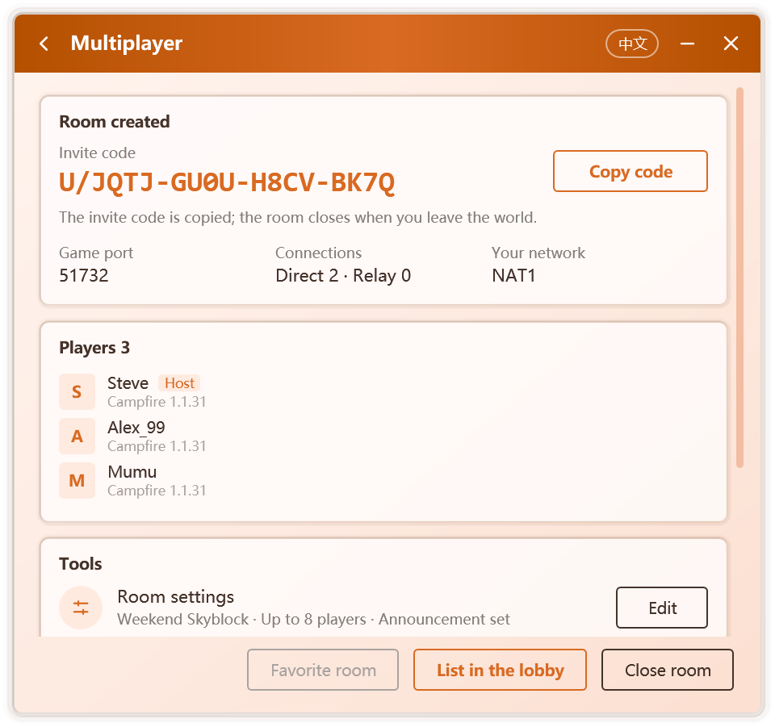

# Hosting and Joining

Multiplayer in Campfire is organized around **rooms**. The host creates a room and enters a singleplayer world, which Campfire opens to LAN; friends join with the invite code the host shares, or find the room in the [Lobby](./lobby). The host's world then appears in the friends' LAN world list, and they enter it exactly as they would on a real local network.

No public IP, port forwarding or dedicated server is needed, and players do not have to use the same launcher.

## Before you begin

- Both sides must run the same game version.
- A player name must be set before creating or joining a room; if it is missing, Campfire asks for one right away.
- Both sides need Campfire running for the whole session. After the window is closed, Campfire can keep running in the notification area; see [Personalization](./personalization#notification-area).
- The first time, Campfire downloads a networking component of about 14 MB and verifies every file. Windows Firewall may ask whether it may use the network; choosing **Allow** improves the chance of a direct connection.

## Host: create a room

1. On **Home**, click **Create a room**.
2. Start the game and enter the singleplayer world you want to share. Campfire opens it to LAN for you; see [Opening to LAN automatically](#opening-to-lan-automatically). If that is not possible, open it to LAN yourself:
   - press Esc, choose **Open to LAN** and click **Start LAN World**;
   - newer game versions have no such button; instead, open **World Options** and turn LAN on under **Multiplayer**.
3. Campfire finds the open world and continues on its own:

   | Step | What happens |
   | --- | --- |
   | Prepare the networking component | Downloaded and verified on first use, then reused |
   | Wait for Open to LAN | The game port on this computer is detected; nothing to type |
   | Create the room | The room and its invite code are created |
   | Connect to the network | Campfire connects to the nodes so friends can find the room |

4. Once the room is ready, the invite code is copied to the clipboard. Share it with your friends, or choose **List in the lobby** to make the room visible to more players; see [Listing your room](./lobby#listing-your-room).

  

### Opening to LAN automatically

Once a room is created, Campfire performs **Open to LAN** as soon as you enter a singleplayer world, preserving the world's game mode and cheat setting. The multiplayer page then shows the port in use.

The feature is provided by the component attached to the game and supports vanilla 1.7.2 and later, as well as loaders that keep the official names. With Fabric or Quilt, or on a Java runtime that cannot attach components, open to LAN manually. Should the process not continue within a few seconds, follow the manual steps above.

The feature can be turned off with **Open to LAN automatically when creating a room** in the multiplayer settings.

While the room is open, the multiplayer page shows the invite code, the game port, this computer's network type, the number of direct and relayed connections, the players in the room, and the **Tools** card with room settings, world backups, voice chat, mod sync and diagnostics; see [Managing a Room](./room#tools).

With **Back up the world before opening a room** on (the default), Campfire saves a copy of the world being played when the room is created; see [World backups](./room#world-backups).

::: tip Entering the port manually
If Campfire does not find the world, click **Enter the port manually** and type the LAN port shown in the game's chat. A dedicated server running on this computer can be shared the same way.
:::

::: info When the room closes
The room closes when the host leaves the world or turns LAN off, or when **Close room** is clicked. Everyone in the room is disconnected.

One exception: when the game restarts to load the voice chat mod after voice chat is turned on, the room stays open with the same invite code; see [Voice Chat](./voice).
:::

## Friends: join a room

Alternatively, open **Lobby** on **Home** and choose a public room; see [Lobby](./lobby).

1. Copy the invite code from the host. Codes look like `U/XXXX-XXXX-XXXX-XXXX`; you can copy the whole message containing it and Campfire picks out the code.
2. Open Campfire. When Home sees a code on the clipboard, it offers to join that room. You can also click **Join a room** on **Home** and paste.
3. Campfire connects to the network, finds the host and enters the room. On restrictive networks, finding the host takes longer.
4. Open the game's **Multiplayer** screen, find the room among the LAN worlds at the bottom of the list and double-click it.

The entry shows the room name the host set, or **Campfire Room** when there is none, together with the player count and latency. You can also choose your own name with **Room display name** in the [multiplayer settings](./network#room).

::: warning Enter through the LAN world list
When the host opens LAN with a premium account, the game verifies every joining player. Offline accounts are let in only when the world is picked from the LAN world list; entering the address through Direct Connection or a server entry ends with an "invalid session" error.
:::

After joining, the multiplayer page shows the local server address, latency, connection type and the players in the room. Click **Leave room** to leave.

## Room information in the game

Inside the host's world, Campfire shows the room status in the game itself:

- **Chat** greets each player on arrival, together with the [room announcement](./room#announcement) if the host set one; players in the world receive a changed announcement right away.
- **Tab list** header and footer show the host, player count, latency and announcement live.
- **LAN world list** shows the player count and latency on the room entry.

The chat and Tab information are sent by the game server itself through a small component attached to the host's game, so they work with premium authentication and encrypted connections, and the host sees them too. The component covers every release since 1.7.2: 1.14.4 to 1.21.11 rely on Mojang's official name mapping file, downloaded and verified on first use; earlier releases use name tables built into Campfire; releases since 26.1 require none.

If the host's Java runtime cannot attach components, or a mod loader such as Fabric or Quilt remaps the game, Campfire falls back to showing the information in the LAN world list only; the connection itself is unaffected. The reason is written to `%LocalAppData%\Campfire\agent.log`.

## Recent and favorite rooms

Campfire keeps track of the rooms you hosted and joined. Click **Recent rooms** on **Home** to see them:

- **Favorite rooms**: click the star on a room to keep it at the top. On the multiplayer page, **Favorite room** does the same.
- **Recent rooms**: the rooms used lately, marked **Hosted** or **Joined**.

Click a room to enter it again. A joined room can be entered again only while its host keeps it open. A room you hosted comes back with its old invite code when you click **Open again**, so codes already sent to friends keep working. Remove entries one by one, or click **Clear history** to remove them all.

## The room in the notification area

With the notification area icon enabled, the icon follows the room: the flame stays lit while a room is open. Right-click it to see the members, copy the invite code, host or join a room, or exit Campfire.

## Next steps

- [Managing a Room](./room): the tools card, room settings and announcements, world backups, diagnostics, removing and blocking.
- [Mod Sync](./mods): make your mods match the host's.
- [Voice Chat](./voice): talk with the players in the room while you play.
- [Network and Privacy](./network): direct and relayed connections, custom nodes, hiding your IP address.
- [FAQ](./faq#multiplayer): troubleshooting joins, invalid sessions and more.
