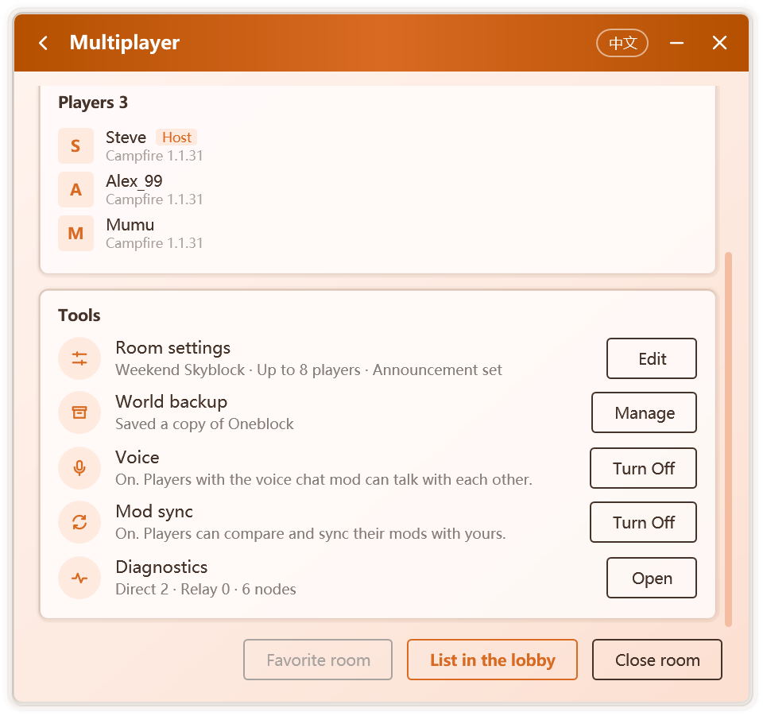
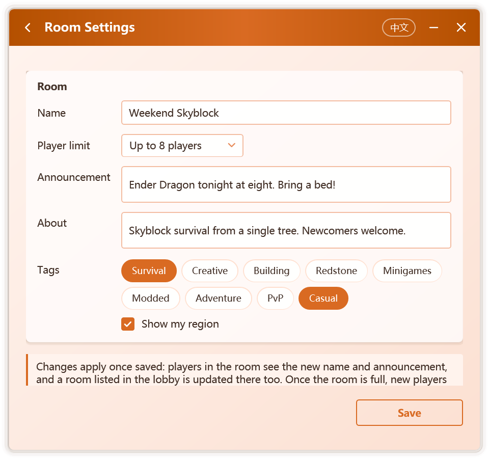
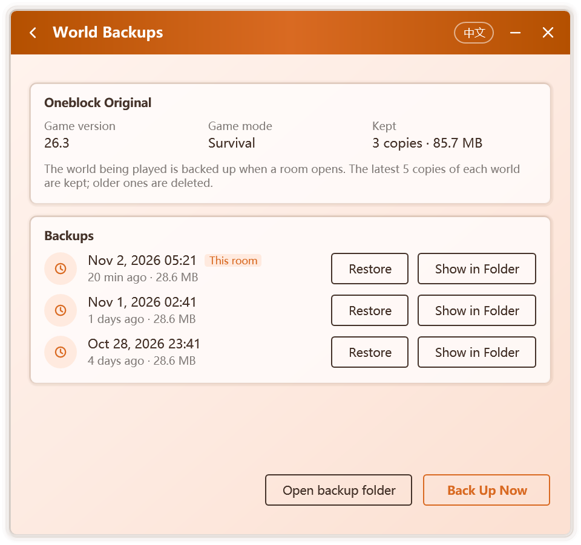

# Managing a Room

## Tools

While a room is open, the **Tools** card of the multiplayer page gathers the room's common features, one row each, with the current state on the right:

  

| Tool | Host | Player |
| --- | --- | --- |
| **Room settings** | Change the name, player limit, announcement and more; see [Room settings](#room-settings) | — |
| **World backup** | View and restore backups of the world; see [World backups](#world-backups) | — |
| **Voice** | Turn voice chat on or off; see [Voice Chat](./voice) | Install the voice chat mod |
| **Mod sync** | Turn mod sync on or off; see [Mod Sync](./mods) | Compare and sync mods |
| **Diagnostics** | Check this computer's multiplayer setup; see [Diagnostics](#diagnostics) | Same |

## Room settings

The host clicks **Edit** under **Tools › Room settings** to change:

  

| Option | Description |
| --- | --- |
| **Name** | Up to 24 characters. Players in the room see it on the room page; a room listed in the lobby uses it there too |
| **Player limit** | No limit, or 2 to 50 players. Once the room is full, new players cannot join and are told "The room is full" |
| **Announcement** | Up to 100 characters; see [Announcement](#announcement) |
| **About** | Up to 100 characters, shown in the room details in the lobby |
| **Tags** | Up to 3, shown in the lobby |
| **Show my region** | Whether the lobby shows the room's rough region |

Changes apply once you click **Save**: players in the room see the new name and announcement, and a room listed in the lobby is updated there too.

### Announcement

Once the host sets an announcement:

- players entering the world see it in the welcome message in chat, and in the footer of the Tab list;
- when the host changes it, players already in the world receive the new announcement in chat;
- players also see it on their multiplayer page.

The in-game announcement is sent by the component attached to the host's game and works wherever the [room information in the game](./multiplayer#room-information-in-the-game) does.

## World backups

With **Settings › Multiplayer › Back up the world before opening a room** on (the default), Campfire saves a zip copy of the world being played each time a room is created. The latest 5 copies of each world are kept and older ones are deleted; worlds above 2 GB are skipped.

Click **Manage** under **Tools › World backup** to open the World Backups page:

  

- the top shows the world's name, game version and game mode, and how many copies are kept and their total size;
- **Backups** lists every copy of the world with its time and size; copies made while the current room is open are marked **This room**;
- **Back Up Now** makes another copy at any time while the room is open;
- **Restore** turns the chosen copy into a new world in the host game's saves folder, where it appears in the singleplayer list. The current world stays as it is, and a new name is chosen if the name is taken;
- **Show in Folder** and **Open backup folder** show the backup files in File Explorer.

Backups are stored in `%LocalAppData%\Campfire\backups\worlds`.

## Diagnostics

Diagnostics runs the following checks and gives a result and advice for each:

| Check | What it looks at |
| --- | --- |
| System | The Windows version; on Windows 7, whether the updates multiplayer needs are installed |
| Component | Whether the networking component is downloaded and runs on this computer |
| Player name | Whether a name is set |
| Connection | Whether the computer is online and has a public IPv6 address |
| Relay servers | How many servers can be reached, and the lowest latency |
| Relay setting | Whether relaying is allowed, and whether the IP address is hidden |
| Local port | Whether the chosen local port is used by another program |
| Game | Whether a running game is found |
| LAN world | Whether a world open to LAN is found |

Open it from **Tools › Diagnostics**, from **Settings › Multiplayer**, or from the message shown when connecting times out. Click **Check again** after fixing a problem.

## Members

The multiplayer page lists everyone in the room. The host and you are marked **Host** and **You**. Each member shows:

- **Name**: read from the game by default, or set yourself in the multiplayer settings.
- **Face**: premium players show the face and hat layer of their skin, others show the first letter of their name. Skins come from Mojang's public service and are cached locally for a day.
- **Client**: the multiplayer client and its version. When a player turns off "Show the program version to other players", only the client name is shown.

The connection to the host, direct or relayed together with the transport used, and its latency appear in the room information at the top of the page.

## Removing and blocking

The host can act on any guest:

| Action | Effect |
| --- | --- |
| **Remove** | The player leaves the world immediately and cannot rejoin for one minute |
| **Block** | The player leaves the world immediately and can no longer join any room you create |

Removed or blocked players see a message in the game, and Campfire tells them why joining failed.

This is enforced by a connection gate on the host's computer: every guest connection reaches the gate before it reaches the world. Even a guest who bypasses the client interface cannot enter a room that has turned them away.

### Managing the blocklist

The blocklist is stored on the host's computer and applies to every room created afterwards. **Settings › Multiplayer › Blocklist** shows the blocked players and when they were blocked, and lets you unblock them one by one.

## Closing and leaving

- **Host**: click **Close room**, or simply leave the world. If other players are still in the room, Campfire asks first. When the game restarts to load the voice chat mod after voice chat is turned on, the room stays open; see [Voice Chat](./voice).
- **Guest**: click **Leave room**.
- **Exiting Campfire** ends the room. With "Keep running in the notification area when closed" turned on, the window's close button only hides the window and the room stays open; use the notification area menu to exit.

When Campfire exits, the networking component exits with it, even if Campfire crashes, so nothing is left running in the background.

## Player name and account

A player name must be set before creating or joining a room; if it is missing, Campfire asks for one right away. Player names are checked against the same word filter as room names.

Campfire reads the player name, UUID and account type from the running game's command line, so it identifies players correctly whichever launcher is used. Only these three values are read; **login credentials are never read or stored**.

Recent Minecraft versions allow only letters, digits and underscores in player names. If the game name contains other characters, Campfire warns before joining, because such a name cannot enter the world.

If you prefer not to read the game account, turn off "Read the player name and account type from the game" in the multiplayer settings and enter a name yourself.
