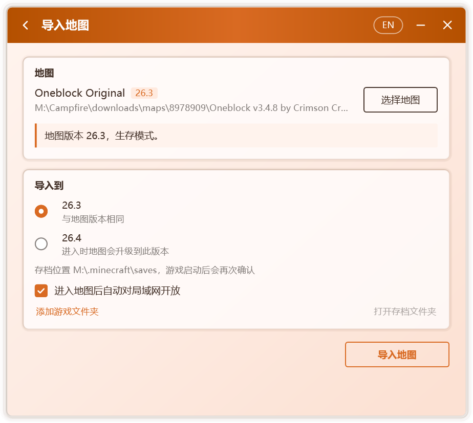

# 地图

**地图** 标签页提供 CurseForge 地图的浏览与下载，并可导入本机已有的地图。导入时，Campfire 会识别地图的游戏版本，将其置入本机能够开启它的版本；导入完成后即可创建房间，与好友共同游玩。

## 浏览在线地图

  

标签页中列出 CurseForge 上的 Java 版地图，支持：

- 按名称检索；
- 按分类筛选，包括冒险、建筑、小游戏、跑酷、解谜、生存与模组地图；
- 按游戏版本筛选；
- 按热门、下载量、更新时间、发布时间或名称排序。

列表随滚动自动加载更多地图。

::: info
在线地图由 Campfire 服务提供，仅正式版可用。服务暂不可用时，或使用从源代码构建的版本时，仍可导入本机已有的地图。
:::

## 下载并导入

选择一张地图即进入 **地图详情**，其中包含介绍、下载量、更新时间与支持的游戏版本。

1. 在 **选择文件** 中选定要下载的文件。每个文件均标注对应的游戏版本；需要模组加载器的文件会注明 **需要** 的加载器；本机已安装对应版本时，会提示 **本机已安装**。
2. 点击 **下载并导入**。下载过程中可随时取消。
3. 下载完成后自动进入导入页面，按[导入地图](#导入地图)继续操作。

下载的文件以 CurseForge 提供的校验值核对，并在本机保留一周，再次导入同一地图时无需重复下载。

::: tip 仅限网站下载的地图
部分作者仅允许在 CurseForge 网站下载其地图。此时详情页显示 **前往 CurseForge 下载**；在浏览器中下载后，将文件拖入 Campfire 窗口即可导入。
:::

## 导入地图

在 **地图** 标签页的 **本地地图** 中点击 **导入地图**，或将地图文件直接拖入 Campfire 窗口。

  

### 1. 选择地图

支持 zip 压缩包、地图文件夹，以及地图文件夹中的 `level.dat` 文件。Campfire 读取地图后显示：

- 地图的游戏版本与游戏模式，例如生存、创造或极限模式；
- 地图所用的模组加载器与模组数量。未记录版本的地图，将依据模组信息推断版本；
- 压缩包中包含多张地图时，需选择其中一张导入。

以下情形会给出明确提示：

| 提示 | 说明 |
| --- | --- |
| 这是基岩版地图 | Java 版无法开启基岩版地图 |
| 地图不完整 | 缺少 `level.dat`，进入游戏后将生成一个新世界 |
| `level.dat` 已损坏 | 存在游戏留下的备份时，将改用备份 |
| 其中没有找到地图 | 所选文件中不含地图文件夹 |

### 2. 选择目标版本

Campfire 查找本机的游戏文件夹，列出能够开启该地图的版本，并逐一标注：

| 标注 | 含义 |
| --- | --- |
| 与地图版本相同 | 最为稳妥的选择 |
| 进入时地图会升级到此版本 | 游戏将自动升级地图，原文件不受影响 |
| 跨越 1.13 升级，命令与红石可能失效 | 1.13 变更了地图格式，命令方块与红石机关常因此失效 |
| 无法确认能否打开 | 地图版本无法识别时显示 |
| 未安装某个加载器 | 地图使用了模组，但该版本未安装对应的加载器 |

选择跨越 1.13 升级或缺少加载器的版本时，Campfire 会再次确认。

Campfire 会查找默认的 `.minecraft` 文件夹、启动器旁的 `.minecraft` 文件夹，以及启动器设置中记录的游戏文件夹。若未找到所用的文件夹，可点击 **添加游戏文件夹**，选择 `.minecraft` 文件夹或其中的 `versions` 文件夹。

每个版本下方显示地图将置入的存档位置。启用版本隔离的启动器会将存档保存在版本文件夹中；游戏启动后，Campfire 依据运行中的游戏再次确认存档位置，如有不同，将自动迁移地图。

### 3. 导入

点击 **导入地图**。导入的是一份副本，原文件不受影响；磁盘空间不足时，Campfire 会提示所需的空间。

导入完成后：

- 点击 **打开存档文件夹**，查看已导入的地图；
- 点击 **创建房间**，邀请好友共同游玩；
- 以启动器启动对应版本，在单人游戏中打开该地图。导入页面中的 **进入地图后自动对局域网开放** 默认启用，Campfire 将在你进入地图后自动对局域网开放，见[自动对局域网开放](./multiplayer#自动对局域网开放)。所选版本不支持时，需在游戏中手动开放。

## 数据位置

| 路径 | 内容 |
| --- | --- |
| `%LocalAppData%\Campfire\downloads\maps\` | 下载的地图文件，一周未使用后自动删除 |

已导入的地图保存在游戏的存档文件夹中，与 Campfire 相互独立，卸载 Campfire 不会影响它们。
