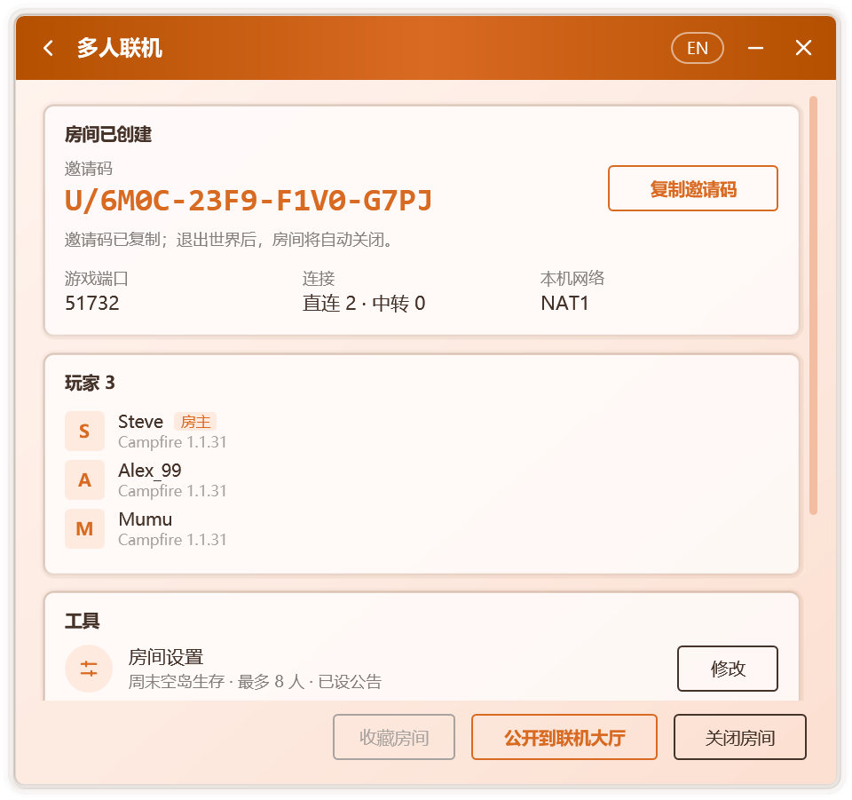

# 创建与加入房间

Campfire 的多人联机以**房间**为单位。房主创建房间并进入单人世界，Campfire 将其对局域网开放；好友凭房主提供的邀请码，或在[联机大厅](./lobby)中找到房间加入。加入后，房主的世界会出现在好友游戏的局域网世界列表中，进入方式与真实的局域网游戏完全相同。

整个过程无需公网 IP、端口映射或专用服务器，也不要求双方使用同一款启动器。

## 开始之前

- 双方的游戏版本须一致。
- 创建或加入房间前须设置玩家名称，未设置时 Campfire 会直接弹出输入框。
- 双方均需运行 Campfire，并在游戏期间保持其开启。关闭窗口后，Campfire 可以继续在通知区域中运行，见[个性化](./personalization#通知区域)。
- 第一次联机时，Campfire 会下载约 14 MB 的联机组件，并逐个文件校验。Windows 防火墙可能询问是否允许其访问网络，选择 **允许** 有助于建立直连。

## 房主：创建房间

1. 在 **主页** 点击 **创建房间**。
2. 启动游戏，进入要分享的单人世界。Campfire 会自动将其对局域网开放，见[自动对局域网开放](#自动对局域网开放)。无法自动开放时，请手动开放：
   - 在游戏菜单中按 Esc，选择 **对局域网开放**，再点击 **创建局域网世界**；
   - 较新的游戏版本中没有该按钮，请改为在 **世界选项** 的 **多人游戏** 中将局域网设为开启。
3. Campfire 会自动发现已开放的世界，完成后续步骤：

   | 步骤 | 说明 |
   | --- | --- |
   | 准备联机组件 | 首次使用时下载并校验，之后直接使用本地副本 |
   | 等待对局域网开放 | 持续检测本机正在监听的游戏端口，无需手动填写 |
   | 创建房间 | 生成房间与邀请码 |
   | 连接联机网络 | 连接联机节点，供好友发现本房间 |

4. 房间创建后，邀请码将自动复制到剪贴板，发送给好友即可；亦可点击 **公开到联机大厅**，使房间为更多玩家所见，见[公开房间](./lobby#公开房间)。

  

### 自动对局域网开放

创建房间后，一旦进入单人世界，Campfire 即代为执行 **对局域网开放**，并沿用世界原有的游戏模式与作弊设置。开放完成后，多人联机页面将显示所用端口。

该功能由附加到游戏中的组件实现，支持 1.7.2 及以上的原版，以及沿用官方名称的加载器。使用 Fabric 或 Quilt，或游戏所用的 Java 运行时不提供附加功能时，需手动开放。若数秒后流程仍未继续，请按上述步骤手动开放。

如不需要此功能，可在联机设置中关闭 **创建房间时自动对局域网开放**。

房间开启期间，多人联机页面会显示邀请码、游戏端口、本机网络类型、当前的直连与中转数量、房间内的玩家列表，以及包含房间设置、存档备份、语音、模组同步与联机诊断的 **工具** 卡片，见[房间管理](./room#工具)。

开启 **开房前备份存档**（默认开启）时，Campfire 会在创建房间时把正在游玩的世界备份一份，见[存档备份](./room#存档备份)。

::: tip 手动指定端口
若 Campfire 迟迟未能发现世界，可点击 **手动输入端口**，填写游戏聊天栏中显示的局域网端口号。在本机运行的专用服务器也能以同样方式分享。
:::

::: info 房间何时关闭
房主退出世界或关闭局域网后，房间随之关闭；也可以在多人联机页面点击 **关闭房间**。关闭时，房间中的全部玩家都会断开连接。

例外：开启语音后为加载语音模组而重新启动游戏时，房间保持开启，邀请码不变，见[语音聊天](./voice)。
:::

## 好友：加入房间

亦可在 **主页** 进入 **联机大厅**，从公开房间中选择加入，见[联机大厅](./lobby)。

1. 复制房主发来的邀请码。邀请码的格式为 `U/XXXX-XXXX-XXXX-XXXX`，可以直接复制含有邀请码的整段消息，Campfire 会自动识别其中的邀请码。
2. 打开 Campfire。主页检测到剪贴板中的邀请码后，会提示是否加入该房间；也可以在 **主页** 点击 **加入房间** 并粘贴。
3. Campfire 将依次连接联机网络、寻找房主并进入房间。网络限制较严时，寻找房主所需的时间会更长。
4. 加入完成后，打开游戏的 **多人游戏** 页面，在列表底部的局域网世界中找到房间条目，双击进入。

房间条目显示房主设定的房间名称，未设定时显示为 **Campfire 联机房间**，并附有在线人数与延迟。也可以在[联机设置](./network#房间)的 **房间显示名称** 中改为自己想要的名称。

::: warning 请从局域网世界列表进入
房主使用正版账号开放局域网时，游戏会校验每位加入者的身份。离线账号只有从局域网世界列表进入时才会被游戏放行；通过“直接连接”或服务器条目输入地址进入，会出现“无效会话”提示。
:::

加入后，多人联机页面会显示本地服务器地址、延迟、连接方式与房间内的玩家。需要离开时点击 **退出房间**。

## 游戏内的房间信息

进入房主的世界后，Campfire 会在游戏中呈现房间状态：

- **聊天栏**：每位玩家进入时显示欢迎消息；房主设置了[房间公告](./room#房间公告)时一并显示，修改公告后在线玩家会收到新公告。
- **Tab 列表**：页眉与页脚实时显示房主、在线人数与延迟，以及房间公告。
- **局域网世界列表**：房间条目显示在线人数与延迟。

聊天栏与 Tab 列表中的信息由附加到房主游戏中的一个小型组件从服务端直接发送，在正版验证与加密连接下同样有效，房主本人也能看到。该组件覆盖 1.7.2 及以上的全部正式版：1.14.4 至 1.21.11 依赖 Mojang 官方的名称映射表，首次使用时自动下载并校验；更早的版本使用 Campfire 内置的名称表；26.1 起的版本无需映射表。

若房主所用的 Java 运行时不提供附加功能，或游戏环境经过 Fabric、Quilt 等模组加载器的重映射，Campfire 会自动退回仅在局域网世界列表中显示信息，游戏连接本身不受影响。原因记录在 `%LocalAppData%\Campfire\agent.log`。

## 最近房间与常用房间

Campfire 会自动记录开过与加入过的房间。在 **主页** 点击 **最近房间** 即可查看：

- **常用房间**：点击房间右侧的星标即可收藏，收藏的房间固定显示在上方；在多人联机页面也可点击 **收藏房间**。
- **最近房间**：按时间列出最近用过的房间，标明是 **我开的** 还是 **加入的**。

点击房间即可再次进入。加入过的房间只有在房主仍开着时才能再次进入；自己开过的房间点击 **重新开房** 会沿用原来的邀请码，已发给朋友的邀请码可以继续使用。不需要的记录可以逐个删除，或点击 **清除记录** 全部删除。

## 托盘中的房间

开启通知区域图标后，房间状态会同步呈现在图标上：房间开启期间火焰常亮。右键单击图标可以查看房间成员、复制邀请码、创建或加入房间，以及退出 Campfire。

## 下一步

- [房间管理](./room)：工具卡片、房间设置与公告、存档备份、联机诊断、移出与拉黑。
- [模组同步](./mods)：让本机模组与房主保持一致。
- [语音聊天](./voice)：在游戏中与房间内的玩家语音交流。
- [网络与隐私](./network)：直连与中转、自定义节点、隐藏 IP 地址。
- [常见问题](./faq#多人联机)：无法加入、无效会话等问题的排查方法。
