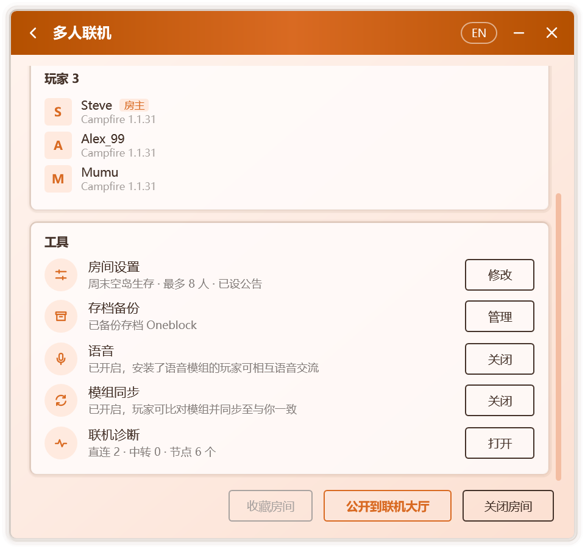
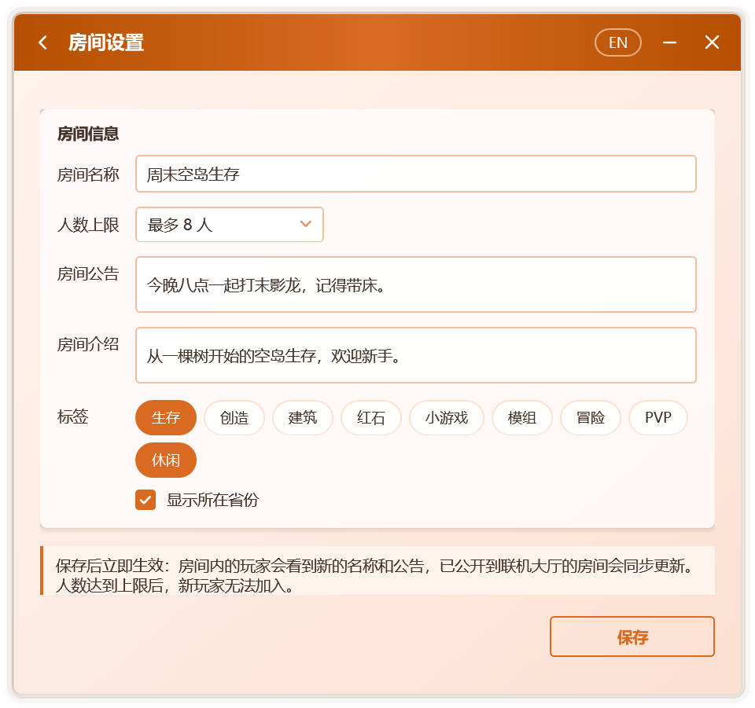
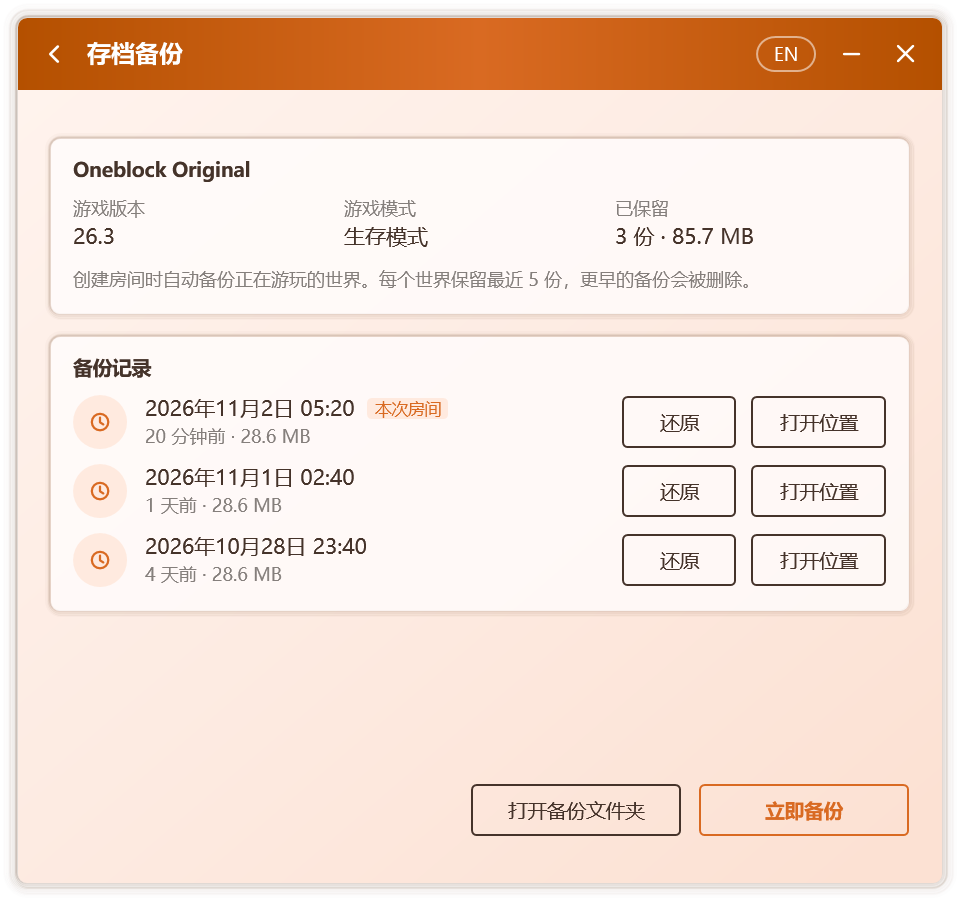

# 房间管理

## 工具

房间开启后，多人联机页面的 **工具** 卡片集中了房间的常用功能，每项各占一栏，并在右侧显示当前状态：

  

| 工具 | 房主 | 玩家 |
| --- | --- | --- |
| **房间设置** | 修改房间名称、人数上限、公告等，见[房间设置](#房间设置) | — |
| **存档备份** | 查看与还原世界的备份，见[存档备份](#存档备份) | — |
| **语音** | 开启或关闭房间语音，见[语音聊天](./voice) | 安装语音模组 |
| **模组同步** | 开启或关闭模组同步，见[模组同步](./mods) | 比对并同步模组 |
| **联机诊断** | 检查本机的联机环境，见[联机诊断](#联机诊断) | 同左 |

## 房间设置

房主在 **工具 › 房间设置** 中点击 **修改**，即可调整：

  

| 选项 | 说明 |
| --- | --- |
| **房间名称** | 最多 24 个字。房间内的玩家可在房间页面看到；公开到联机大厅时同样作为大厅中的名称 |
| **人数上限** | 人数不限，或 2 至 50 人。人数达到上限后，新玩家无法加入，并会看到“房间人数已满” |
| **房间公告** | 最多 100 个字，见[房间公告](#房间公告) |
| **房间介绍** | 最多 100 个字，在联机大厅的房间详情中显示 |
| **标签** | 至多 3 个，在联机大厅中显示 |
| **显示所在省份** | 是否在联机大厅中显示大致地区 |

点击 **保存** 后立即生效：房间内的玩家会看到新的名称与公告，已公开到联机大厅的房间也会同步更新。

### 房间公告

房主设置公告后：

- 玩家进入世界时，聊天栏的欢迎消息中会显示公告，Tab 列表的页脚中也会显示；
- 房主修改公告后，已在世界中的玩家会在聊天栏收到新公告；
- 玩家的多人联机页面同样显示公告。

游戏内的公告由附加到房主游戏中的组件发送，其适用范围与[游戏内的房间信息](./multiplayer#游戏内的房间信息)相同。

## 存档备份

开启 **设置 › 联机 › 开房前备份存档** 后（默认开启），每次创建房间时，Campfire 会把正在游玩的世界压缩保存一份。每个世界保留最近 5 份，更早的备份会被删除；超过 2 GB 的世界不备份。

在 **工具 › 存档备份** 中点击 **管理**，可打开存档备份页面：

  

- 页面上方显示世界的名称、游戏版本、游戏模式，以及已保留的份数与总大小；
- **备份记录** 列出该世界的每一份备份及其时间与大小，当前房间开启期间生成的备份标有 **本次房间**；
- **立即备份**：房间开启期间随时再备份一次；
- **还原**：将所选备份还原为一个新世界，放入房主游戏的存档文件夹，可在单人游戏列表中找到。当前世界不会被改动，同名世界已存在时会自动改用新名称；
- **打开位置** 与 **打开备份文件夹**：在资源管理器中查看备份文件。

备份保存在 `%LocalAppData%\Campfire\backups\worlds` 中。

## 联机诊断

联机诊断依次检查以下项目，并为每一项给出结论与处理建议：

| 项目 | 检查内容 |
| --- | --- |
| 系统 | Windows 版本；Windows 7 是否已安装联机所需的更新 |
| 联机组件 | 是否已下载，能否在本机运行 |
| 玩家名称 | 是否已设置 |
| 网络连接 | 是否联网，是否具备公网 IPv6 |
| 中转服务器 | 可连通的服务器数量与最低延迟 |
| 中转设置 | 是否允许中转，是否隐藏了 IP 地址 |
| 本地端口 | 设定的本地端口是否被其他程序占用 |
| 游戏 | 是否检测到运行中的游戏 |
| 局域网世界 | 是否发现已对局域网开放的世界 |

可在 **工具 › 联机诊断**、**设置 › 联机**，以及连接超时的提示中打开。处理后点击 **重新检测** 即可再次检查。

## 成员列表

多人联机页面会列出房间中的全部玩家，房主与本人分别带有 **房主** 与 **你** 标记。每位成员显示：

- **玩家名称**：默认读取游戏中的玩家名称，也可在联机设置中自定义。
- **头像**：正版玩家显示其皮肤的面部与帽子层，其他玩家显示名称首字母。皮肤通过 Mojang 的公开接口获取，并在本地缓存一天。
- **客户端**：对方使用的联机客户端与版本。对方关闭“向其他玩家显示软件版本”后，仅显示客户端名称。

与房主之间的连接方式（直连或中转及所用协议）和延迟显示在页面上方的房间信息中。

## 移出与拉黑

房主可以对访客执行以下操作：

| 操作 | 效果 |
| --- | --- |
| **移出** | 对方立即离开世界，一分钟内无法重新加入 |
| **拉黑** | 对方立即离开世界，并且之后无法再加入你创建的任何房间 |

被移出或拉黑的玩家会在游戏中看到相应提示，Campfire 中也会显示失败原因。

这一机制由房主一侧的连接网关实现：访客的游戏连接先经过房主本机的网关，再到达世界。因此，即使访客绕过客户端界面，也无法进入已将其拒之门外的房间。

### 管理黑名单

黑名单保存在房主的电脑上，与房间无关，对之后创建的所有房间均生效。在 **设置 › 联机 › 黑名单** 中可以查看被拉黑的玩家与拉黑时间，并逐个解除。

## 关闭与退出

- **房主**：点击 **关闭房间**，或直接退出世界。若房间中仍有其他玩家，Campfire 会先请求确认。开启语音后为加载模组而重新启动游戏时，房间会保持开启，见[语音聊天](./voice)。
- **访客**：点击 **退出房间**。
- **退出 Campfire**：房间会随之结束。若开启了“关闭窗口时保留在通知区域”，点击窗口的关闭按钮只会隐藏窗口，房间保持开启；需要退出时，请使用通知区域图标的菜单。

Campfire 退出时，联机组件进程会被一并终止，即使 Campfire 意外崩溃也不会在后台残留。

## 玩家名称与账号

创建或加入房间前须设置玩家名称，未设置时 Campfire 会直接弹出输入框；玩家名称同样会经过违禁词检查。

Campfire 会从运行中游戏的启动参数中读取玩家名称、UUID 与账号类型，因此无论使用哪款启动器都能正确识别。该过程只读取上述三项信息，**不会读取或保存任何登录凭据**。

新版 Minecraft 的玩家名称仅允许英文字母、数字与下划线。若游戏中的名称含有其他字符，Campfire 会在加入前给出提示，因为这样的名称无法进入世界。

如不希望读取游戏账号，可在联机设置中关闭“读取游戏中的玩家名称与账号类型”，并手动填写玩家名称。
