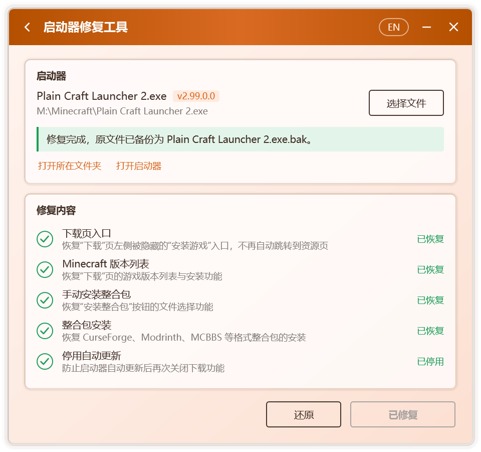

# 啟動器修復

部分啟動器喺新版本中停用咗遊戲下載、加載器安裝與整合包安裝，或按所在地區關閉咗呢啲功能。啟動器修復工具可以恢復呢啲功能，同時保證修改範圍最小、過程可驗證、結果可還原。

## 可恢復嘅功能

| 項目 | 說明 |
| --- | --- |
| **Minecraft 版本列表** | 恢復「下載」頁嘅遊戲版本列表，以及遊戲與 Mod 加載器嘅安裝 |
| **手動安裝整合包** | 恢復「安裝整合包」按鈕嘅文件選擇功能 |
| **整合包安裝** | 恢復 CurseForge、Modrinth、MCBBS、HMCL、MMC 等格式整合包嘅安裝 |
| **地區限制** | 解除按地區關閉嘅下載、安裝與文件補全 |
| **停用自動更新** | 防止啟動器自動更新後再次關閉上述功能 |

Campfire 會先檢測所選啟動器，只列出與其相關嘅項目，並逐項標明 **待修復**、**已恢復**、**無需修復** 等狀態。

## 修復步驟

1. **關閉啟動器。** 啟動器運行時其程序文件被佔用，Campfire 會提示先將其關閉。
2. 打開 Campfire，喺 **工具** 中選擇 **啟動器修復工具**。
3. 選擇啟動器。Campfire 會自動查搵自身所在文件夾中嘅啟動器；亦可以按 **選擇文件**，或直接將啟動器文件拖入窗口。
4. 查看檢測結果與 **修復內容**，確認後按 **一鍵修復**。
5. 修復完成後，按 **打開啟動器** 就可以直接使用。

  

::: tip 位於受保護文件夾嘅啟動器
若啟動器位於 `Program Files` 等受保護嘅文件夾，寫入時可能被系統拒絕。此時請以管理員身份運行 Campfire。
:::

## 檢測結果

| 提示 | 含義 |
| --- | --- |
| 已關閉下載功能，可以一鍵修復 | 檢測到受影響嘅版本，可直接修復 |
| 已按地區關閉下載功能，可以一鍵修復 | 檢測到地區限制，可直接解除 |
| 下載功能已恢復 | 該啟動器此前已由 Campfire 修復 |
| 下載功能正常，無需修復 | 該版本唔受影響，Campfire 唔會做任何修改 |
| 代碼結構與已知版本不同，暫唔支持修復 | 冇辦法確認修改位置，Campfire 唔會做任何修改 |

只要冇辦法確定修改係安全嘅，Campfire 就唔會寫入文件。

## 備份與還原

修復前嘅啟動器會以 `.bak` 為後綴保存在同一文件夾中，例如 `啟動器.exe.bak`。需要恢復時，可任選一種方式：

- 喺啟動器修復工具中按 **還原**。Campfire 會先確認備份文件係受支持嘅啟動器，再執行還原。
- 手動刪除修復後嘅啟動器，再將 `.bak` 文件改回原名。

## 關於自動更新

為防止啟動器喺自動更新後再次關閉上述功能，修復會同時停用啟動器嘅自動更新。需要升級啟動器時：

1. 手動下載新版啟動器並替換舊文件；
2. 再次運行 Campfire，檢測新版是否需要修復。

## 安全性

- **最小修改。** 只改動與上述功能直接相關嘅少數方法，唔添加任何聯網行為。
- **精確定位。** 修改位置依據方法名稱與代碼特徵確定，而非固定嘅文件偏移，因此啟動器嘅後續小版本通常無需更新 Campfire 就可以修復。
- **先驗證後寫入。** 修復結果先喺內存中生成，重新加載並逐項校驗通過後才寫入磁盤；任一步驟失敗，原文件都保持唔變。
- **僅喺本機進行。** 修復過程唔上傳、唔下載任何文件。

技術細節見[工作原理](./how-it-works#啟動器修復)。
