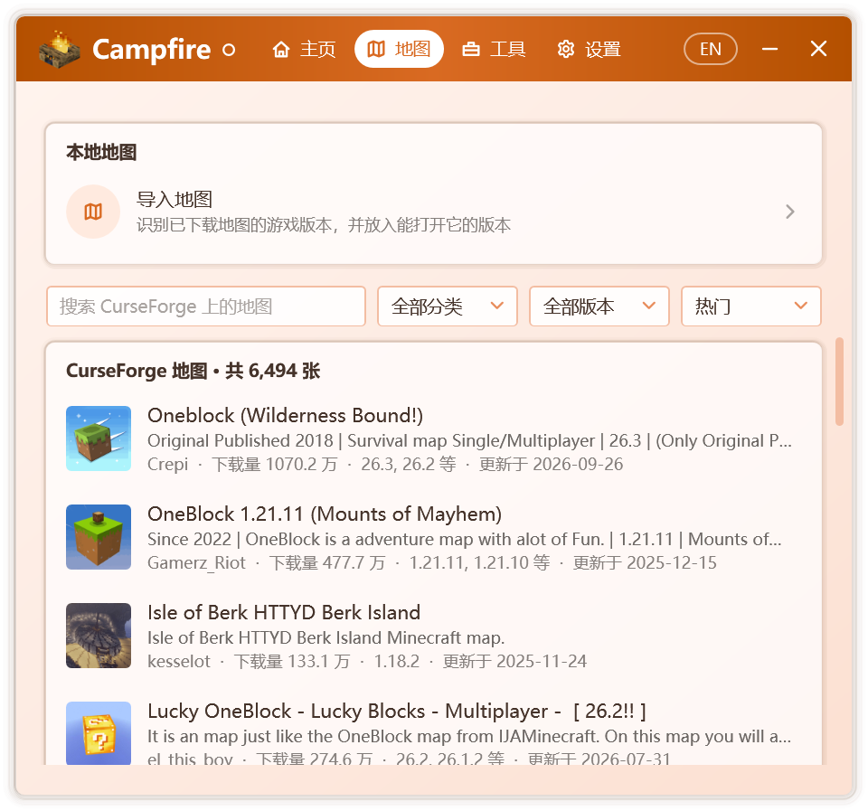
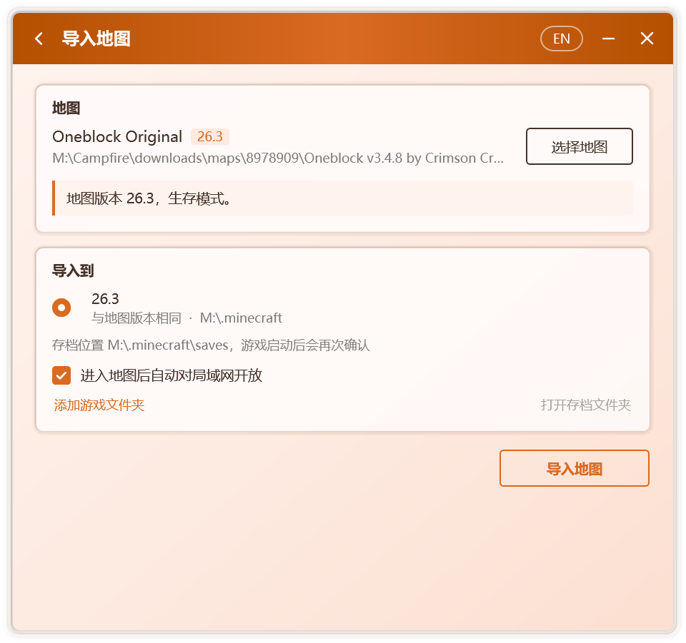

# 地圖

**地圖** 標籤頁提供 CurseForge 地圖嘅瀏覽與下載，並可導入本機已有啲地圖。導入時，Campfire 會識別地圖嘅遊戲版本，將其置入本機可以開啟佢嘅版本；導入完成後就可以創建房間，與好友共同遊玩。

## 瀏覽在線地圖

  

標籤頁中列出 CurseForge 上嘅 Java 版地圖，支持：

- 按名稱檢索；
- 按分類篩選，包括冒險、建築、小遊戲、跑酷、解謎、生存與模組地圖；
- 按遊戲版本篩選；
- 按熱門、下載量、更新時間、發佈時間或名稱排序。

列表隨滾動自動加載更多地圖。

::: info
在線地圖由 Campfire 服務提供，僅正式版可用。服務暫不可用時，或使用從源代碼構建嘅版本時，仍可導入本機已有啲地圖。
:::

## 下載並導入

選擇一張地圖即進入 **地圖詳情**，其中包含介紹、下載量、更新時間與支持嘅遊戲版本。

1. 喺 **選擇文件** 中選定要下載嘅文件。每個文件均標註對應嘅遊戲版本；需要模組加載器嘅文件會註明 **需要** 嘅加載器；本機已安裝對應版本時，會提示 **本機已安裝**。
2. 按 **下載並導入**。下載過程中可隨時取消。
3. 下載完成後自動進入導入頁面，按[導入地圖](#導入地圖)繼續操作。

下載嘅文件以 CurseForge 提供嘅校驗值核對，並喺本機保留一週，再次導入同一地圖時無需重複下載。

::: tip 僅限網站下載嘅地圖
部分作者僅容許喺 CurseForge 網站下載其地圖。此時詳情頁顯示 **前往 CurseForge 下載**；喺瀏覽器中下載後，將文件拖入 Campfire 窗口就可以導入。
:::

## 導入地圖

喺 **地圖** 標籤頁嘅 **本地地圖** 中按 **導入地圖**，或將地圖文件直接拖入 Campfire 窗口。

  

### 1. 選擇地圖

支持 zip 壓縮包、地圖文件夾，以及地圖文件夾中嘅 `level.dat` 文件。Campfire 讀取地圖後顯示：

- 地圖嘅遊戲版本與遊戲模式，例如生存、創造或極限模式；
- 地圖所用嘅模組加載器與模組數量。未記錄版本嘅地圖，將依據模組信息推斷版本；
- 壓縮包中包含多張地圖時，需選擇其中一張導入。

以下情形會畀出明確提示：

| 提示 | 說明 |
| --- | --- |
| 呢個係基岩版地圖 | Java 版冇辦法開啟基岩版地圖 |
| 地圖唔完整 | 缺少 `level.dat`，進入遊戲後將生成一個新世界 |
| `level.dat` 已損壞 | 存在遊戲留下嘅備份時，將改用備份 |
| 其中冇搵到地圖 | 所選文件中唔含地圖文件夾 |

### 2. 選擇目標版本

Campfire 查搵本機嘅遊戲文件夾，列出可以開啟該地圖嘅版本，並逐一標註：

| 標註 | 含義 |
| --- | --- |
| 與地圖版本相同 | 最為穩妥嘅選擇 |
| 進入時地圖會升級到此版本 | 遊戲將自動升級地圖，原文件唔受影響 |
| 跨越 1.13 升級，命令與紅石可能失效 | 1.13 變更咗地圖格式，命令方塊與紅石機關常因此失效 |
| 冇辦法確認能否打開 | 地圖版本冇辦法識別時顯示 |
| 未安裝某個加載器 | 地圖使用咗模組，但該版本未安裝對應嘅加載器 |

選擇跨越 1.13 升級或缺少加載器嘅版本時，Campfire 會再次確認。

Campfire 會查搵默認嘅 `.minecraft` 文件夾、啟動器旁嘅 `.minecraft` 文件夾，以及啟動器設置中記錄嘅遊戲文件夾。若未搵到所用嘅文件夾，可按 **添加遊戲文件夾**，選擇 `.minecraft` 文件夾或其中嘅 `versions` 文件夾。

每個版本下方顯示地圖將置入嘅存檔位置。啟用版本隔離嘅啟動器會將存檔保存在版本文件夾中；遊戲啟動後，Campfire 依據運行中嘅遊戲再次確認存檔位置，如有不同，將自動遷移地圖。

### 3. 導入

按 **導入地圖**。導入嘅係一份副本，原文件唔受影響；磁盤空間不足時，Campfire 會提示所需嘅空間。

導入完成後：

- 按 **打開存檔文件夾**，查看已導入嘅地圖；
- 按 **創建房間**，邀請好友共同遊玩；
- 以啟動器啟動對應版本，喺單人遊戲中打開該地圖。導入頁面中嘅 **進入地圖後自動對局域網開放** 默認啟用，Campfire 將喺你進入地圖後自動對局域網開放，見[自動對局域網開放](./multiplayer#自動對局域網開放)。所選版本唔支持時，需喺遊戲中手動開放。

## 數據位置

| 路徑 | 內容 |
| --- | --- |
| `%LocalAppData%\Campfire\downloads\maps\` | 下載嘅地圖文件，一週未使用後自動刪除 |

已導入嘅地圖保存在遊戲嘅存檔文件夾中，與 Campfire 相互獨立，卸載 Campfire 唔會影響佢哋。
