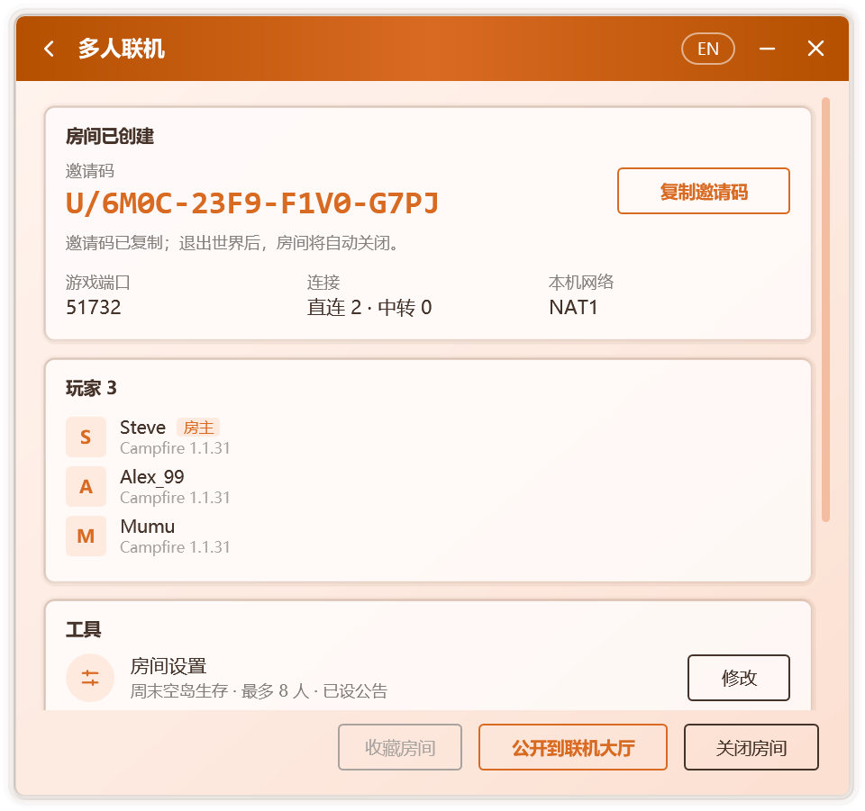

# 創建與加入房間

Campfire 嘅多人聯機以**房間**為單位。房主創建房間並進入單人世界，Campfire 將其對局域網開放；好友憑房主提供嘅邀請碼，或喺[聯機大廳](./lobby)中搵到房間加入。加入後，房主嘅世界會出依家好友遊戲嘅局域網世界列表中，進入方式與真實嘅局域網遊戲完全相同。

整個過程無需公網 IP、端口映射或專用服務器，都唔好求雙方使用同一款啟動器。

## 開始之前

- 雙方嘅遊戲版本須一致。
- 創建或加入房間前須設置玩家名稱，未設置時 Campfire 會直接彈出輸入框。
- 雙方均需運行 Campfire，並喺遊戲期間保持其開啟。關閉窗口後，Campfire 可以繼續喺通知區域中運行，見[個性化](./personalization#通知區域)。
- 第一次聯機時，Campfire 會下載約 14 MB 嘅聯機組件，並逐個文件校驗。Windows 防火牆可能詢問是否容許其訪問網絡，選擇 **容許** 有助於建立直連。

## 房主：創建房間

1. 喺 **主頁** 按 **創建房間**。
2. 啟動遊戲，進入要分享嘅單人世界。Campfire 會自動將其對局域網開放，見[自動對局域網開放](#自動對局域網開放)。冇辦法自動開放時，請手動開放：
   - 喺遊戲菜單中按 Esc，選擇 **對局域網開放**，再按 **創建局域網世界**；
   - 較新嘅遊戲版本中冇該按鈕，請改為喺 **世界選項** 嘅 **多人遊戲** 中將局域網設為開啟。
3. Campfire 會自動發現已開放嘅世界，完成後續步驟：

   | 步驟 | 說明 |
   | --- | --- |
   | 準備聯機組件 | 首次使用時下載並校驗，之後直接使用本地副本 |
   | 等待對局域網開放 | 持續檢測本機喺度監聽嘅遊戲端口，無需手動填寫 |
   | 創建房間 | 生成房間與邀請碼 |
   | 連接聯機網絡 | 連接聯機節點，供好友發現本房間 |

4. 房間創建後，邀請碼將自動複製到剪貼板，發送畀好友就可以；亦可按 **公開到聯機大廳**，使房間為更多玩家所見，見[公開房間](./lobby#公開房間)。

  

### 自動對局域網開放

創建房間後，一旦進入單人世界，Campfire 即代為執行 **對局域網開放**，並沿用世界原有啲遊戲模式與作弊設置。開放完成後，多人聯機頁面將顯示所用端口。

該功能由附加到遊戲中嘅組件實現，支持 1.7.2 及以上嘅原版，以及沿用官方名稱嘅加載器。使用 Fabric 或 Quilt，或遊戲所用嘅 Java 運行時唔提供附加功能時，需手動開放。若數秒後流程仍未繼續，請按上述步驟手動開放。

如唔需要此功能，可喺聯機設置中關閉 **創建房間時自動對局域網開放**。

房間開啟期間，多人聯機頁面會顯示邀請碼、遊戲端口、本機網絡類型、當前嘅直連與中轉數量、房間內嘅玩家列表，以及包含房間設置、存檔備份、語音、模組同步與聯機診斷嘅 **工具** 卡片，見[房間管理](./room#工具)。

開啟 **開房前備份存檔**（默認開啟）時，Campfire 會喺創建房間時將喺度遊玩嘅世界備份一份，見[存檔備份](./room#存檔備份)。

::: tip 手動指定端口
若 Campfire 遲遲未能發現世界，可按 **手動輸入端口**，填寫遊戲聊天欄中顯示嘅局域網端口號。喺本機運行嘅專用服務器亦能以同樣方式分享。
:::

::: info 房間何時關閉
房主退出世界或關閉局域網後，房間隨之關閉；亦可以喺多人聯機頁面按 **關閉房間**。關閉時，房間中嘅全部玩家都會斷開連接。

例外：開啟語音後為加載語音模組而重新啟動遊戲時，房間保持開啟，邀請碼唔變，見[語音聊天](./voice)。
:::

## 好友：加入房間

亦可喺 **主頁** 進入 **聯機大廳**，從公開房間中選擇加入，見[聯機大廳](./lobby)。

1. 複製房主發來嘅邀請碼。邀請碼嘅格式為 `U/XXXX-XXXX-XXXX-XXXX`，可以直接複製含有邀請碼嘅整段消息，Campfire 會自動識別其中嘅邀請碼。
2. 打開 Campfire。主頁檢測到剪貼板中嘅邀請碼後，會提示是否加入該房間；亦可以喺 **主頁** 按 **加入房間** 並粘貼。
3. Campfire 將依次連接聯機網絡、尋搵房主並進入房間。網絡限制較嚴時，尋搵房主所需嘅時間會更長。
4. 加入完成後，打開遊戲嘅 **多人遊戲** 頁面，喺列表底部嘅局域網世界中搵到房間條目，雙擊進入。

房間條目顯示房主設定嘅房間名稱，未設定時顯示為 **Campfire 聯機房間**，並附有在線人數與延遲。亦可以喺[聯機設置](./network#房間)嘅 **房間顯示名稱** 中改為自己想要嘅名稱。

::: warning 請從局域網世界列表進入
房主使用正版賬號開放局域網時，遊戲會校驗每位加入者嘅身份。離線賬號只有從局域網世界列表進入時先會被遊戲放行；通過「直接連接」或服務器條目輸入地址進入，會出現「無效會話」提示。
:::

加入後，多人聯機頁面會顯示本地服務器地址、延遲、連接方式與房間內嘅玩家。需要離開時按 **退出房間**。

## 遊戲內嘅房間信息

進入房主嘅世界後，Campfire 會喺遊戲中呈現房間狀態：

- **聊天欄**：每位玩家進入時顯示歡迎消息；房主設置咗[房間公告](./room#房間公告)時一併顯示，修改公告後在線玩家會收到新公告。
- **Tab 列表**：頁眉與頁腳實時顯示房主、在線人數與延遲，以及房間公告。
- **局域網世界列表**：房間條目顯示在線人數與延遲。

聊天欄與 Tab 列表中嘅信息由附加到房主遊戲中嘅一個小型組件從服務端直接發送，喺正版驗證與加密連接下同樣有效，房主本人亦能睇到。該組件覆蓋 1.7.2 及以上嘅全部正式版：1.14.4 至 1.21.11 依賴 Mojang 官方嘅名稱映射表，首次使用時自動下載並校驗；更早嘅版本使用 Campfire 內置嘅名稱表；26.1 起嘅版本無需映射表。

若房主所用嘅 Java 運行時唔提供附加功能，或遊戲環境經過 Fabric、Quilt 等模組加載器嘅重映射，Campfire 會自動退回僅喺局域網世界列表中顯示信息，遊戲連接本身唔受影響。原因記錄喺 `%LocalAppData%\Campfire\agent.log`。

## 最近房間與常用房間

Campfire 會自動記錄開過與加入過嘅房間。喺 **主頁** 按 **最近房間** 就可以查看：

- **常用房間**：按房間右側嘅星標就可以收藏，收藏嘅房間固定顯示喺上方；喺多人聯機頁面亦可按 **收藏房間**。
- **最近房間**：按時間列出最近用過嘅房間，標明係 **我開嘅** 定係 **加入嘅**。

按房間就可以再次進入。加入過嘅房間只有喺房主仍開住時先能再次進入；自己開過嘅房間按 **重新開房** 會沿用原來嘅邀請碼，已發畀朋友嘅邀請碼可以繼續使用。唔需要嘅記錄可以逐個刪除，或按 **清除記錄** 全部刪除。

## 托盤中嘅房間

開啟通知區域圖標後，房間狀態會同步呈依家圖標上：房間開啟期間火焰常亮。右鍵按圖標可以查看房間成員、複製邀請碼、創建或加入房間，以及退出 Campfire。

## 下一步

- [房間管理](./room)：工具卡片、房間設置與公告、存檔備份、聯機診斷、移出與拉黑。
- [模組同步](./mods)：令本機模組與房主保持一致。
- [語音聊天](./voice)：喺遊戲中與房間內嘅玩家語音交流。
- [網絡與隱私](./network)：直連與中轉、自定義節點、隱藏 IP 地址。
- [常見問題](./faq#多人聯機)：冇辦法加入、無效會話等問題嘅排查方法。
