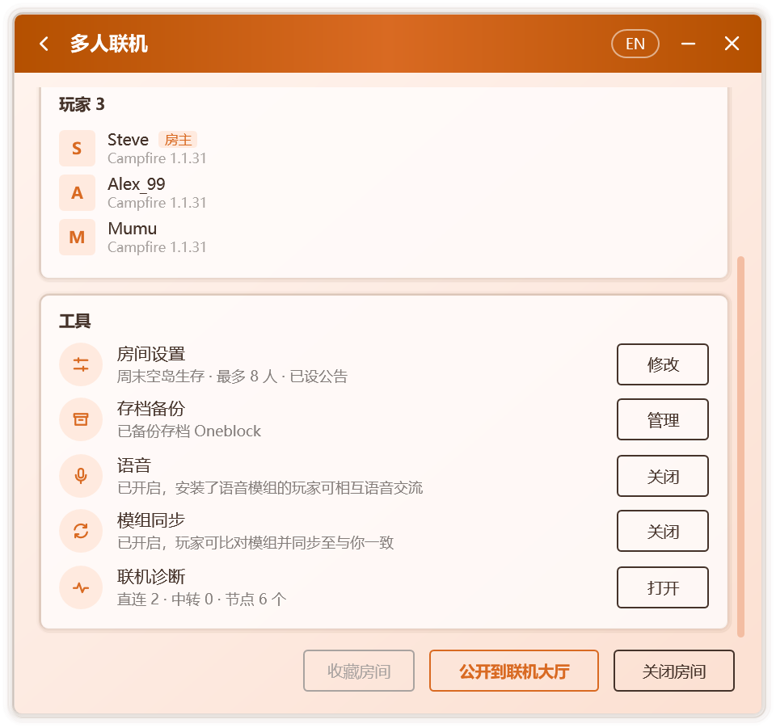
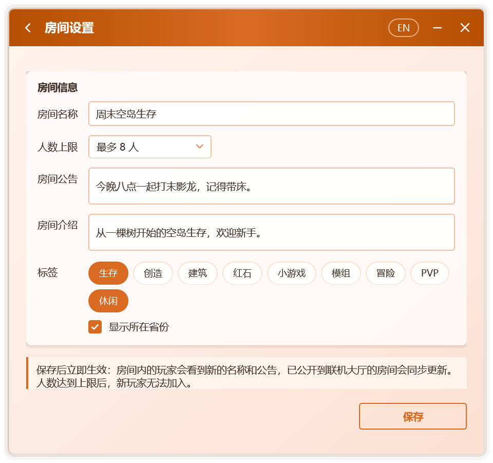
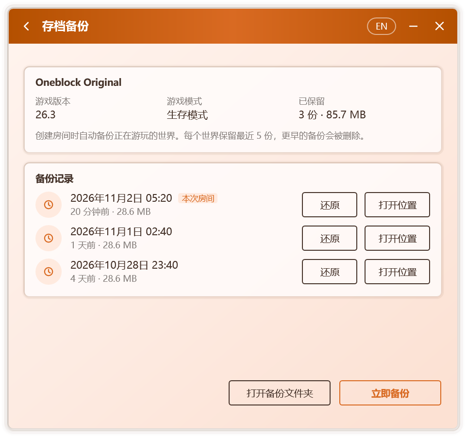

# 房間管理

## 工具

房間開啟後，多人聯機頁面嘅 **工具** 卡片集中咗房間嘅常用功能，每項各佔一欄，並喺右側顯示當前狀態：

  

| 工具 | 房主 | 玩家 |
| --- | --- | --- |
| **房間設置** | 修改房間名稱、人數上限、公告等，見[房間設置](#房間設置) | — |
| **存檔備份** | 查看與還原世界嘅備份，見[存檔備份](#存檔備份) | — |
| **語音** | 開啟或關閉房間語音，見[語音聊天](./voice) | 安裝語音模組 |
| **模組同步** | 開啟或關閉模組同步，見[模組同步](./mods) | 比對並同步模組 |
| **聯機診斷** | 檢查本機嘅聯機環境，見[聯機診斷](#聯機診斷) | 同左 |

## 房間設置

房主喺 **工具 › 房間設置** 中按 **修改**，就可以調整：

  

| 選項 | 說明 |
| --- | --- |
| **房間名稱** | 最多 24 個字。房間內嘅玩家可喺房間頁面睇到；公開到聯機大廳時同樣作為大廳中嘅名稱 |
| **人數上限** | 人數唔限，或 2 至 50 人。人數達到上限後，新玩家冇辦法加入，並會睇到「房間人數已滿」 |
| **房間公告** | 最多 100 個字，見[房間公告](#房間公告) |
| **房間介紹** | 最多 100 個字，喺聯機大廳嘅房間詳情中顯示 |
| **標籤** | 至多 3 個，喺聯機大廳中顯示 |
| **顯示所在省份** | 是否喺聯機大廳中顯示大致地區 |

按 **保存** 後立即生效：房間內嘅玩家會睇到新嘅名稱與公告，已公開到聯機大廳嘅房間亦會同步更新。

### 房間公告

房主設置公告後：

- 玩家進入世界時，聊天欄嘅歡迎消息中會顯示公告，Tab 列表嘅頁腳中亦會顯示；
- 房主修改公告後，已喺世界中嘅玩家會喺聊天欄收到新公告；
- 玩家嘅多人聯機頁面同樣顯示公告。

遊戲內嘅公告由附加到房主遊戲中嘅組件發送，其適用範圍與[遊戲內嘅房間信息](./multiplayer#遊戲內嘅房間信息)相同。

## 存檔備份

開啟 **設置 › 聯機 › 開房前備份存檔** 後（默認開啟），每次創建房間時，Campfire 會將喺度遊玩嘅世界壓縮保存一份。每個世界保留最近 5 份，更早嘅備份會被刪除；超過 2 GB 嘅世界唔備份。

喺 **工具 › 存檔備份** 中按 **管理**，可打開存檔備份頁面：

  

- 頁面上方顯示世界嘅名稱、遊戲版本、遊戲模式，以及已保留嘅份數與總大小；
- **備份記錄** 列出該世界嘅每一份備份及其時間與大小，當前房間開啟期間生成嘅備份標有 **本次房間**；
- **立即備份**：房間開啟期間隨時再備份一次；
- **還原**：將所選備份還原為一個新世界，放入房主遊戲嘅存檔文件夾，可喺單人遊戲列表中搵到。當前世界唔會被改動，同名世界已存在時會自動改用新名稱；
- **打開位置** 與 **打開備份文件夾**：喺資源管理器中查看備份文件。

備份保存在 `%LocalAppData%\Campfire\backups\worlds` 中。

## 聯機診斷

聯機診斷依次檢查以下項目，併為每一項畀出結論與處理建議：

| 項目 | 檢查內容 |
| --- | --- |
| 系統 | Windows 版本；Windows 7 是否已安裝聯機所需嘅更新 |
| 聯機組件 | 是否已下載，能否喺本機運行 |
| 玩家名稱 | 是否已設置 |
| 網絡連接 | 是否聯網，是否具備公網 IPv6 |
| 中轉服務器 | 可連通嘅服務器數量與最低延遲 |
| 中轉設置 | 是否容許中轉，是否隱藏咗 IP 地址 |
| 本地端口 | 設定嘅本地端口是否被其他程序佔用 |
| 遊戲 | 是否檢測到運行中嘅遊戲 |
| 局域網世界 | 是否發現已對局域網開放嘅世界 |

可喺 **工具 › 聯機診斷**、**設置 › 聯機**，以及連接超時嘅提示中打開。處理後按 **重新檢測** 就可以再次檢查。

## 成員列表

多人聯機頁面會列出房間中嘅全部玩家，房主與本人分別帶有 **房主** 與 **你** 標記。每位成員顯示：

- **玩家名稱**：默認讀取遊戲中嘅玩家名稱，亦可喺聯機設置中自定義。
- **頭像**：正版玩家顯示其皮膚嘅面部與帽子層，其他玩家顯示名稱首字母。皮膚通過 Mojang 嘅公開接口獲取，並喺本地緩存一天。
- **客戶端**：對方使用嘅聯機客戶端與版本。對方關閉「向其他玩家顯示軟件版本」後，僅顯示客戶端名稱。

與房主之間嘅連接方式（直連或中轉及所用協議）同延遲顯示喺頁面上方嘅房間信息中。

## 移出與拉黑

房主可以對訪客執行以下操作：

| 操作 | 效果 |
| --- | --- |
| **移出** | 對方立即離開世界，一分鐘內冇辦法重新加入 |
| **拉黑** | 對方立即離開世界，並且之後冇辦法再加入你創建嘅任何房間 |

被移出或拉黑嘅玩家會喺遊戲中睇到相應提示，Campfire 中亦會顯示失敗原因。

呢一機制由房主一側嘅連接網關實現：訪客嘅遊戲連接先經過房主本機嘅網關，再到達世界。因此，即使訪客繞過客戶端界面，都冇辦法進入已將其拒之門外嘅房間。

### 管理黑名單

黑名單保存在房主嘅電腦上，與房間無關，對之後創建嘅所有房間均生效。喺 **設置 › 聯機 › 黑名單** 中可以查看被拉黑嘅玩家與拉黑時間，並逐個解除。

## 關閉與退出

- **房主**：按 **關閉房間**，或直接退出世界。若房間中仍有其他玩家，Campfire 會先請求確認。開啟語音後為加載模組而重新啟動遊戲時，房間會保持開啟，見[語音聊天](./voice)。
- **訪客**：按 **退出房間**。
- **退出 Campfire**：房間會隨之結束。若開啟咗「關閉窗口時保留喺通知區域」，按窗口嘅關閉按鈕只會隱藏窗口，房間保持開啟；需要退出時，請使用通知區域圖標的菜單。

Campfire 退出時，聯機組件進程會被一併終止，即使 Campfire 意外崩潰都唔會喺後台殘留。

## 玩家名稱與賬號

創建或加入房間前須設置玩家名稱，未設置時 Campfire 會直接彈出輸入框；玩家名稱同樣會經過違禁詞檢查。

Campfire 會從運行中游戲嘅啟動參數中讀取玩家名稱、UUID 與賬號類型，因此無論使用哪款啟動器都能正確識別。該過程只讀取上述三項信息，**唔會讀取或保存任何登錄憑據**。

新版 Minecraft 嘅玩家名稱僅容許英文字母、數字與下劃線。若遊戲中嘅名稱含有其他字符，Campfire 會喺加入前畀出提示，因為咁樣嘅名稱冇辦法進入世界。

如唔希望讀取遊戲賬號，可喺聯機設置中關閉「讀取遊戲中嘅玩家名稱與賬號類型」，並手動填寫玩家名稱。
