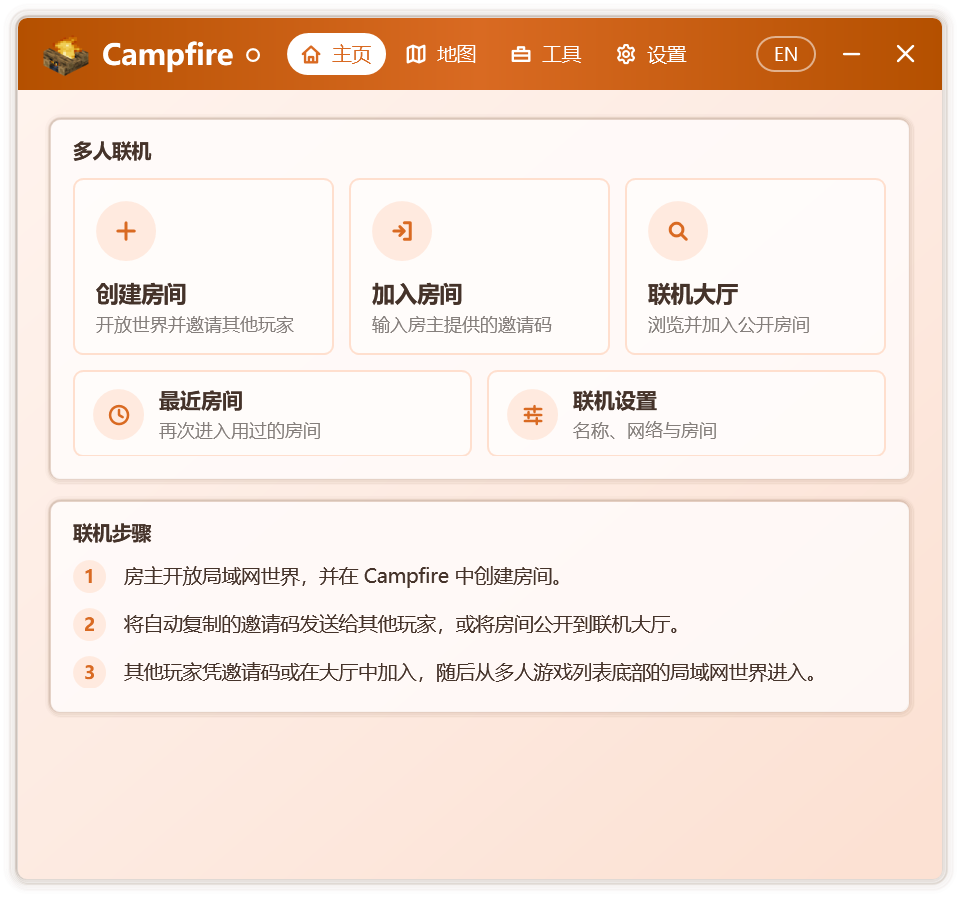

# 認識 Campfire

Campfire 係一款面向 Minecraft Java 版玩家嘅 Windows 工具箱。佢將遠程多人遊戲、聯機大廳、地圖與啟動器修復整合於同一程序之中：無需安裝，唔寫入註冊表，從 Windows 7 SP1 到 Windows 11 均可運行。

Campfire 另有[Android 版](./android)，同桌面版使用同一套聯機協議，手機同電腦上嘅玩家可以進入同一個房間。

## 設計理念

**專注。** Campfire 只做少數幾件事，併力求將每一件做得足夠細緻。程序本體唔依賴安裝器，聯機所需嘅網絡組件僅喺首次使用時按需下載，並逐個文件校驗。

**與啟動器無關。** 多人聯機直接作用於喺度運行嘅遊戲，而非某一款啟動器。無論使用何種啟動器、何種賬號類型啟動遊戲，均可創建或加入房間。採用相同聯機協議嘅其他客戶端，亦能與 Campfire 用戶進入同一房間。

**透明可驗證。** Campfire 嘅全部源代碼公開。對啟動器嘅每一處修改都限定喺明確嘅方法之內，於內存中校驗無誤後才寫入磁盤，並始終保留可還原嘅備份。遠程內容僅限文字與列表數據，冇辦法更改設置或運行程序，全部聯網行為見[聯網與安全](./security)。

## 主要功能

### 多人聯機

房主創建房間並進入單人世界後，Campfire 會自動將其對局域網開放並生成邀請碼。好友加入房間後，房主嘅世界會出依家其遊戲嘅局域網世界列表中，雙擊就可以進入，體驗與身處同一局域網無異。

- 優先喺玩家之間建立點對點直連，網絡條件受限時可經中轉節點傳輸。
- 房間可公開至聯機大廳，供更多玩家發現與加入。
- 進入世界後，聊天欄呈現歡迎消息，Tab 列表嘅頁眉與頁腳實時顯示房主、在線人數與延遲，覆蓋 1.7.2 及以上嘅全部正式版。
- 房主可隨時修改房間名稱、人數上限與公告，查看成員、移出或拉黑訪客；訪客可選擇隱藏自己嘅 IP 地址。
- 加入房間後可一鍵將本機模組同步至與房主一致；房主開啟語音後，雙方可喺遊戲中語音交流。
- 開房前自動備份存檔，可隨時將備份還原為新世界；最近房間與常用房間可一鍵再次進入。
- 聯機診斷逐項檢查聯機環境，並畀出處理建議。

詳見[創建與加入房間](./multiplayer)、[聯機大廳](./lobby)、[房間管理](./room)、[模組同步](./mods)與[語音聊天](./voice)。

### 地圖

- 瀏覽、檢索並下載 CurseForge 上嘅地圖。
- 導入時識別地圖嘅遊戲版本，置入本機可以開啟佢嘅版本，並提示升級風險；導入後就可以創建房間。

詳見[地圖](./maps)。

### 工具

- **啟動器修復**：恢復被啟動器停用嘅遊戲下載、加載器安裝與整合包安裝，並可解除按地區關閉嘅下載功能。詳見[啟動器修復](./launcher-repair)。
- **JRE 啟用工具**：解除啟動器對 JRE 嘅默認停用，使 JRE 與 JDK 一樣可用於啟動遊戲。詳見[JRE 啟用工具](./jre)。

### 體驗

- 淺色與深色模式，自選主題色、Windows 主題色或由桌面壁紙自動取色，並提供六種配色風格。
- 頁面切換、彈窗與控件均配有過渡動效，可隨時關閉。
- 通知區域圖標實時反映聯機狀態，關閉窗口後房間仍可喺後台保持。
- 簡體中文、繁體中文、粵語同 English 界面，默認跟隨系統語言。

## 界面概覽

  

Campfire 嘅窗口分為四個標籤頁：

| 標籤頁 | 內容 |
| --- | --- |
| 主頁 | 創建房間、加入房間、聯機大廳、最近房間與聯機設置入口，當前房間狀態與聯機步驟 |
| 地圖 | CurseForge 地圖瀏覽與下載，導入本地地圖 |
| 工具 | 啟動器修復工具、JRE 啟用工具；檢測到可修復嘅啟動器時，標籤旁顯示紅點 |
| 設置 | 個性化、常規、聯機、關於與開源許可 |

首次啟動時，Campfire 會通過一段簡短嘅新手引導介紹上述區域；之後可喺 **設置 › 關於** 中再次查看。

## 開源與許可

Campfire 係開源免費嘅社區項目，源代碼託管於 [GitHub](https://github.com/Xocio/Campfire)。程序所使用嘅第三方組件及其許可，可喺 **設置 › 開源許可** 中查看。Campfire 與 Mojang Studios 及微軟均無關聯。
