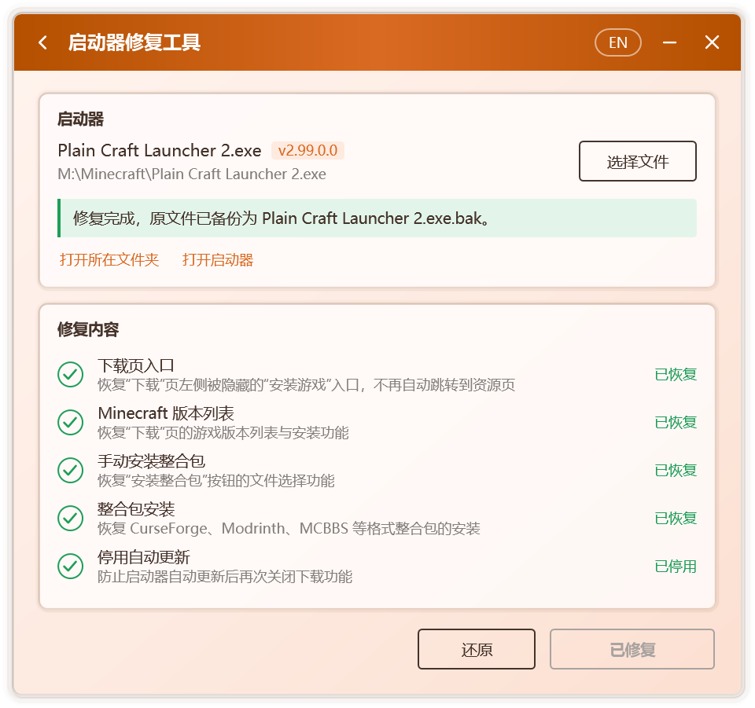

# 啟動器修復

部分啟動器在新版本中停用了遊戲下載、載入器安裝與整合包安裝，或按所在地區關閉了這些功能。啟動器修復工具可以恢復這些功能，同時保證修改範圍最小、過程可驗證、結果可還原。

## 可恢復的功能

| 專案 | 說明 |
| --- | --- |
| **Minecraft 版本列表** | 恢復「下載」頁的遊戲版本列表，以及遊戲與 Mod 載入器的安裝 |
| **手動安裝整合包** | 恢復「安裝整合包」按鈕的檔案選擇功能 |
| **整合包安裝** | 恢復 CurseForge、Modrinth、MCBBS、HMCL、MMC 等格式整合包的安裝 |
| **地區限制** | 解除按地區關閉的下載、安裝與檔案補全 |
| **停用自動更新** | 防止啟動器自動更新後再次關閉上述功能 |

Campfire 會先檢測所選啟動器，只列出與其相關的專案，並逐項標明 **待修復**、**已恢復**、**無需修復** 等狀態。

## 修復步驟

1. **關閉啟動器。** 啟動器執行時其程式檔案被佔用，Campfire 會提示先將其關閉。
2. 開啟 Campfire，在 **工具** 中選擇 **啟動器修復工具**。
3. 選擇啟動器。Campfire 會自動查詢自身所在資料夾中的啟動器；也可以點選 **選擇檔案**，或直接將啟動器檔案拖入視窗。
4. 檢視檢測結果與 **修復內容**，確認後點擊 **一鍵修復**。
5. 修復完成後，點選 **開啟啟動器** 即可直接使用。

  

::: tip 位於受保護資料夾的啟動器
若啟動器位於 `Program Files` 等受保護的資料夾，寫入時可能被系統拒絕。此時請以管理員身份執行 Campfire。
:::

## 檢測結果

| 提示 | 含義 |
| --- | --- |
| 已關閉下載功能，可以一鍵修復 | 檢測到受影響的版本，可直接修復 |
| 已按地區關閉下載功能，可以一鍵修復 | 檢測到地區限制，可直接解除 |
| 下載功能已恢復 | 該啟動器此前已由 Campfire 修復 |
| 下載功能正常，無需修復 | 該版本不受影響，Campfire 不會做任何修改 |
| 程式碼結構與已知版本不同，暫不支援修復 | 無法確認修改位置，Campfire 不會做任何修改 |

只要無法確定修改是安全的，Campfire 就不會寫入檔案。

## 備份與還原

修復前的啟動器會以 `.bak` 為字尾儲存在同一資料夾中，例如 `啟動器.exe.bak`。需要恢復時，可任選一種方式：

- 在啟動器修復工具中點選 **還原**。Campfire 會先確認備份檔案是受支援的啟動器，再執行還原。
- 手動刪除修復後的啟動器，再將 `.bak` 檔案改回原名。

## 關於自動更新

為防止啟動器在自動更新後再次關閉上述功能，修復會同時停用啟動器的自動更新。需要升級啟動器時：

1. 手動下載新版啟動器並替換舊檔案；
2. 再次執行 Campfire，檢測新版是否需要修復。

## 安全性

- **最小修改。** 只改動與上述功能直接相關的少數方法，不新增任何連網行為。
- **精確定位。** 修改位置依據方法名稱與程式碼特徵確定，而非固定的檔案偏移，因此啟動器的後續小版本通常無需更新 Campfire 即可修復。
- **先驗證後寫入。** 修復結果先在記憶體中生成，重新載入並逐項校驗通過後才寫入磁碟；任一步驟失敗，原檔案都保持不變。
- **僅在本機進行。** 修復過程不上傳、不下載任何檔案。

技術細節見[工作原理](./how-it-works#啟動器修復)。
