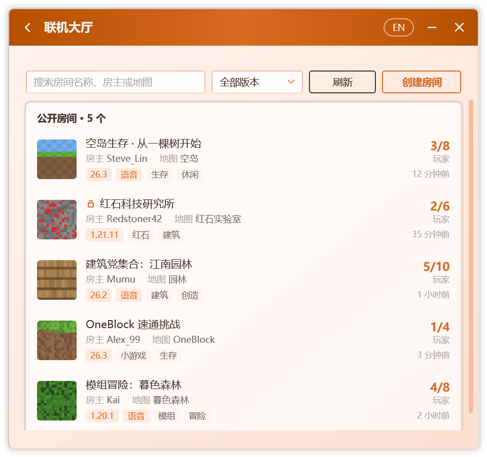

# 連線大廳

連線大廳彙集了 Campfire 使用者公開的房間。玩家可在此發現正在進行的世界並加入其中；房主亦可將自己的房間公開至大廳，迎接更多同伴。

在 **主頁** 點選 **連線大廳** 即可進入。

  

::: info
連線大廳由 Campfire 服務提供，僅正式版可用。從原始碼構建的版本不提供大廳，邀請碼連線不受影響。
:::

## 瀏覽與加入

大廳列出當前全部公開房間，每個房間顯示以下資訊：

| 資訊 | 說明 |
| --- | --- |
| 圖示與名稱 | 由房主設定 |
| 房主與地圖 | 房主的玩家名稱與世界名稱 |
| 遊戲版本與標籤 | 加入前請確認遊戲版本一致；提供語音的房間帶有 **語音** 標籤 |
| 玩家 | 當前人數與人數上限 |
| 開啟時間 | 房間公開至今的時長 |

頁面頂部支援按房間名稱、房主或地圖檢索，並可按遊戲版本篩選。列表會定期自動重新整理，亦可點選 **重新整理** 立即更新。

選擇房間即進入 **房間詳情**，其中列出房間介紹、遊戲版本、大致地區與開啟時間；房間提供語音時也會註明，加入後在房間頁面安裝語音模組即可使用，見[語音聊天](./voice)。點選 **加入房間** 後，Campfire 自大廳領取該房間的邀請碼並完成加入，其後的流程與憑邀請碼加入完全一致，見[建立與加入房間](./multiplayer)。

::: tip 設有密碼的房間
標有 **需要密碼** 的房間，需輸入房主提供的密碼方可加入。密碼由伺服器校驗，驗證通過後才會發放邀請碼。
:::

::: warning 加入前請確認遊戲版本
請以與房間相同的遊戲版本啟動遊戲。加入後，從多人遊戲列表底部的區域網世界進入。
:::

已處於房間中時無法加入其他房間，請先離開或關閉當前房間。

## 公開房間

1. 按照[建立與加入房間](./multiplayer)中的步驟建立房間。
2. 房間就緒後，在多人連線頁面點選 **公開到連線大廳**。
3. 填寫公開資訊：

   | 選項 | 說明 |
   | --- | --- |
   | **房間名稱** | 必填，預設為「玩家名 的世界」。含有不宜公開的內容時無法提交 |
   | **房間圖示** | 可選。可選用 PNG 或 JPG 圖片，或直接使用地圖自帶的圖示 |
   | **房間介紹** | 可選，最多 100 個字，說說玩法、規則或歡迎的玩家。同樣會經過違禁詞檢查 |
   | **房間密碼** | 可選。留空即任何人均可加入 |
   | **標籤** | 至多 3 個，例如生存、建築、紅石、小遊戲 |
   | **顯示所在省份** | 是否在大廳中顯示伺服器推斷的大致地區 |

4. 點選 **公開房間**。

遊戲版本與世界名稱由 Campfire 從執行中的遊戲讀取，無需手動填寫；讀取失敗時，房間仍可公開。

房間公開期間，多人連線頁面左下角顯示其公開狀態，Campfire 每隔數分鐘向大廳更新一次人數與是否提供語音。點選 **取消公開** 可隨時撤下；關閉房間時亦會自動取消公開。

公開後仍可在 **工具 › 房間設定** 中修改房間名稱、人數上限、介紹、標籤與是否顯示所在省份，儲存後大廳中的資訊隨即更新，見[房間設定](./room#房間設定)。

::: warning 關於 IP 地址
與你直連的玩家可以獲知你的 IP 地址。如有顧慮，可在連線設定中開啟[隱藏我的 IP 地址](./network#隱藏我的-ip-地址)。房間公開後，你仍可隨時[移出或拉黑](./room)任何玩家。
:::

## 舉報

如認為某個房間的名稱或內容不當，可在房間詳情中點選 **舉報**。經多名玩家舉報後，該房間將自大廳隱藏。

## 公開時的提示

| 提示 | 原因與處理 |
| --- | --- |
| 房間名稱含有不允許公開的內容 | 修改房間名稱後重試 |
| 房間介紹含有不允許公開的內容 | 修改房間介紹後重試 |
| 該房間已由其他玩家公開到連線大廳 | 同一邀請碼僅能公開一次 |
| 操作過於頻繁 | 同一網路中公開的房間過多，或操作過於頻繁，請稍後重試 |
| 連線大廳的房間已滿 | 請稍後重試 |
| 當前版本無法公開房間 | 請先更新 Campfire |
| 房間因多名玩家舉報，已從大廳隱藏 | 同一邀請碼在一段時間內無法再次公開 |

## 隱私

僅當你將房間公開至大廳時，Campfire 才會傳送房間資訊，包括房間名稱、介紹、邀請碼、玩家名稱、遊戲版本、地圖名稱、標籤、人數與是否提供語音，以及一個大廳專用的隨機編號。該編號與連線裝置標識、統計標識均無關聯。

伺服器僅儲存房間密碼的摘要，IP 地址亦僅以加鹽摘要的形式儲存，用於限制釋出頻率與處理違規。取消公開或關閉房間後，房間即刻自大廳移除，相關記錄於一天內刪除。完整說明見[連網與安全](./security#連線大廳)。
