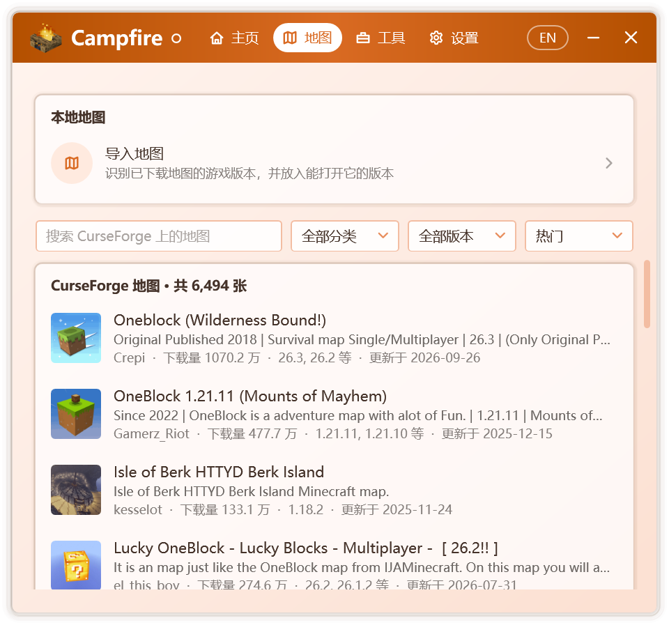
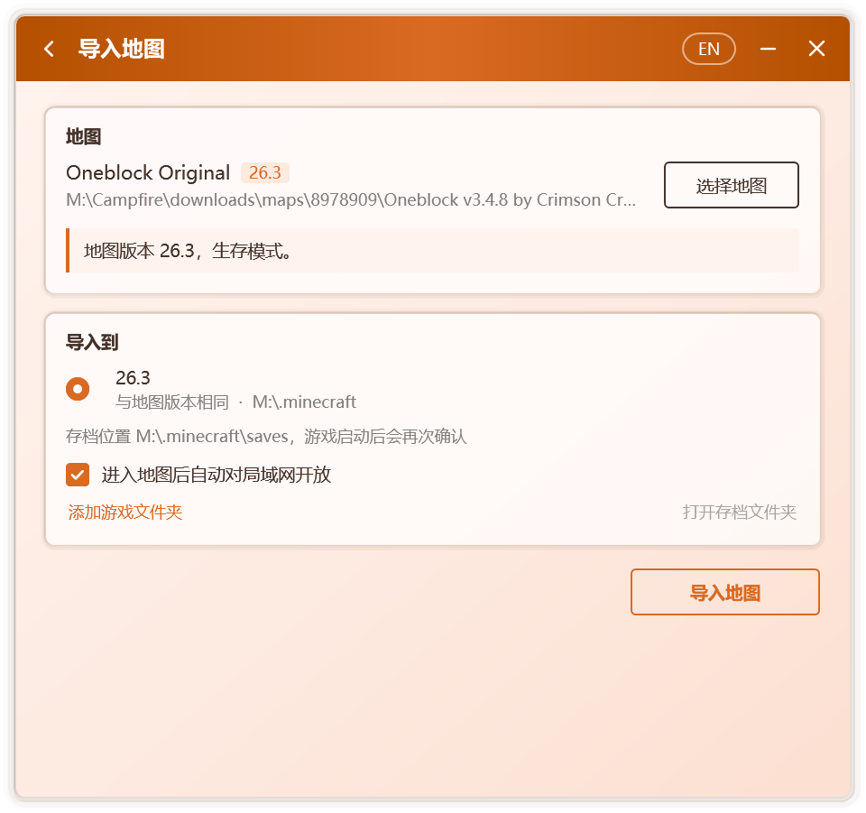

# 地圖

**地圖** 標籤頁提供 CurseForge 地圖的瀏覽與下載，並可匯入本機已有的地圖。匯入時，Campfire 會識別地圖的遊戲版本，將其置入本機能夠開啟它的版本；匯入完成後即可建立房間，與好友共同遊玩。

## 瀏覽線上地圖

  

標籤頁中列出 CurseForge 上的 Java 版地圖，支援：

- 按名稱檢索；
- 按分類篩選，包括冒險、建築、小遊戲、跑酷、解謎、生存與模組地圖；
- 按遊戲版本篩選；
- 按熱門、下載量、更新時間、釋出時間或名稱排序。

列表隨滾動自動載入更多地圖。

::: info
線上地圖由 Campfire 服務提供，僅正式版可用。服務暫不可用時，或使用從原始碼構建的版本時，仍可匯入本機已有的地圖。
:::

## 下載並匯入

選擇一張地圖即進入 **地圖詳情**，其中包含介紹、下載量、更新時間與支援的遊戲版本。

1. 在 **選擇檔案** 中選定要下載的檔案。每個檔案均標註對應的遊戲版本；需要模組載入器的檔案會註明 **需要** 的載入器；本機已安裝對應版本時，會提示 **本機已安裝**。
2. 點選 **下載並匯入**。下載過程中可隨時取消。
3. 下載完成後自動進入匯入頁面，按[匯入地圖](#匯入地圖)繼續操作。

下載的檔案以 CurseForge 提供的校驗值核對，並在本機保留一週，再次匯入同一地圖時無需重複下載。

::: tip 僅限網站下載的地圖
部分作者僅允許在 CurseForge 網站下載其地圖。此時詳情頁顯示 **前往 CurseForge 下載**；在瀏覽器中下載後，將檔案拖入 Campfire 視窗即可匯入。
:::

## 匯入地圖

在 **地圖** 標籤頁的 **本地地圖** 中點選 **匯入地圖**，或將地圖檔案直接拖入 Campfire 視窗。

  

### 1. 選擇地圖

支援 zip 壓縮包、地圖資料夾，以及地圖資料夾中的 `level.dat` 檔案。Campfire 讀取地圖後顯示：

- 地圖的遊戲版本與遊戲模式，例如生存、創造或極限模式；
- 地圖所用的模組載入器與模組數量。未記錄版本的地圖，將依據模組資訊推斷版本；
- 壓縮包中包含多張地圖時，需選擇其中一張匯入。

以下情形會給出明確提示：

| 提示 | 說明 |
| --- | --- |
| 這是基岩版地圖 | Java 版無法開啟基岩版地圖 |
| 地圖不完整 | 缺少 `level.dat`，進入遊戲後將生成一個新世界 |
| `level.dat` 已損壞 | 存在遊戲留下的備份時，將改用備份 |
| 其中沒有找到地圖 | 所選檔案中不含地圖資料夾 |

### 2. 選擇目標版本

Campfire 查詢本機的遊戲資料夾，列出能夠開啟該地圖的版本，並逐一標註：

| 標註 | 含義 |
| --- | --- |
| 與地圖版本相同 | 最為穩妥的選擇 |
| 進入時地圖會升級到此版本 | 遊戲將自動升級地圖，原檔案不受影響 |
| 跨越 1.13 升級，命令與紅石可能失效 | 1.13 變更了地圖格式，命令方塊與紅石機關常因此失效 |
| 無法確認能否開啟 | 地圖版本無法識別時顯示 |
| 未安裝某個載入器 | 地圖使用了模組，但該版本未安裝對應的載入器 |

選擇跨越 1.13 升級或缺少載入器的版本時，Campfire 會再次確認。

Campfire 會查詢預設的 `.minecraft` 資料夾、啟動器旁的 `.minecraft` 資料夾，以及啟動器設定中記錄的遊戲資料夾。若未找到所用的資料夾，可點選 **新增遊戲資料夾**，選擇 `.minecraft` 資料夾或其中的 `versions` 資料夾。

每個版本下方顯示地圖將置入的存檔位置。啟用版本隔離的啟動器會將存檔儲存在版本資料夾中；遊戲啟動後，Campfire 依據執行中的遊戲再次確認存檔位置，如有不同，將自動遷移地圖。

### 3. 匯入

點選 **匯入地圖**。匯入的是一份副本，原檔案不受影響；磁碟空間不足時，Campfire 會提示所需的空間。

匯入完成後：

- 點選 **開啟存檔資料夾**，檢視已匯入的地圖；
- 點選 **建立房間**，邀請好友共同遊玩；
- 以啟動器啟動對應版本，在單人遊戲中開啟該地圖。匯入頁面中的 **進入地圖後自動對區域網開放** 預設啟用，Campfire 將在你進入地圖後自動對區域網開放，見[自動對區域網開放](./multiplayer#自動對區域網開放)。所選版本不支援時，需在遊戲中手動開放。

## 資料位置

| 路徑 | 內容 |
| --- | --- |
| `%LocalAppData%\Campfire\downloads\maps\` | 下載的地圖檔案，一週未使用後自動刪除 |

已匯入的地圖儲存在遊戲的存檔資料夾中，與 Campfire 相互獨立，解除安裝 Campfire 不會影響它們。
