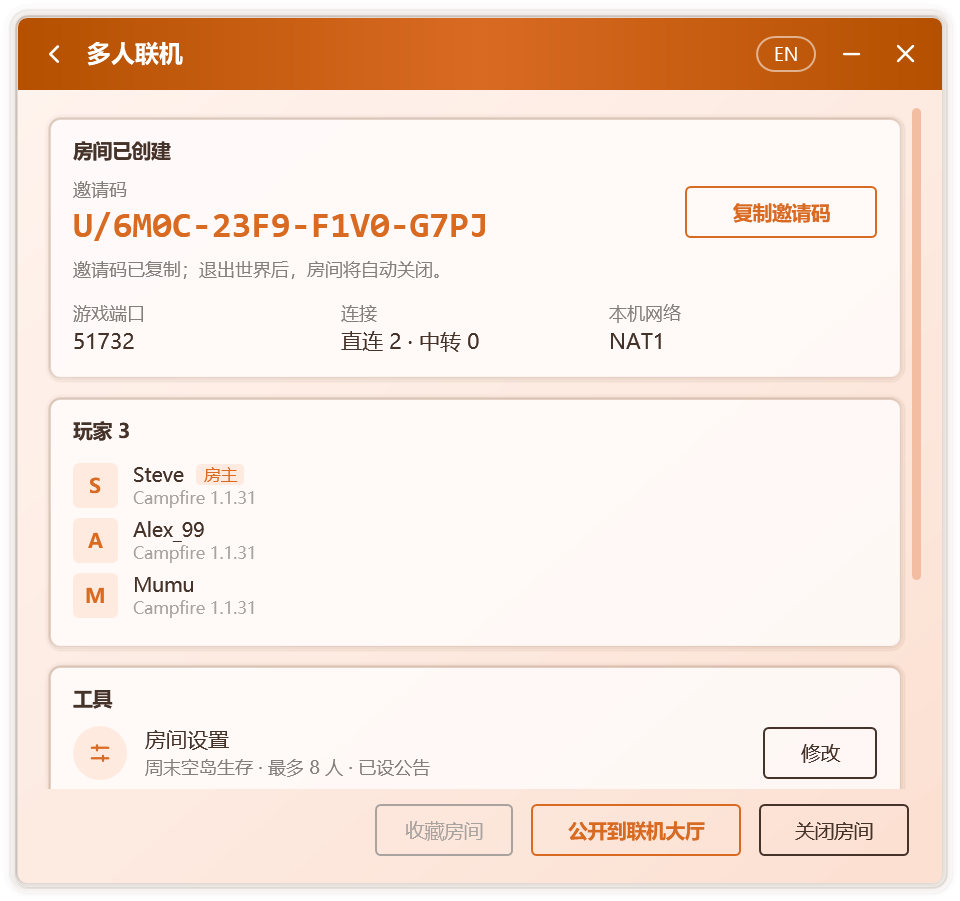

# 建立與加入房間

Campfire 的多人連線以**房間**為單位。房主建立房間並進入單人世界，Campfire 將其對區域網開放；好友憑房主提供的邀請碼，或在[連線大廳](./lobby)中找到房間加入。加入後，房主的世界會出現在好友遊戲的區域網世界列表中，進入方式與真實的區域網遊戲完全相同。

整個過程無需公網 IP、埠對映或專用伺服器，也不要求雙方使用同一款啟動器。

## 開始之前

- 雙方的遊戲版本須一致。
- 建立或加入房間前須設定玩家名稱，未設定時 Campfire 會直接彈出輸入框。
- 雙方均需執行 Campfire，並在遊戲期間保持其開啟。關閉視窗後，Campfire 可以繼續在通知區域中執行，見[個性化](./personalization#通知區域)。
- 第一次連線時，Campfire 會下載約 14 MB 的連線元件，並逐個檔案校驗。Windows 防火牆可能詢問是否允許其訪問網路，選擇 **允許** 有助於建立直連。

## 房主：建立房間

1. 在 **主頁** 點選 **建立房間**。
2. 啟動遊戲，進入要分享的單人世界。Campfire 會自動將其對區域網開放，見[自動對區域網開放](#自動對區域網開放)。無法自動開放時，請手動開放：
   - 在遊戲選單中按 Esc，選擇 **對區域網開放**，再點選 **建立區域網世界**；
   - 較新的遊戲版本中沒有該按鈕，請改為在 **世界選項** 的 **多人遊戲** 中將區域網設為開啟。
3. Campfire 會自動發現已開放的世界，完成後續步驟：

   | 步驟 | 說明 |
   | --- | --- |
   | 準備連線元件 | 首次使用時下載並校驗，之後直接使用本地副本 |
   | 等待對區域網開放 | 持續檢測本機正在監聽的遊戲埠，無需手動填寫 |
   | 建立房間 | 生成房間與邀請碼 |
   | 連線連線網路 | 連線連線節點，供好友發現本房間 |

4. 房間建立後，邀請碼將自動複製到剪貼簿，傳送給好友即可；亦可點選 **公開到連線大廳**，使房間為更多玩家所見，見[公開房間](./lobby#公開房間)。

  

### 自動對區域網開放

建立房間後，一旦進入單人世界，Campfire 即代為執行 **對區域網開放**，並沿用世界原有的遊戲模式與作弊設定。開放完成後，多人連線頁面將顯示所用埠。

該功能由附加到遊戲中的元件實現，支援 1.7.2 及以上的原版，以及沿用官方名稱的載入器。使用 Fabric 或 Quilt，或遊戲所用的 Java 執行時不提供附加功能時，需手動開放。若數秒後流程仍未繼續，請按上述步驟手動開放。

如不需要此功能，可在連線設定中關閉 **建立房間時自動對區域網開放**。

房間開啟期間，多人連線頁面會顯示邀請碼、遊戲埠、本機網路型別、當前的直連與中轉數量、房間內的玩家列表，以及包含房間設定、存檔備份、語音、模組同步與連線診斷的 **工具** 卡片，見[房間管理](./room#工具)。

開啟 **開房前備份存檔**（預設開啟）時，Campfire 會在建立房間時把正在遊玩的世界備份一份，見[存檔備份](./room#存檔備份)。

::: tip 手動指定埠
若 Campfire 遲遲未能發現世界，可點選 **手動輸入埠**，填寫遊戲聊天欄中顯示的區域網埠號。在本機執行的專用伺服器也能以同樣方式分享。
:::

::: info 房間何時關閉
房主退出世界或關閉區域網後，房間隨之關閉；也可以在多人連線頁面點選 **關閉房間**。關閉時，房間中的全部玩家都會斷開連線。

例外：開啟語音後為載入語音模組而重新啟動遊戲時，房間保持開啟，邀請碼不變，見[語音聊天](./voice)。
:::

## 好友：加入房間

亦可在 **主頁** 進入 **連線大廳**，從公開房間中選擇加入，見[連線大廳](./lobby)。

1. 複製房主發來的邀請碼。邀請碼的格式為 `U/XXXX-XXXX-XXXX-XXXX`，可以直接複製含有邀請碼的整段訊息，Campfire 會自動識別其中的邀請碼。
2. 開啟 Campfire。主頁檢測到剪貼簿中的邀請碼後，會提示是否加入該房間；也可以在 **主頁** 點選 **加入房間** 並貼上。
3. Campfire 將依次連線連線網路、尋找房主並進入房間。網路限制較嚴時，尋找房主所需的時間會更長。
4. 加入完成後，開啟遊戲的 **多人遊戲** 頁面，在列表底部的區域網世界中找到房間條目，雙擊進入。

房間條目顯示房主設定的房間名稱，未設定時顯示為 **Campfire 連線房間**，並附有線上人數與延遲。也可以在[連線設定](./network#房間)的 **房間顯示名稱** 中改為自己想要的名稱。

::: warning 請從區域網世界列表進入
房主使用正版賬號開放區域網時，遊戲會校驗每位加入者的身份。離線賬號只有從區域網世界列表進入時才會被遊戲放行；通過「直接連線」或伺服器條目輸入地址進入，會出現「無效會話」提示。
:::

加入後，多人連線頁面會顯示本地伺服器地址、延遲、連線方式與房間內的玩家。需要離開時點選 **退出房間**。

## 遊戲內的房間資訊

進入房主的世界後，Campfire 會在遊戲中呈現房間狀態：

- **聊天欄**：每位玩家進入時顯示歡迎訊息；房主設定了[房間公告](./room#房間公告)時一併顯示，修改公告後線上玩家會收到新公告。
- **Tab 列表**：頁首與頁尾即時顯示房主、線上人數與延遲，以及房間公告。
- **區域網世界列表**：房間條目顯示線上人數與延遲。

聊天欄與 Tab 列表中的資訊由附加到房主遊戲中的一個小型元件從服務端直接傳送，在正版驗證與加密連線下同樣有效，房主本人也能看到。該元件覆蓋 1.7.2 及以上的全部正式版：1.14.4 至 1.21.11 依賴 Mojang 官方的名稱對映表，首次使用時自動下載並校驗；更早的版本使用 Campfire 內建的名稱表；26.1 起的版本無需對映表。

若房主所用的 Java 執行時不提供附加功能，或遊戲環境經過 Fabric、Quilt 等模組載入器的重對映，Campfire 會自動退回僅在區域網世界列表中顯示資訊，遊戲連線本身不受影響。原因記錄在 `%LocalAppData%\Campfire\agent.log`。

## 最近房間與常用房間

Campfire 會自動記錄開過與加入過的房間。在 **主頁** 點選 **最近房間** 即可檢視：

- **常用房間**：點選房間右側的星標即可收藏，收藏的房間固定顯示在上方；在多人連線頁面也可點選 **收藏房間**。
- **最近房間**：按時間列出最近用過的房間，標明是 **我開的** 還是 **加入的**。

點選房間即可再次進入。加入過的房間只有在房主仍開著時才能再次進入；自己開過的房間點選 **重新開房** 會沿用原來的邀請碼，已發給朋友的邀請碼可以繼續使用。不需要的記錄可以逐個刪除，或點選 **清除記錄** 全部刪除。

## 托盤中的房間

開啟通知區域圖示後，房間狀態會同步呈現在圖示上：房間開啟期間火焰常亮。右鍵單擊圖示可以檢視房間成員、複製邀請碼、建立或加入房間，以及退出 Campfire。

## 下一步

- [房間管理](./room)：工具卡片、房間設定與公告、存檔備份、連線診斷、移出與拉黑。
- [模組同步](./mods)：讓本機模組與房主保持一致。
- [語音聊天](./voice)：在遊戲中與房間內的玩家語音交流。
- [網路與隱私](./network)：直連與中轉、自定義節點、隱藏 IP 地址。
- [常見問題](./faq#多人連線)：無法加入、無效會話等問題的排查方法。
