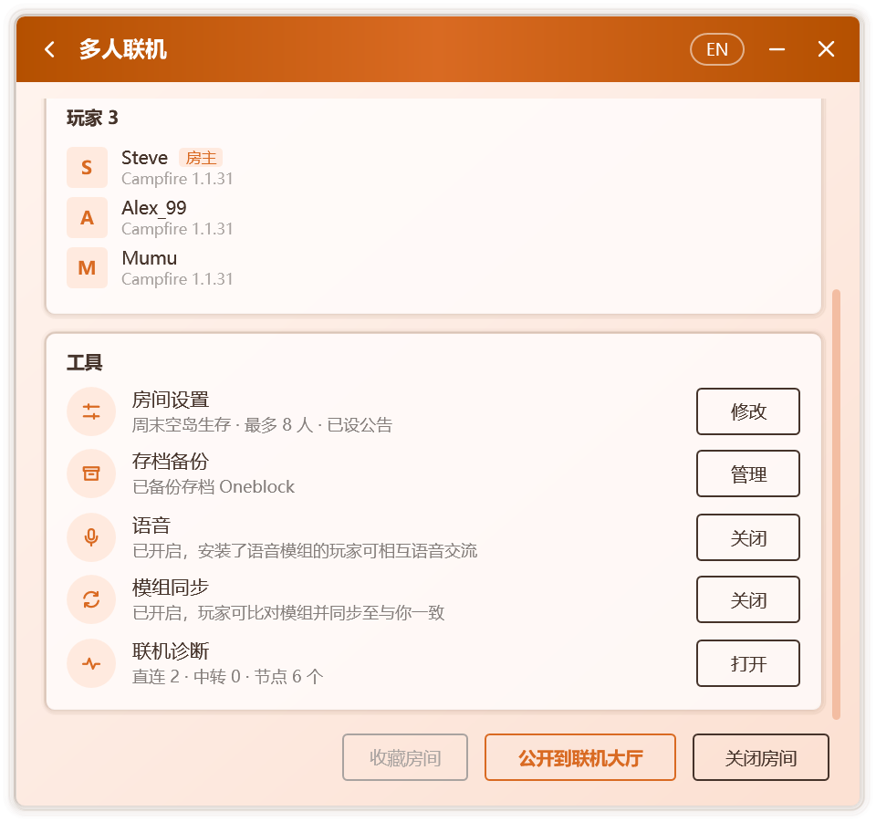
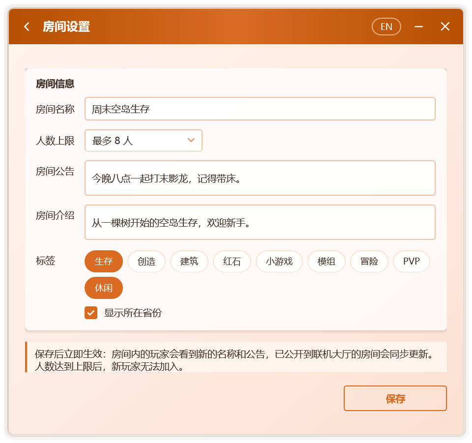
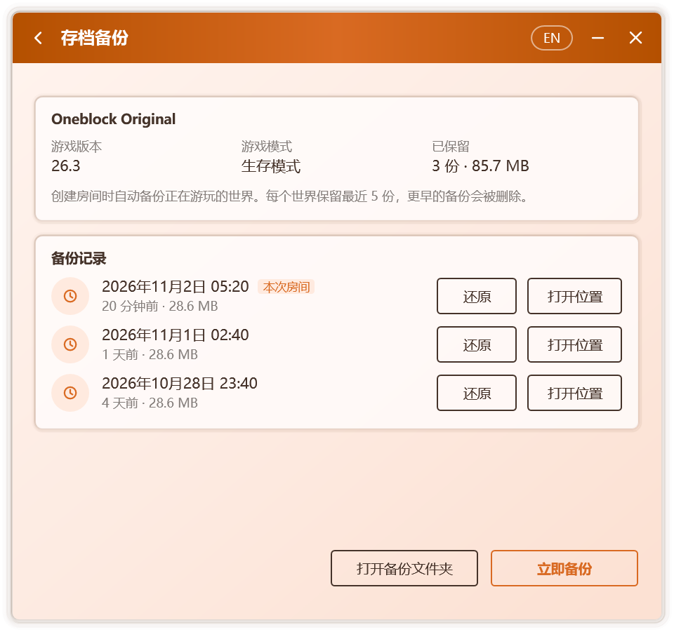

# 房間管理

## 工具

房間開啟後，多人連線頁面的 **工具** 卡片集中了房間的常用功能，每項各佔一欄，並在右側顯示當前狀態：

  

| 工具 | 房主 | 玩家 |
| --- | --- | --- |
| **房間設定** | 修改房間名稱、人數上限、公告等，見[房間設定](#房間設定) | — |
| **存檔備份** | 檢視與還原世界的備份，見[存檔備份](#存檔備份) | — |
| **語音** | 開啟或關閉房間語音，見[語音聊天](./voice) | 安裝語音模組 |
| **模組同步** | 開啟或關閉模組同步，見[模組同步](./mods) | 比對並同步模組 |
| **連線診斷** | 檢查本機的連線環境，見[連線診斷](#連線診斷) | 同左 |

## 房間設定

房主在 **工具 › 房間設定** 中點選 **修改**，即可調整：

  

| 選項 | 說明 |
| --- | --- |
| **房間名稱** | 最多 24 個字。房間內的玩家可在房間頁面看到；公開到連線大廳時同樣作為大廳中的名稱 |
| **人數上限** | 人數不限，或 2 至 50 人。人數達到上限後，新玩家無法加入，並會看到「房間人數已滿」 |
| **房間公告** | 最多 100 個字，見[房間公告](#房間公告) |
| **房間介紹** | 最多 100 個字，在連線大廳的房間詳情中顯示 |
| **標籤** | 至多 3 個，在連線大廳中顯示 |
| **顯示所在省份** | 是否在連線大廳中顯示大致地區 |

點選 **儲存** 後立即生效：房間內的玩家會看到新的名稱與公告，已公開到連線大廳的房間也會同步更新。

### 房間公告

房主設定公告後：

- 玩家進入世界時，聊天欄的歡迎訊息中會顯示公告，Tab 列表的頁尾中也會顯示；
- 房主修改公告後，已在世界中的玩家會在聊天欄收到新公告；
- 玩家的多人連線頁面同樣顯示公告。

遊戲內的公告由附加到房主遊戲中的元件傳送，其適用範圍與[遊戲內的房間資訊](./multiplayer#遊戲內的房間資訊)相同。

## 存檔備份

開啟 **設定 › 連線 › 開房前備份存檔** 後（預設開啟），每次建立房間時，Campfire 會把正在遊玩的世界壓縮儲存一份。每個世界保留最近 5 份，更早的備份會被刪除；超過 2 GB 的世界不備份。

在 **工具 › 存檔備份** 中點選 **管理**，可開啟存檔備份頁面：

  

- 頁面上方顯示世界的名稱、遊戲版本、遊戲模式，以及已保留的份數與總大小；
- **備份記錄** 列出該世界的每一份備份及其時間與大小，當前房間開啟期間生成的備份標有 **本次房間**；
- **立即備份**：房間開啟期間隨時再備份一次；
- **還原**：將所選備份還原為一個新世界，放入房主遊戲的存檔資料夾，可在單人遊戲列表中找到。當前世界不會被改動，同名世界已存在時會自動改用新名稱；
- **開啟位置** 與 **開啟備份資料夾**：在資源管理器中檢視備份檔案。

備份儲存在 `%LocalAppData%\Campfire\backups\worlds` 中。

## 連線診斷

連線診斷依次檢查以下專案，併為每一項給出結論與處理建議：

| 專案 | 檢查內容 |
| --- | --- |
| 系統 | Windows 版本；Windows 7 是否已安裝連線所需的更新 |
| 連線元件 | 是否已下載，能否在本機執行 |
| 玩家名稱 | 是否已設定 |
| 網路連線 | 是否連網，是否具備公網 IPv6 |
| 中轉伺服器 | 可連通的伺服器數量與最低延遲 |
| 中轉設定 | 是否允許中轉，是否隱藏了 IP 地址 |
| 本地埠 | 設定的本地埠是否被其他程式佔用 |
| 遊戲 | 是否檢測到執行中的遊戲 |
| 區域網世界 | 是否發現已對區域網開放的世界 |

可在 **工具 › 連線診斷**、**設定 › 連線**，以及連線超時的提示中開啟。處理後點擊 **重新檢測** 即可再次檢查。

## 成員列表

多人連線頁面會列出房間中的全部玩家，房主與本人分別帶有 **房主** 與 **你** 標記。每位成員顯示：

- **玩家名稱**：預設讀取遊戲中的玩家名稱，也可在連線設定中自定義。
- **頭像**：正版玩家顯示其皮膚的面部與帽子層，其他玩家顯示名稱首字母。皮膚通過 Mojang 的公開介面獲取，並在本地快取一天。
- **客戶端**：對方使用的連線客戶端與版本。對方關閉「向其他玩家顯示軟體版本」後，僅顯示客戶端名稱。

與房主之間的連線方式（直連或中轉及所用協議）和延遲顯示在頁面上方的房間資訊中。

## 移出與拉黑

房主可以對訪客執行以下操作：

| 操作 | 效果 |
| --- | --- |
| **移出** | 對方立即離開世界，一分鐘內無法重新加入 |
| **拉黑** | 對方立即離開世界，並且之後無法再加入你建立的任何房間 |

被移出或拉黑的玩家會在遊戲中看到相應提示，Campfire 中也會顯示失敗原因。

這一機制由房主一側的連線閘道器實現：訪客的遊戲連線先經過房主本機的閘道器，再到達世界。因此，即使訪客繞過客戶端介面，也無法進入已將其拒之門外的房間。

### 管理黑名單

黑名單儲存在房主的電腦上，與房間無關，對之後建立的所有房間均生效。在 **設定 › 連線 › 黑名單** 中可以檢視被拉黑的玩家與拉黑時間，並逐個解除。

## 關閉與退出

- **房主**：點選 **關閉房間**，或直接退出世界。若房間中仍有其他玩家，Campfire 會先請求確認。開啟語音後為載入模組而重新啟動遊戲時，房間會保持開啟，見[語音聊天](./voice)。
- **訪客**：點選 **退出房間**。
- **退出 Campfire**：房間會隨之結束。若開啟了「關閉視窗時保留在通知區域」，點選視窗的關閉按鈕只會隱藏視窗，房間保持開啟；需要退出時，請使用通知區域圖示的選單。

Campfire 退出時，連線元件程序會被一併終止，即使 Campfire 意外崩潰也不會在後臺殘留。

## 玩家名稱與賬號

建立或加入房間前須設定玩家名稱，未設定時 Campfire 會直接彈出輸入框；玩家名稱同樣會經過違禁詞檢查。

Campfire 會從執行中游戲的啟動引數中讀取玩家名稱、UUID 與賬號型別，因此無論使用哪款啟動器都能正確識別。該過程只讀取上述三項資訊，**不會讀取或儲存任何登入憑據**。

新版 Minecraft 的玩家名稱僅允許英文字母、數字與下劃線。若遊戲中的名稱含有其他字元，Campfire 會在加入前給出提示，因為這樣的名稱無法進入世界。

如不希望讀取遊戲賬號，可在連線設定中關閉「讀取遊戲中的玩家名稱與賬號型別」，並手動填寫玩家名稱。
