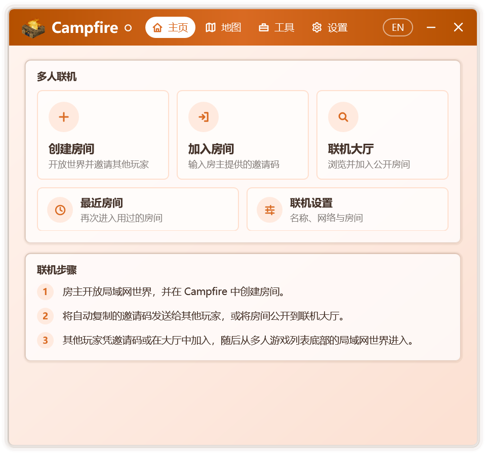

# 認識 Campfire

Campfire 是一款面向 Minecraft Java 版玩家的 Windows 工具箱。它將遠端多人遊戲、連線大廳、地圖與啟動器修復整合於同一程式之中：無需安裝，不寫入登錄檔，從 Windows 7 SP1 到 Windows 11 均可執行。

Campfire 另有[Android 版](./android)，與桌面版使用同一套連線協定，手機與電腦上的玩家可以進入同一房間。

## 設計理念

**專注。** Campfire 只做少數幾件事，併力求把每一件做得足夠細緻。程式本體不依賴安裝器，連線所需的網路元件僅在首次使用時按需下載，並逐個檔案校驗。

**與啟動器無關。** 多人連線直接作用於正在執行的遊戲，而非某一款啟動器。無論使用何種啟動器、何種賬號型別啟動遊戲，均可建立或加入房間。採用相同連線協議的其他客戶端，也能與 Campfire 使用者進入同一房間。

**透明可驗證。** Campfire 的全部原始碼公開。對啟動器的每一處修改都限定在明確的方法之內，於記憶體中校驗無誤後才寫入磁碟，並始終保留可還原的備份。遠端內容僅限文字與列表資料，無法更改設定或執行程式，全部連網行為見[連網與安全](./security)。

## 主要功能

### 多人連線

房主建立房間並進入單人世界後，Campfire 會自動將其對區域網開放並生成邀請碼。好友加入房間後，房主的世界會出現在其遊戲的區域網世界列表中，雙擊即可進入，體驗與身處同一區域網無異。

- 優先在玩家之間建立點對點直連，網路條件受限時可經中轉節點傳輸。
- 房間可公開至連線大廳，供更多玩家發現與加入。
- 進入世界後，聊天欄呈現歡迎訊息，Tab 列表的頁首與頁尾即時顯示房主、線上人數與延遲，覆蓋 1.7.2 及以上的全部正式版。
- 房主可隨時修改房間名稱、人數上限與公告，檢視成員、移出或拉黑訪客；訪客可選擇隱藏自己的 IP 地址。
- 加入房間後可一鍵將本機模組同步至與房主一致；房主開啟語音後，雙方可在遊戲中語音交流。
- 開房前自動備份存檔，可隨時將備份還原為新世界；最近房間與常用房間可一鍵再次進入。
- 連線診斷逐項檢查連線環境，並給出處理建議。

詳見[建立與加入房間](./multiplayer)、[連線大廳](./lobby)、[房間管理](./room)、[模組同步](./mods)與[語音聊天](./voice)。

### 地圖

- 瀏覽、檢索並下載 CurseForge 上的地圖。
- 匯入時識別地圖的遊戲版本，置入本機能夠開啟它的版本，並提示升級風險；匯入後即可建立房間。

詳見[地圖](./maps)。

### 工具

- **啟動器修復**：恢復被啟動器停用的遊戲下載、載入器安裝與整合包安裝，並可解除按地區關閉的下載功能。詳見[啟動器修復](./launcher-repair)。
- **JRE 啟用工具**：解除啟動器對 JRE 的預設停用，使 JRE 與 JDK 一樣可用於啟動遊戲。詳見[JRE 啟用工具](./jre)。

### 體驗

- 淺色與深色模式，自選主題色、Windows 主題色或由桌面桌布自動取色，並提供六種配色風格。
- 頁面切換、彈窗與控制元件均配有過渡動效，可隨時關閉。
- 通知區域圖示即時反映連線狀態，關閉視窗後房間仍可在後臺保持。
- 簡體中文、繁體中文、粵語與 English 介面，預設跟隨系統語言。

## 介面概覽

  

Campfire 的視窗分為四個標籤頁：

| 標籤頁 | 內容 |
| --- | --- |
| 主頁 | 建立房間、加入房間、連線大廳、最近房間與連線設定入口，當前房間狀態與連線步驟 |
| 地圖 | CurseForge 地圖瀏覽與下載，匯入本地地圖 |
| 工具 | 啟動器修復工具、JRE 啟用工具；檢測到可修復的啟動器時，標籤旁顯示紅點 |
| 設定 | 個性化、常規、連線、關於與開源許可 |

首次啟動時，Campfire 會通過一段簡短的新手引導介紹上述區域；之後可在 **設定 › 關於** 中再次檢視。

## 開源與許可

Campfire 是開源免費的社群專案，原始碼託管於 [GitHub](https://github.com/Xocio/Campfire)。程式所使用的第三方元件及其許可，可在 **設定 › 開源許可** 中檢視。Campfire 與 Mojang Studios 及微軟均無關聯。
